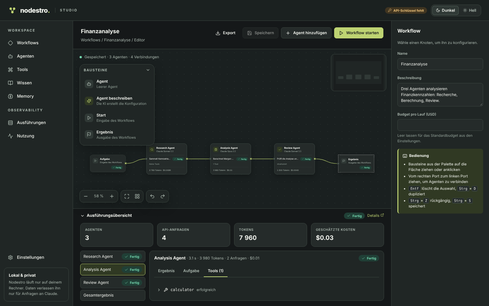
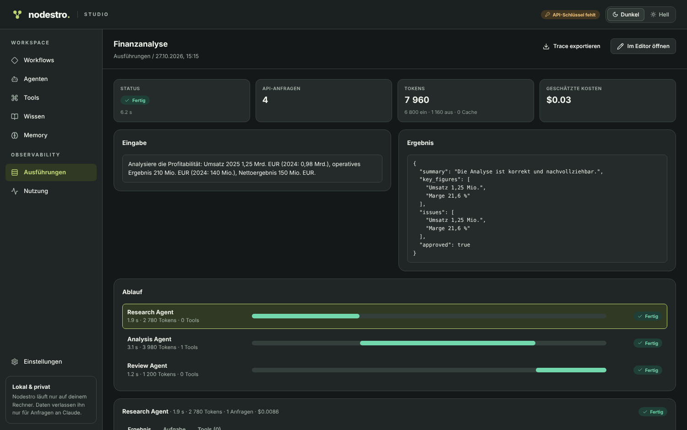

# Nodestro Studio

**Nodestro** (*Node* + *Maestro*) ist ein visuelles Studio für Multi-Agent-Workflows. Du ziehst Agenten auf eine
Arbeitsfläche, verbindest sie und startest den Workflow. Jeder Agent ist ein Knoten, und jeder Lauf lässt sich danach
Schritt für Schritt nachvollziehen. Nodestro baut auf der Python-Library
[`orkexa`](https://github.com/peterkarlhuber/orkexa) auf, arbeitet mit Anthropic, OpenAI, Gemini sowie
OpenAI-kompatiblen Endpunkten, Ollama und vLLM und läuft nur lokal auf deinem Rechner.

Dieses Repository ist die Anwendung: Oberfläche, eingebaute Dokumentation und der Befehl `nodestro`. Seit 0.2 liegen
Engine, API, SDKs, Integrationen und Beispiele in eigenen Repositories; wie sie zusammenhängen, steht in
[docs/PLATTFORM.md](docs/PLATTFORM.md). Nodestro 0.1 bleibt unverändert als `nodestro-legacy` erhalten.



## Funktionen

- **Workflow-Editor** wie bei n8n: Agenten, Start und Ergebnis als Knoten, mit Verbindungen per Drag & Drop. Er hat
  Rückgängig/Wiederholen, automatisches Anordnen, Tastenkürzel sowie Import und Export als JSON.
- **Agenten konfigurieren** mit den Möglichkeiten des Orkexa-`Agent`, schrittweise aufklappbar:
  - Grundlagen: Anbieter und Modell, System-Prompt und Aufgabe mit Platzhaltern für die Ergebnisse der Vorgänger.
  - Tools und Server-Tools (Websuche, Web-Fetch, Code-Ausführung; Server-Tools nur bei Anthropic).
  - Wissen, Memory und ein strukturiertes Ausgabeformat.
  - Denken und Aufwand sowie eine Qualitätsprüfung durch einen Judge.
  - Erweitert: Tool-Wahl, Caching, Limits, Fallback-Modelle und Verhalten bei Ablehnung.

  Unvollständige Eingaben prüft Nodestro live mit den Regeln der Library.
- **KI-Workflow-Architekt:** Du beschreibst ein Vorhaben, und der Architekt entwirft den ganzen Workflow: Agenten,
  Prompts, Modelle, Tools, Verbindungen und strukturierte Ausgaben. Bestehende Workflows überarbeitet er auf Wunsch
  gezielt. Du siehst jeden Schritt live, prüfst den Entwurf mit allen Änderungen und übernimmst ihn erst nach deiner
  Bestätigung. Neue Tools sind nur Entwürfe, bis du sie freigibst; ein Kostenlimit begrenzt jeden Entwurf.
- **Nodestro Assistant:** Ein Chat rechts neben jeder Seite (Strg+J) beantwortet Fragen zur Bedienung aus der
  eingebauten Dokumentation, mit Links auf die Abschnitte. Workflows, Agenten, Tools, Memory, Wissen und Ausführungen
  hängst du ausdrücklich an; der Assistant analysiert sie, ändert aber selbst nichts und übergibt Verbesserungen auf
  Wunsch an den Architekten. Geheimnisse werden vor dem Senden ersetzt.

  

- **API & Export:** Ein Workflow wird mit einem Klick zur Web-API. Veröffentlichen friert die gespeicherte Version mit
  Tools und Unterworkflows ein; Versionen sind unveränderlich und lassen sich zurückrollen. Die API antwortet
  standardmäßig nur diesem Computer, mit gehashten Schlüsseln (Rechte `run`, `read`, `approve`), Limits, Idempotenz,
  Server-Sent Events und Freigaben über die API oder in Nodestro. Optional öffnet ein eigener Port die APIs für das
  lokale Netzwerk, ohne die Oberfläche freizugeben. Derselbe Workflow lässt sich als eigenständiges FastAPI-Projekt
  (ZIP mit derselben Laufzeit, Lock-Dateien, Tests, Beispielen und README) exportieren, ohne KI und ohne Kosten.
- **Agent beschreiben:** Du sagst in eigenen Worten, was ein Agent können soll, und der Agent Architect schlägt die
  komplette Konfiguration vor.
- **Tool-Bibliothek:** Es gibt eingebaute Tools, eigene Python-Tools mit Tests und Tools, die die KI erstellt.
  - Code und Tests werden statisch geprüft.
  - Die Tests laufen in einer Sandbox (eigener Prozess oder Docker).
  - Erst nach deiner Freigabe steht ein Tool allen Agenten zur Verfügung.
  - Tools dürfen Python-Bibliotheken wie `numpy` oder `pandas` nutzen. Nodestro erkennt sie, zeigt Versionen und
    indirekte Pakete und installiert erst nach deiner Freigabe, mit `uv` in eine eigene Umgebung je Workflow.
- **Wissen:** Du lädst PDFs, Bilder und Texte hoch und weist sie einzelnen Agenten zu. Es gibt drei Arten, sie zu
  nutzen: vollständig im Kontext, bei Bedarf lesen oder per Volltextsuche (RAG mit SQLite FTS5), wahlweise mit Zitaten.
- **Dateien als Eingabe:** Formularfelder nehmen eine oder mehrere Dateien an (TXT, MD, CSV, JSON, XLSX, PDF, DOCX,
  PNG/JPG/WebP und ZIP), auch ganze Ordner per Drag & Drop. Jedes Feld legt Formate, Anzahl und Größe fest und ist
  wahlweise Pflicht oder optional; geprüft wird vor dem Start. Agenten bekommen Texte und Tabellen strukturiert,
  Bilder multimodal und ZIP-Archive als Übersicht mit gezieltem Lesen. Archive werden nie ausgeführt und auf
  Pfad-Tricks, Links und ZIP-Bomben geprüft. Ins Wissen gelangt eine Datei nur, wenn du den konkreten Inhalt prüfst
  und bestätigst, mit Herkunft, Dublettenprüfung und Sammlungen. Ergebnisse gibt es zusätzlich als DOCX und XLSX.
- **Memory:** Ein Agent hat entweder ein Gedächtnis pro Lauf oder ein dauerhaftes Gedächtnis, das mehrere Agenten teilen
  können. Ein Assistent schlägt die Startstruktur vor. Im Memory-Browser lässt sich alles lesen und bearbeiten.
- **Ausführungen live:**
  - Du siehst Text-Streaming, Tool-Aufrufe, Fehler, Tokens und Kosten je Agent und für den ganzen Workflow.
  - Unabhängige Agenten laufen parallel.
  - Ein Lauf lässt sich abbrechen und hat ein Budget-Limit.
  - Der Trace zeigt den zeitlichen Ablauf und lässt sich als JSON exportieren.
  - Exportierte Traces lassen sich wieder importieren und ansehen, ohne etwas erneut auszuführen.
- **Nutzung:** Tokens und geschätzte Kosten nach Tag, Workflow und Modell.
- **Hilfe:** Eine eingebaute Dokumentation mit Suche (Menüpunkt *Dokumentation*) und kurze Erklärungen an den
  Bedienelementen, die bei Hover, Tastaturfokus oder Antippen des ?-Symbols erscheinen.
- **Sechs Sprachen:** Deutsch, English, Español, Français, Português (Brasil) und Italiano, alle vollständig, auch die
  Dokumentation. Beim ersten Start gilt die Sprache des Browsers (sonst Englisch), unter *Einstellungen* lässt sie
  sich jederzeit umstellen. Die Umstellung wirkt sofort und ändert nur die Oberfläche, nie deine Agenten, Prompts oder
  Ergebnisse.
- **Design:** Midnight Citron mit dunklem und hellem Theme. Status erscheint immer als Text und Symbol, nie nur als
  Farbe. Navigation und Formulare sind per Tastatur bedienbar.

| Ausführung im Detail | Eigenes Tool mit Tests |
| --- | --- |
|  |  |

## Voraussetzungen

- Python 3.10 oder neuer
- Node.js 20 oder neuer (nur zum Bauen der Oberfläche)
- Ein API-Schlüssel für mindestens einen Anbieter (Anthropic, OpenAI oder Gemini) oder ein lokaler, OpenAI-kompatibler
  Server wie Ollama oder vLLM
- Optional Docker, für die stärker isolierte Tool-Sandbox

## Installation

```bash
git clone https://github.com/peterkarlhuber/nodestro-studio.git
cd nodestro-studio

# Oberfläche bauen (landet in src/nodestro_studio/static)
cd frontend
npm ci
npm run build
cd ..

# Studio mit allen Komponenten installieren (Runtime, API, Integrationen, Beispiele; jeweils am getesteten Commit)
python -m venv .venv
source .venv/bin/activate          # Windows: .venv\Scripts\activate
pip install -e .
```

Mit `make install` geht beides in einem Schritt (macOS/Linux). Die Komponenten und orkexa sind private
Repositories; pip braucht dafür Lesezugriff auf GitHub.

**Upgrade von 0.1:** Die Distribution heißt weiterhin `nodestro`. In der Umgebung, in der 0.1 installiert ist, die
Schritte oben in einem Checkout dieses Repositories ausführen (Oberfläche bauen, dann `pip install -U .` bzw.
`pip install -U -e .`). Das ersetzt 0.1 samt Befehl `nodestro`; der Datenordner `~/.nodestro` wird ohne Migration
weiter genutzt. Details in [docs/PLATTFORM.md](docs/PLATTFORM.md#upgrade-von-nodestro-01).

## Starten

```bash
export ANTHROPIC_API_KEY=sk-ant-...   # Windows PowerShell: $env:ANTHROPIC_API_KEY="sk-ant-..."
# oder/zusätzlich: OPENAI_API_KEY, GEMINI_API_KEY (bzw. GOOGLE_API_KEY)
nodestro
```

Nodestro öffnet <http://localhost:8000> im Browser. Den Schlüssel kannst du statt als Umgebungsvariable auch in einer
`.env`-Datei im aktuellen Ordner ablegen oder unter **Einstellungen** eintragen.

| Option | Bedeutung |
| --- | --- |
| `--host 127.0.0.1` | Adresse (auch `NODESTRO_HOST`) |
| `--port 8000` | Port (auch `NODESTRO_PORT`) |
| `--data-dir ~/.nodestro` | Ablage für Workflows, Läufe, Wissen und Memory (auch `NODESTRO_DATA_DIR`) |
| `--no-browser` | Browser nicht automatisch öffnen |
| `--reload` | Neustart bei Codeänderungen (Entwicklung) |

Alle Daten liegen in einer SQLite-Datenbank im Datenordner. Nodestro bindet standardmäßig nur an `127.0.0.1` und ist
damit von außen nicht erreichbar.

### Erste Schritte

1. Wähle unter **Workflows → Beispiele** das Beispiel **Finanzanalyse**, klicke **Als Kopie übernehmen** und dann
   **Workflow starten**.
2. Klicke einen Agenten an, um ihn rechts im Inspector zu konfigurieren.
3. Ziehe aus der Palette einen neuen Agenten auf die Fläche. Unter **Agent beschreiben** kannst du ihn auch von der KI
   entwerfen lassen.
4. Unter **Ausführungen** siehst du jeden Lauf im Detail.

## Entwicklung

```bash
pip install -e ".[dev]"
cd frontend && npm ci && cd ..

# zwei Terminals:
nodestro --reload --no-browser      # API auf :8000, API-Referenz unter /api/docs
cd frontend && npm run dev          # Oberfläche mit Hot Reload auf :5173
```

| Befehl | Prüft |
| --- | --- |
| `make check` | Stil, Typen, Tests von Studio und Oberfläche, Abhängigkeitsrichtung |
| `pytest` | Studio-Tests: Dokumentation, Befehl `nodestro`, Upgrade mit echten 0.1-Daten, Plattform-Skripte |
| `ruff check . && ruff format --check .` | Python-Stil |
| `mypy` | Typen (strict) |
| `cd frontend && npm run lint && npm run typecheck && npm test` | Frontend |
| `make e2e` (`scripts/e2e.sh [suite ...]`) | alle sieben Browser-Suiten (smoke, i18n, architect, python, assistant, flow, api), jede gegen einen eigenen Nodestro mit simulierten Modellen und Paketverzeichnis; braucht die gebaute Oberfläche und Playwright |
| `make check-versions` | die Pins aller Komponenten gegen [platform/versions.json](platform/versions.json) |
| `make check-imports` | die Abhängigkeitsrichtung der installierten Pakete, kein claude-agent |

Die Tests von Engine, API, Beispielen und Integrationen liegen in deren Repositories; die Plattform-Pipeline
(`.github/workflows/platform.yml`) führt sie gegen genau die Commits aus `platform/versions.json` zusammen aus.
Kein Test ruft einen bezahlten Anbieter auf.

Die CI auf GitHub braucht das Repository-Secret `NODESTRO_READ`, ein Token mit Lesezugriff („Contents: Read“) auf
`peterkarlhuber/orkexa` und die `nodestro-*`-Repositories.

Die Architektur ist in [docs/ARCHITEKTUR.md](docs/ARCHITEKTUR.md) beschrieben, die Plattform in [docs/PLATTFORM.md](docs/PLATTFORM.md), die ursprüngliche Idee in
[docs/PROJEKTBESCHREIBUNG.md](docs/PROJEKTBESCHREIBUNG.md) und das Design in
[docs/design/DESIGN_SYSTEM.md](docs/design/DESIGN_SYSTEM.md).

## Lizenz

MIT, siehe [LICENSE](LICENSE).
