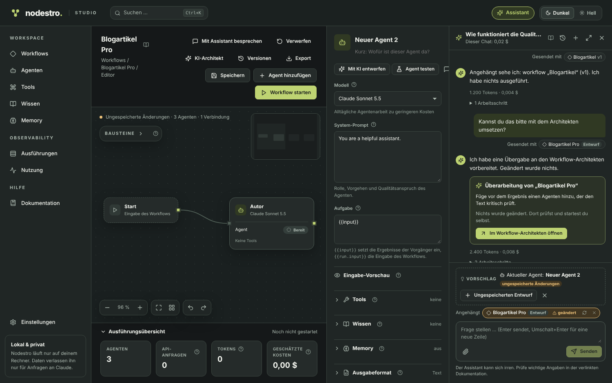
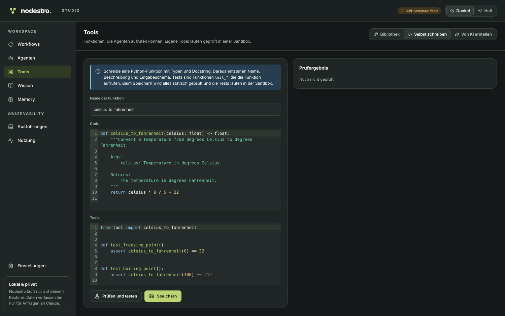

# Nodestro Studio

**Nodestro** (*Node* + *Maestro*) is a visual studio for multi-agent workflows. You drag agents onto a canvas,
connect them and start the workflow. Every agent is a node, and every run can be traced step by step afterwards.
Nodestro is built on the Python library [`orkexa`](https://github.com/peterkarlhuber/orkexa), works with Anthropic,
OpenAI, Gemini as well as OpenAI-compatible endpoints, Ollama and vLLM, and runs only locally on your computer.

This repository is the application: the user interface, the built-in documentation and the `nodestro` command. Since
0.2, the engine, API, SDKs, integrations and examples live in their own repositories; how they fit together is
described in [docs/PLATFORM.md](docs/PLATFORM.md). Nodestro 0.1 is preserved unchanged as `nodestro-legacy`.


## Features

- **Workflow editor:** agents, start and result as nodes, connected by drag and drop. It has undo/redo, automatic
  layout, keyboard shortcuts, and import and export as JSON. The building blocks (left), the properties (right) and
  the execution overview (bottom) can each be hidden and resized; the layout is remembered per browser.
- **Agent configuration** with the capabilities of the Orkexa `Agent`, revealed step by step:
  - Basics: provider and model, system prompt and task with placeholders for the results of predecessors.
  - Tools and server tools (web search, web fetch, code execution; server tools only with Anthropic).
  - Knowledge, memory and a structured output format.
  - Thinking and effort, and a quality check by a judge.
  - Advanced: tool choice, caching, limits, fallback models and behavior on refusal.

  Nodestro checks incomplete input live with the rules of the library.
- **AI Workflow Architect:** you describe a goal, and the architect designs the whole workflow: agents, prompts,
  models, tools, connections and structured outputs. On request it revises existing workflows in a targeted way. You
  see every step live, review the draft with all changes and apply it only after you confirm. New tools are drafts
  until you approve them; a cost limit caps every draft.
- **Nodestro Assistant:** a chat next to every page (Ctrl+J) answers questions about using Nodestro from the built-in
  documentation, with links to the sections. You explicitly attach workflows, agents, tools, memory, knowledge and
  runs; the assistant analyzes them but never changes anything itself, and on request hands improvements over to the
  architect. Secrets are replaced before sending.

  

- **API & export:** one click turns a workflow into a web API. Publishing freezes the saved version together with its
  tools and sub-workflows; versions are immutable and can be rolled back. By default the API answers only this
  computer, with hashed keys (scopes `run`, `read`, `approve`), limits, idempotency, server-sent events and approvals
  through the API or in Nodestro. Optionally, a separate port opens the APIs to the local network without exposing the
  user interface. The same workflow can be exported as a standalone FastAPI project (a ZIP with the same runtime, lock
  files, tests, examples and README), without AI and without cost.
- **Describe an agent:** you say in your own words what an agent should do, and the Agent Architect proposes the
  complete configuration.
- **Tool library:** built-in tools, your own Python tools with tests, and tools created by the AI.
  - Code and tests are checked statically.
  - The tests run in a sandbox (a separate process or Docker).
  - A tool becomes available to all agents only after you approve it.
  - Tools may use Python libraries such as `numpy` or `pandas`. Nodestro detects them, shows versions and indirect
    packages, and installs only after your approval, with `uv` into a separate environment per workflow.
- **Knowledge:** you upload PDFs, images and texts and assign them to individual agents. There are three ways to use
  them: fully in the context, read on demand, or full-text search (RAG with SQLite FTS5), optionally with citations.
- **Files as input:** form fields accept one or more files (TXT, MD, CSV, JSON, XLSX, PDF, DOCX, PNG/JPG/WebP and
  ZIP), including whole folders by drag and drop. Each field defines formats, count and size and is either required or
  optional; it is checked before the start. Agents receive texts and tables in structured form, images multimodally
  and ZIP archives as an overview with targeted reading. Archives are never executed and are checked for path tricks,
  links and ZIP bombs. A file only enters the knowledge base after you review and confirm its actual content, with
  origin, duplicate detection and collections. Results are also available as DOCX and XLSX.
- **Memory:** an agent has either a memory per run or a persistent memory that several agents can share. An assistant
  proposes the initial structure. The memory browser lets you read and edit everything.
- **Live runs:**
  - You see text streaming, tool calls, errors, tokens and costs per agent and for the whole workflow.
  - Independent agents run in parallel.
  - A run can be cancelled and has a budget limit.
  - The trace shows the timeline and can be exported as JSON.
  - Exported traces can be imported and viewed again without executing anything.
- **Usage:** tokens and estimated costs by day, workflow and model.
- **Help:** built-in documentation with search (menu item *Documentation*) and short explanations at the controls,
  shown on hover, keyboard focus or a tap on the ? icon.
- **Six languages:** Deutsch, English, Español, Français, Português (Brasil) and Italiano, all complete, including the
  documentation. On first start the browser language applies (otherwise English); it can be changed at any time under
  *Settings*. The change takes effect immediately and only affects the interface, never your agents, prompts or
  results.
- **Design:** Midnight Citron with a dark and a light theme. Status always appears as text and icon, never as color
  alone. Navigation, forms and the editor panels can be operated with the keyboard.

| Run in detail | Custom tool with tests |
| --- | --- |
|  |  |

## Requirements

- Python 3.10 or newer
- Node.js 20 or newer (only to build the user interface)
- An API key for at least one provider (Anthropic, OpenAI or Gemini) or a local OpenAI-compatible server such as
  Ollama or vLLM
- Optionally Docker, for the more strongly isolated tool sandbox

**Tested platforms:** CI and the release checks run on Linux (Python 3.10 and 3.13, Node.js 20 and 22). The browser
tests pass in Chromium and Firefox on Linux; WebKit on Linux passes their functional checks. macOS, Windows and Safari
are not tested; the Windows hints below are untested.

## Installation

```bash
git clone https://github.com/peterkarlhuber/nodestro-studio.git
cd nodestro-studio

# Build the user interface (written to src/nodestro_studio/static)
cd frontend
npm ci
npm run build
cd ..

# Install the studio with all components (runtime, API, integrations, examples; each at its tested commit)
python -m venv .venv
source .venv/bin/activate          # Windows: .venv\Scripts\activate
pip install -e .
```

`make install` does both in one step (macOS/Linux). The components and orkexa are private repositories; pip needs
read access to GitHub for them.

**Upgrading from 0.1:** the distribution is still called `nodestro`. In the environment where 0.1 is installed, run
the steps above in a checkout of this repository (build the user interface, then `pip install -U .` or
`pip install -U -e .`). This replaces 0.1 including the `nodestro` command; the data folder `~/.nodestro` keeps being
used without migration. Details in [docs/PLATFORM.md](docs/PLATFORM.md#upgrading-from-nodestro-01).

## Running

```bash
export ANTHROPIC_API_KEY=sk-ant-...   # Windows PowerShell: $env:ANTHROPIC_API_KEY="sk-ant-..."
# or in addition: OPENAI_API_KEY, GEMINI_API_KEY (or GOOGLE_API_KEY)
nodestro
```

Nodestro opens <http://localhost:8000> in the browser. Instead of an environment variable you can also put the key
into a `.env` file in the current folder or enter it under **Settings**.

| Option | Meaning |
| --- | --- |
| `--host 127.0.0.1` | Address (also `NODESTRO_HOST`) |
| `--port 8000` | Port (also `NODESTRO_PORT`) |
| `--data-dir ~/.nodestro` | Storage for workflows, runs, knowledge and memory (also `NODESTRO_DATA_DIR`) |
| `--no-browser` | Do not open the browser automatically |
| `--reload` | Restart on code changes (development) |

All data lives in a SQLite database in the data folder. By default Nodestro binds only to `127.0.0.1` and is
therefore not reachable from other computers.

### First steps

1. Under **Workflows → Examples**, pick the **Financial analysis** example, click **Copy to my workflows** and then
   **Start workflow**.
2. Click an agent to configure it in the properties panel on the right.
3. Drag a new agent from the building blocks onto the canvas. With **Describe an agent** you can also let the AI
   design it.
4. Under **Executions** you see every run in detail.

## Development

```bash
pip install -e ".[dev]"
cd frontend && npm ci && cd ..

# two terminals:
nodestro --reload --no-browser      # API on :8000, API reference at /api/docs
cd frontend && npm run dev          # user interface with hot reload on :5173
```

| Command | Checks |
| --- | --- |
| `make check` | Style, types, tests of the studio and the user interface, dependency direction |
| `pytest` | Studio tests: documentation, the `nodestro` command, upgrade with real 0.1 data, platform scripts |
| `ruff check . && ruff format --check .` | Python style |
| `mypy` | Types (strict) |
| `cd frontend && npm run lint && npm run typecheck && npm test` | Frontend |
| `make e2e` (`scripts/e2e.sh [suite ...]`) | All nine browser suites (smoke, i18n, architect, python, assistant, flow, panels, api, journeys) against Nodestro servers with simulated models and temporary data folders; needs the built user interface and Playwright; `E2E_BROWSER=firefox` or `webkit` runs them in another engine |
| `make check-versions` | The pins of all components against [platform/versions.json](platform/versions.json) |
| `make check-imports` | The dependency direction of the installed packages, no claude-agent |

The tests of the engine, API, examples and integrations live in their repositories; the platform pipeline
(`.github/workflows/platform.yml`) runs them together against exactly the commits in `platform/versions.json`.
No test calls a paid provider.

The CI on GitHub needs the repository secret `NODESTRO_READ`, a token with read access ("Contents: Read") to
`peterkarlhuber/orkexa` and the `nodestro-*` repositories.

The architecture is described in [docs/ARCHITECTURE.md](docs/ARCHITECTURE.md), the platform in
[docs/PLATFORM.md](docs/PLATFORM.md), the original idea in [docs/PROJECT_DESCRIPTION.md](docs/PROJECT_DESCRIPTION.md)
and the design in [docs/design/DESIGN_SYSTEM.md](docs/design/DESIGN_SYSTEM.md).
Open work (known bugs, follow-ups, technical debt) is listed in [docs/TODO.md](docs/TODO.md).

## License

MIT, see [LICENSE](LICENSE).
