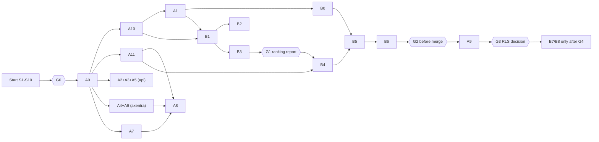

# Master Implementation Plan: Security and Database Backends for Orkexa, Nodestro and Axentra

| Field | Value |
|---|---|
| **Identifier** | `MUP-ONA` |
| **Version** | 1.1 |
| **Created** | 2026-11-06 (version 1.0); version 1.1 on 2026-11-06 |
| **Client** | Peter |
| **Status** | Plan, not implemented. Execution only after start approval (Gate G0) |
| **Technical basis** | Architecture audit "Architecture, Security and Database Backends: Orkexa, Nodestro, Axentra", **revision 4** of 2026-11-06 (`architektur-audit-levuvo-portfolio.md`) |
| **Planning baselines** | orkexa `80b95e5`, nodestro-runtime `802fa8f`, nodestro-api `984c61d`, nodestro-studio `39fb164`, nodestro-server `ddd095f`, nodestro-local-docker `8420a02`, nodestro-desktop `5d1e8e9`, nodestro-sdk `9327e2c`, nodestro-integrations `306319f`, nodestro-examples `2f05f4c`, nodestro-cloud `c1b6dd2`, axentra `067529b`, axentra-studio `7a6d1ce` (all `origin/master`, 2026-11-06 approx. 20:45Z) |

This is the English translation of the German MUP-ONA 1.1 (O13, 8.7). Until the translation check (reports/translation-check.md) has passed and the client has approved this version, the German version is the reference; contradictions are resolved in favor of the German version.

This plan is **the binding What and How**. It is understandable without the audit; the audit remains the in-depth source for rationale. The execution state (what is done) is not recorded here but in the progress log (chapter 8).

**Reading guide.** Chapter 1 is the start instruction. Chapters 2–7 define the scope, decisions, target state, compatibility and gates. Chapters 8–10 govern start, resumption, Git and tests. Chapter 11 contains all work packages. Chapters 12–15 contain documentation duties, overall completion, the compact overview and the completeness check.

**Markers:** **[F]** fact verified in the code (as of planning) · **[S]** estimate or inference · **MUST** binding · **SHOULD** the normal case; a justified deviation is allowed and must be documented.

---

## 1. START INSTRUCTION FOR A NEW CODING AGENT

### 1.1 Activation command

The client starts the implementation with exactly this text (fill in the placeholders in angle brackets or delete the line):

> Implement the master implementation plan `architektur-umsetzungsplan-orkexa-nodestro-axentra.md` (MUP-ONA, version 1.1) completely. First check the current repository state according to chapter 8.1, take already completed tasks into account only with evidence, work through all approved phases in the defined order, and run all prescribed tests and integration checks. Document the progress persistently according to chapter 8 and stop only at the approval gates defined in the plan or on security-critical blockers. No production releases, deployments, package publications or activation of production switches without separate approval.
>
> Gate G0 (start approval): I confirm the decision matrix in chapter 6 <as recommended | with the following deviations: …>.
> Merge right: You may merge PRs yourself with a merge commit after the checks according to chapter 9.5 have passed <yes | no, I merge myself>.
> Automatic continuation after B3 (chapter 7.3): <not granted | granted under the conditions of chapter 7.3>.

Original (German, binding wording of the activation command):

> Setze den Master-Umsetzungsplan `architektur-umsetzungsplan-orkexa-nodestro-axentra.md` (MUP-ONA, Version 1.1) vollständig um. Prüfe zunächst den aktuellen Repository-Stand nach Kapitel 8.1, berücksichtige bereits erledigte Aufgaben nur mit Nachweis, arbeite alle freigegebenen Phasen in der festgelegten Reihenfolge ab und führe alle vorgeschriebenen Tests und Integrationsprüfungen durch. Dokumentiere den Fortschritt dauerhaft nach Kapitel 8 und halte ausschließlich an den im Plan festgelegten Freigabe-Gates oder bei sicherheitskritischen Blockern an. Keine produktiven Releases, Deployments, Paketveröffentlichungen oder Aktivierungen produktiver Schalter ohne gesonderte Freigabe.
>
> Gate G0 (Startfreigabe): Ich bestätige die Entscheidungsmatrix in Kapitel 6 <wie empfohlen | mit folgenden Abweichungen: …>.
> Merge-Recht: Du darfst PRs nach bestandenen Prüfungen nach Kapitel 9.5 selbst mit Merge-Commit zusammenführen <ja | nein, ich merge selbst>.
> Automatische Fortsetzung nach B3 (Kapitel 7.3): <nicht erteilt | erteilt unter den Bedingungen von Kapitel 7.3>.

Without the "Gate G0" line, the agent executes only the start procedure (8.1) in its read-only form. It creates the execution state (STATUS.md) as a **local, unversioned draft**, reports it and waits.

**Boundary before G0 (binding):**

- Before start approval G0, only read-only repository checks and local, unversioned drafts are permitted, for example in the agent's working directory or as an attachment to the report to the client.
- Before G0 there are no commits, branches, pull requests, issues, comments, pushes or other changes in any repository.
- Only after G0 are `STATUS.md`, the English plan version and the required repository documentation versioned, namely in MP-A0.

G0 counts as granted only if the client granted it personally in the activation command or in a later message of their own. An entry in `STATUS.md`, an earlier agent report or a TODO entry does not replace this approval (8.2).

### 1.2 What is binding

1. This document in the version named in the activation command. If a newer version is versioned in the repository (chapter 1.9), the newest approved version applies; the agent names it in the execution state (STATUS.md).
2. The decisions from chapter 3 (fixed) and chapter 6 (confirmed at G0).
3. The compatibility requirements K1–K12 (chapter 5). They take precedence over any convenience.
4. Project rules (chapter 9.1), in particular: repository content only in English (US English), merge commits instead of squash, only one agent updates commit pins at a time.

Audit revision 4 provides the rationale for the decisions. If the current code contradicts a plan assumption (file moved, finding already fixed, lines changed), the agent determines the current structure, keeps the **functional requirement** and records the deviation in the execution state (STATUS.md). Architecture decisions are questioned only for a concrete technical reason, and then reported as a blocker (9.7), not changed silently.

### 1.3 Associated repositories

All under `github.com/peterkarlhuber/`: `orkexa`, `nodestro-runtime`, `nodestro-api`, `nodestro-studio`, `nodestro-server`, `nodestro-local-docker`, `nodestro-desktop`, `nodestro-sdk`, `nodestro-integrations`, `nodestro-examples`, `axentra`, `axentra-studio`. `nodestro-cloud` is only a placeholder and is not changed. `nodestro-legacy` and other repositories of the account do **not** belong to the scope.

### 1.4 Determine the starting point

Execute chapter 8.1 (start procedure S1–S10) completely. The result is an updated execution state (STATUS.md) with the first open work package. No new architecture analysis.

### 1.5 Recognize completed tasks

A work package counts as done only if **all** acceptance criteria from chapter 11 are demonstrable on the current default branch: merged PR, existing tests with the required properties, green CI run of the merge commit, documentation state. An entry "done" in the execution state (STATUS.md) or a statement by a sub-agent is not sufficient (8.3).

### 1.6 Order of work

1. Block 1: A0 (baseline) first. Then in orkexa serially A10 ⇒ A1 ⇒ B0 share (shared files `retrieval.py`, `pyproject.toml`, CHANGELOG); in parallel A11 (runtime, api) and the B0 shares in other repositories.
2. Block 2: A2+A3+A5 (nodestro-api) ∥ A4+A6 (axentra) ∥ B1 (orkexa) ∥ A7.
3. Block 3: B2 (orkexa) ∥ B3 (nodestro-runtime) ∥ A8 (after A4, A7, A11).
4. **Gate G1** (hold point after the merge of B3, ranking and compatibility report; decides on B4–B6, see 7.4).
5. Block 4: B4 ⇒ B5 ⇒ B6 strictly one after another.
6. A9 (RLS assessment, ADR) after B6; the result is a decision proposal, not an implementation.
7. B7, B8 only after separate approval (Gate G4).

Details and dependencies: chapter 14.2.

### 1.7 Organization

- The **lead agent** owns the execution state (STATUS.md), the pin cascade, all merges and all gate reports.
- **Sub-agents** work per work package and repository in their own Git worktrees, never two sub-agents in the same file (9.6).
- The lead agent checks every integration itself against the acceptance criteria.

### 1.8 Mandatory evidence

- All tests from chapter 10 and the work packages, against **real** SQLite files and **real** PostgreSQL servers, with and without pgvector, also with a runtime role without DDL privilege.
- No security-critical check may be skipped. A missing server in the mandatory job makes the job fail.

### 1.9 Git and PRs

Branch per work package group and repository (`mup/<paket>-<kurzname>`), one reviewable PR per repository and package group, merge commit, pins from bottom to top (chapter 9). Before each PR in a shared repository: check open PRs of other agents and report overlaps.

**Versioning of this plan:** in the existing repository `nodestro-studio` under `docs/architecture/mup-ona/` (rationale in 8.5). No new repository.

### 1.10 Continue autonomously or stop

- **Autonomous:** within approved packages, fix all ordinary technical problems (failing tests, lint, type errors, merge conflicts, CI flakes with a proven cause, outdated file paths). After a successfully accepted package, start the next approved package.
- **Stop and report precisely (9.7):**
  - at every gate from chapter 7;
  - on impending data loss or a violated compatibility requirement K1–K12;
  - on an unresolved security finding;
  - on a required change outside the approved scope;
  - if an architecture decision is technically untenable;
  - if a mandatory test would only turn green by weakening it.

### 1.11 Record progress

Execution state `docs/architecture/mup-ona/STATUS.md` (nodestro-studio) with evidence per package; before G0 only as a local, unversioned draft (1.1). Repository tasks in the existing `docs/TODO.md`. No further status lists (chapter 8).

### 1.12 Completion

Completion according to chapter 13. The agent reports one of the three states:

- "fully completed";
- "technically complete, approval pending";
- "partially implemented" (with a list of the open items).

Then it stops. Releases, deployments and package publications are never part of this.

---

## 2. Scope and boundaries

**In scope:**

- Security track A: A0–A8, A10, A11, plus A9 as an assessment.
- Architecture track B: B0–B6.
- B7 and B8 only as prepared packages that require separate approval.
- Platforms: Orkexa, Nodestro (all repositories named above), Axentra and Axentra Studio.

**Out of scope:**

- other products;
- production deployments;
- publications on PyPI, npm or in container registries;
- Git releases beyond the tags defined in B0;
- activation of production switches (e.g. `NODESTRO_TOOL_APPROVALS`, Axentra switches);
- introduction of RLS in Nodestro;
- ANN/HNSW;
- changes to `nodestro-legacy` or `nodestro-cloud`;
- the ongoing convergence Nodestro ↔ Axentra (M1–M11);
- changes to existing ADRs without approval (addenda only according to O10).

**Strategic goal:** The backends and verification tools in Orkexa should later be usable by further products not determined today. Specific other products are neither a prerequisite nor an argument.

---

## 3. Binding architecture decisions (category A)

These decisions are fixed. They are not discussed again in work packages.

| ID | Decision |
|---|---|
| E-1 | Orkexa remains **one** repository and **one** Python distribution `orkexa`. No distribution `orkexa-postgres`, no security package as a separate distribution. |
| E-2 | PostgreSQL is optional: `pip install "orkexa[postgres]"`. The SQL rule engine is optional: `pip install "orkexa[sqlcheck]"`. The core runs without `psycopg`, `pglast` and `pytest`. |
| E-3 | Database backends live under `orkexa.backends.sqlite` and `orkexa.backends.postgres` as equivalent implementations of the same contracts `Index`, `FileStore`, `MemoryBackend` (plus `ReindexableIndex`). |
| E-4 | Contract modules `retrieval.py`, `embeddings.py`, `files.py`, `memory.py` remain modules (not packages). `LocalFileStore`, `EphemeralMemory`, `FileMemory` remain there. |
| E-5 | No backend factory, no registry, no policy engine, no subpackage `testing/security/`, no second general-purpose SQL security library for SQLite. |
| E-6 | A backend enforces the partition (`tenant_id`) but never checks permissions. Permissions, tenant identity, source rights, workflows and migrations remain in the product. |
| E-7 | Nodestro keeps its product logic, its migration runner and all migration files. The duplicate generic PostgreSQL implementation is removed only once the Orkexa backend is fully integrated and verified (B6). |
| E-8 | Axentra remains independent: no runtime and no test dependency on Orkexa or Nodestro. RLS, identity, sessions, migrations and its own security checks remain with Axentra. |
| E-9 | Security before risky migration: security measures and test preparations come before code moves. Behavior changes and pure moves are never in the same step. |
| E-10 | No automatic introduction of RLS in Nodestro. A9 is an assessment with a decision proposal. The existing decision M10 (no RLS, static checker) and the review condition SR-01 continue to apply. |
| E-11 | Existing migrations, checksums, embeddings and the format `real[]` are not changed. |
| E-12 | Fixed column names in PostgreSQL backends; only the table prefix is configurable. |
| E-13 | No DDL at runtime. `verify_schema` is read-only. `migrate()` only on explicit call, never by Nodestro. No implicit `CREATE EXTENSION`. |
| E-14 | Statement catalog with executor and partition guard in the PostgreSQL backend; generic rule engine as `orkexa.testing.sqlcheck`; the reconstruction of SQL from Python source code remains in Nodestro's checker. |
| E-15 | B2 (SQLite move) belongs to the target architecture and is implemented. If it is deferred, it stays visible as open and blocks the status "fully completed". |
| E-16 | Hold point after B3: B3 itself is implemented, verified and merged within the scope of the G0 approval. Gate G1 decides only on the start of B4–B6 (exception: automatic continuation granted in advance according to 7.3); see 7.4. |

E-1 to E-11 were set by Peter. E-12 to E-16 are recommendations of the audit; they are binding from Gate G0 on, unless Peter changes them there (see O1, O2, O5 in chapter 6).

---

## 4. Target state

### 4.1 Orkexa

```text
src/orkexa/
├── __init__.py          # public names unchanged, incl. SQLiteIndex, SQLiteFileStore, SQLiteMemory
├── retrieval.py         # contract + algorithms: Chunk, Hit, Index, ReindexableIndex, RetrievalMode, check_mode,
│                        # split_text, pdf_pages, pdf_pages_isolated, tokenize, fold, query_words, word_weight,
│                        # lexical_evidence, fuse_hybrid, fuse_rrf, HYBRID_FUSIONS, LEXICAL_WEIGHT,
│                        # MAX_QUERY_CHARS, MAX_QUERY_WORDS, VectorStatus, RetrievalError, search tool;
│                        # re-export SQLiteIndex (PEP 562 + TYPE_CHECKING)
├── embeddings.py        # EmbeddingModel, EmbeddingIdentity, CallableEmbeddings, OllamaEmbeddings, validate_vector
├── files.py             # StoredFile, FileStore, LocalFileStore; re-export SQLiteFileStore
├── memory.py            # MemoryBackend, EphemeralMemory, FileMemory, memory tool; re-export SQLiteMemory
├── backends/
│   ├── __init__.py      # docstring only, no imports
│   ├── sqlite/
│   │   ├── __init__.py  # SQLiteIndex, SQLiteFileStore, SQLiteMemory
│   │   ├── index.py     # incl. FTS5 query building and loading of sqlite_vec
│   │   ├── files.py
│   │   └── memory.py
│   └── postgres/
│       ├── __init__.py  # PostgresIndex, PostgresFileStore, PostgresMemory, PostgresLayout, ConnectionSource,
│       │                # verify_schema, SchemaReport, schema_steps, migrate
│       ├── index.py
│       ├── files.py
│       ├── memory.py
│       ├── connection.py  # protocol ConnectionSource; psycopg adapter with late import
│       ├── schema.py      # schema v1 as data; verify_schema (read-only); migrate (explicit)
│       ├── _sql.py        # statement catalog, prefix check, rendering, executor, partition guard
│       └── _vector.py     # pgvector detection and refresh(); scoring with pgvector and in Python
└── testing/
    ├── __init__.py      # docstring only
    ├── fakes.py         # ScriptedClient
    ├── sqlcheck.py      # rule engine (extra sqlcheck: pglast)
    └── conformance/
        ├── __init__.py  # Case, run_cases, Report, capability matching
        ├── index.py     # search, hybrid, input limits, vector validation, equivalence
        ├── reindex.py
        ├── files.py
        ├── memory.py
        └── partition.py
tests/backends/
├── sqlite/              # races, corruption, symlink, pragmas, legacy file, import order
└── postgres/            # catalog + sqlcheck + mutation probe, prefix, role without DDL, load, pgvector A/B
```

Small deviations in the file layout are allowed if they are technically justified and described in the PR. New abstraction layers according to E-5 are not allowed.

**Import rules (enforced by `import-linter`):**

- Contract modules never import `orkexa.backends` at runtime (only under `TYPE_CHECKING` and in the PEP 562 `__getattr__`).
- No core module imports `orkexa.backends.postgres` or `orkexa.testing`.
- `backends.postgres` imports `psycopg` only in `connection.py`, inside the adapter function.
- `testing.sqlcheck` may load `pglast` at module import.

**Extras:**

- `postgres` = `psycopg>=3.2,<4` (without `binary`/`pool`; the driver choice remains with the product);
- `sqlcheck` = `pglast>=7,<9`;
- `vector` and `pdf` as today;
- `dev` extended with `psycopg`, `pglast`, `import-linter`.

### 4.2 Nodestro

- `nodestro_runtime.postgres_tables` contains only Nodestro subclasses of the Orkexa classes with `counts`, `attach_file`, `text`, the wiring (`PostgresMemorySpace`, `PostgresMemoryTables`, `knowledge_tables`, `tenant_storage`) and an adapter `PostgresDatabase` → `ConnectionSource`.
- `KnowledgeBase`, `ScopedIndex`, tenant ID format, `PostgresDatabase` (pool, backup hook), migration runner, migrations `0001`–`0010` (+ later `0011…`), allowlist and source code checker remain in Nodestro.
- The tenant SQL checker uses the rule engine `orkexa.testing.sqlcheck`, keeps reconstruction, table detection, allowlist and all 112 mandatory cases. In addition, it checks Orkexa's catalog, rendered with prefix `nodestro_`.
- Server start calls `verify_schema(..., PostgresLayout("nodestro_"))` read-only.

### 4.3 Axentra

Unchanged and independent. New are:

- A4 (6to4/Teredo block);
- A6 (owner role refused in production);
- A7 shares (redaction, OIDC response limit, DNS within the time budget, HSTS in Axentra Studio);
- vendored test vectors (A8) as JSON with checksum.

---

## 5. Immutable data and compatibility requirements

### 5.1 Requirements K1–K12

| ID | Requirement | Verification (test ID from chapter 10) |
|---|---|---|
| K1 | Nodestro migrations `0001`–`0010` remain byte-identical | T-MIG-1: SHA-256 of each file against a fixed list |
| K2 | All stored migration checksums remain valid | T-MIG-2: start against legacy data database; runner check green |
| K3 | Existing PostgreSQL data is preserved | T-UPG-1..4 |
| K4 | Stored embeddings are preserved (no rewrite) | T-UPG-2: checksum over `nodestro_chunk_vectors` before/after |
| K5 | Format `real[]` remains | T-SCH-1: `verify_schema` checks the column type |
| K6 | Space keys and embedding identities remain valid | T-UPG-3: old spaces `active`, search without reindex |
| K7 | Existing SQLite files remain readable and writable | T-SQL-10: legacy file fixture |
| K8 | Public Orkexa APIs remain compatible | T-API-1..3: surface, import order, mypy probe |
| K9 | Nodestro permissions remain effective | T-NOD-HTTP: HTTP isolation tests, permission tests |
| K10 | No unnoticed schema change at start | T-DDL-1: event trigger counts DDL = 0 |
| K11 | No cross-tenant access | T-PART (chapter 10.4), T-CAT, T-GUARD |
| K12 | No mandatory PostgreSQL dependency for Orkexa core users | T-PKG-1: installation without extras, core suite green |

A violation of K1–K12 is always a reason to stop (9.7), even if all other tests are green.

### 5.2 Legacy data fixtures (mandatory from A0)

Tests on fresh databases are not sufficient. A0 therefore creates reproducible legacy data sets that all later packages use:

- **FX-PG-0:** PostgreSQL dump, created with nodestro-runtime at the state before the first package. Content:
  - two tenants;
  - knowledge with files, chunks and vectors in two spaces (one `active`, one `building`);
  - memory files;
  - at least one NaN-free vector and one zero vector, inserted via SQL, because the current PostgreSQL implementation accepts them;
  - migrations 0001–0010 applied.
  - Generation script and dump are in `nodestro-runtime/tests/fixtures/legacy/` with checksum.
- **FX-PG-0v:** the same generation on a server with pgvector.
- **FX-SQ-0:** SQLite files (index with and without `sqlite_vec`, FileStore, Memory), created with Orkexa before B1, in `orkexa/tests/fixtures/legacy/`.
- **FX-RANK-0:** fixed ranking corpus (200 chunks, fixed vectors, normalized and not normalized, ties, zero vector, near-duplicates, 30 queries) with the results of the state before B3 for SQLite, PostgreSQL A and PostgreSQL B, as JSON.

### 5.3 Upgrade and rollback scenarios (mandatory in B3, B6; parts in B2)

| ID | Scenario | Steps | Expectation |
|---|---|---|---|
| U1 | PostgreSQL upgrade without pgvector | restore FX-PG-0 ⇒ start new state ⇒ search in all modes ⇒ write, delete, reindex in tenant A | start without DDL, checksums green, all legacy data found, tenant B unchanged |
| U2 | PostgreSQL upgrade with pgvector | as U1 with FX-PG-0v | as U1; A against B within the criteria from 10.6 |
| U3 | Rollback after upgrade | U1 ⇒ start old state (previous pin) ⇒ search, write | old state works with the data written in the meantime |
| U4 | pgvector installed later | FX-PG-0 ⇒ `CREATE EXTENSION vector` by the operator ⇒ new state | `verify_schema` reports pgvector, search uses pgvector without restart after `refresh()` |
| U5 | Legacy vectors with NaN/zero | FX-PG-0 (contains zero vector) ⇒ new state | vector is excluded at query time and counted in `VectorStatus`, data unchanged |
| U6 | SQLite upgrade | open FX-SQ-0 with new Orkexa ⇒ search, write, delete ⇒ open with old Orkexa | both directions work |
| U7 | Schema deviation | FX-PG-0 with an intentionally missing index ⇒ new state | start aborts with a clear message, **changes nothing** |
| U8 | Abort in the middle of a reindex | start reindex in A, kill the process hard ⇒ new start | old space `active`, `building` remains recognizable, no other tenant affected |

---

## 6. Decision matrix O1–O13 (category B)

Goal: confirm all decisions once at Gate G0. The "safe default assumption" applies if nothing else is said at G0.

| ID | Decision | Recommended choice | Rationale | Impact | Risk | Safe default assumption | Timing |
|---|---|---|---|---|---|---|---|
| O1 | Contract additions and score semantics | `ReindexableIndex`, `tokenize`/`fold`, `fuse_rrf`, `validate_vector`, query limits, `capabilities`; vector score = cosine, 6 digits; full text = reciprocal rank; hybrid = `fuse_hybrid` | fixes drift causes in one place | new public names in Orkexa | low, additive | as recommended | before start (G0) |
| O2 | Backend structure and test tree (4.1), without `testing/security/` | as 4.1 | chapter 8 of the audit | file layout in Orkexa | low | as recommended | before start (G0) |
| O3 | Versioning | tags `orkexa-v0.2.0` (after B0), `axentra-v0.1.0`; SemVer from 0.2; alias removal only in a minor version; no PyPI | consumers need traceable states | tag and CHANGELOG rules | low | as recommended, tags only prepared locally until approval | before start (G0) |
| O4 | Error codes | one code set for `RetrievalError` of all backends; new `partition.missing`, `query.too_long`, `vector.invalid`, `vector.dimension`, `schema.mismatch`, `document.too_complex` | products map codes, not texts | Nodestro maps to UI codes | low | as recommended | before B1 |
| O5 | Statement catalog + `orkexa.testing.sqlcheck` | as E-14 | verifiable, finite set of SQL | addendum to `nodestro-runtime/docs/AXENTRA.md` (M10 evidence) | medium (transition) | as recommended | before start (G0) |
| O6 | PDF limits | 30 s per document, 2000 pages, 5 million characters, 512 MiB address space (Linux only); configurable | prevents DoS; normal documents are far below [S] | very large PDFs are rejected (`document.too_complex`) | low | as recommended | before A1 |
| O7 | Ranking change through B3 | accept if the ranking report meets the criteria from 7.2 | drift 4/5 are bugs, not a contract | changed scores for users | medium | **not** accepted in advance; decision at G1 | at G1 |
| O8 | pgvector image in CI | `pgvector/pgvector:pg17`, digest-pinned | mode B otherwise untested | new CI dependency | low | as recommended | before B3 |
| O9 | RLS for Nodestro | not decided; assessment after B6 (A9) | E-10 | none | – | no RLS implementation | after B6 (G3) |
| O10 | ADR addenda | ADR-0002 (studio) addendum on full text (folding, prefix `to_tsquery`); new Orkexa ADRs for O1, O2, O4, O5 | documentation drift D6 | new ADR files, existing ADR only with an addendum | low | addendum as a new file, existing ADR file not changed | before B1 |
| O11 | SQLite path is a symlink | reject with `RetrievalError("storage.symlink")` | prevents writing into foreign files | users with symlink paths must switch [S: rare] | low | **warn instead of reject** until confirmed | before A10 |
| O12 | `tenant_id = ANY(%s)` | only with an allowlist entry and justification; engine default `allow_any=False` | multiple tenants in the array otherwise unnoticed | allowlist maintenance in Nodestro | low | as recommended | before A11 |
| O13 | Language of the versioned plan | repositories require English; versioned version `MUP-ONA.md` in English. Until the check has passed and the approval according to 8.7 has been given, the German version (the plan file architektur-umsetzungsplan-orkexa-nodestro-axentra.md) is the content reference; after that, only the versioned English version applies | project rule 2026-10-30 | translation in A0 | low (translation errors; check by review) | as recommended | before start (G0) |

**Required before start:** O1, O2, O3, O5, O13 (framework); O6, O8, O10, O11, O12 can also be confirmed at G0, otherwise the safe default assumption applies. **At G1:** O7. **After B6:** O9.

---

## 7. Approval gates (category C)

### 7.1 Overview

| Gate | When | What the agent presents | Who decides | Without approval |
|---|---|---|---|---|
| **G0** Start approval | before any repository change, also before documentation and status | local draft of the execution state (STATUS.md) according to 8.1, deviations from the plan, decision matrix | Peter, only through his own message (activation command) | only the read-only start procedure; no commits, branches, PRs or other repository changes |
| **G1** Hold point after B3 | after merge and acceptance of B3 | ranking and compatibility report (7.2) on the already merged B3 changes | Peter (or automatically according to 7.3, only if granted in advance) | B4–B6 do not start; A packages and B2 continue. G1 does not decide retroactively on B3 (7.4) |
| **G2** Before B6 merge | B6 technically accepted, before merge in nodestro-runtime | integration report: U1–U8, parity, coverage, all mandatory jobs | Peter, unless merge right and automatic continuation were granted and all criteria are green | B6 remains an open PR |
| **G3** RLS decision | after A9 report | ADR draft with prototype results | Peter | no RLS implementation |
| **G4** Optional packages | at any time on request | evidence of need | Peter | do not start B7/B8 |
| **G5** Release/deployment | never part of this plan | – | Peter separately | publish nothing, deploy nothing |

In addition, the objective merge gate from 9.5 applies to every merge. Gates are never passed silently: every gate decision is recorded with date, decision-maker and wording in the execution state (STATUS.md).

### 7.2 Content of the ranking and compatibility report (G1)

The report is available as `docs/architecture/mup-ona/reports/G1-ranking.md` (nodestro-studio, English) and contains:

1. **Before/after per backend** on FX-RANK-0: for each of the 30 queries, top 10 before and after for PostgreSQL A, PostgreSQL B and SQLite, with metrics:
   - Overlap@10;
   - Kendall τ of the common hits;
   - number of changed rank-1 hits.
2. **A against B after B3:** fulfillment of the equivalence criteria (10.6) per query; every violation with its cause.
3. **Impact on user data:** result of U1–U5 on FX-PG-0/0v, number of excluded NaN and zero vectors, note on score thresholds. Beforehand it must be checked whether Nodestro stores score thresholds in workflows, agents or settings; the result must be recorded in the report.
4. **Regression evidence:** links to green CI runs (merge commit) for Orkexa and nodestro-runtime incl. mandatory jobs `pg-a`, `pg-b`, `pg-a-restricted`, `pg-b-restricted`.
5. **Open risks** with classification.
6. **Readiness for B4–B6:** A11 completed, parity test prepared, no open P1/P2 findings in affected files.
7. **Recommendation** (continue / do not continue) with rationale.

### 7.3 Optional automatic continuation (only if expressly granted in the activation command)

This rule is **not** granted as long as the activation command does not expressly name it. If it is granted, the agent may pass G1 (and G2, if merge right is additionally granted) without asking back, **only if all** of the following objective conditions are met:

1. All mandatory jobs of the affected repositories are green on the merge commit, without a rerun due to failures of unexplained cause.
2. The list of skipped tests matches the checked-in expectation exactly.
3. K1–K12 are demonstrated. U1–U8, insofar as intended for the gate, are green.
4. Ranking criteria:
   - A against B meets 10.6 for all 30 queries;
   - Overlap@10 before against after is ≥ 0.7 in the median, with no query below 0.4;
   - every deviation is traced back to one of the documented drift points.
5. No open security finding with priority P1 or P2 in scope.
6. The report is fully created and linked in the execution state (STATUS.md).

On test failures, data incompatibility, unresolved security findings, incomplete evidence, or if a condition only counts as met with room for judgment, **the agent always stops**. An automatic gate transition is recorded in the execution state (STATUS.md) as "automatic according to 7.3" with the evidence and reported to the client.

### 7.4 Meaning of Gate G1

1. **B3 runs within the scope of G0:** B3 is implemented within the G0 approval, verified according to 9.5 and merged, including the pin cascade. No G1 approval is needed for B3 itself.
2. **Report on what is merged:** The ranking and compatibility report (7.2) describes the effect of the **already merged** B3 changes compared to the state before B3 (FX-RANK-0, FX-PG-0/0v).
3. **What G1 decides:** only whether B4–B6 may start, together with O7 (acceptance of the ranking change). G1 is not a retroactive approval of B3.
4. **Negative result:** If the report shows a negative ranking result, a relevant compatibility problem or unmet acceptance criteria of B3, B4 does not start. The agent then proceeds as follows:
   - a. **Correct:** It fixes the cause in B3 via a follow-up PR within the scope of MP-B3, with the same tests and criteria, and recreates the report. G1 remains active.
   - b. **Roll back in a controlled way:** If a correction within scope is not possible, or if the client decides so, the agent rolls back B3 according to 9.8. First the consumer pins go back to the state before B3, then the revert PR in nodestro-runtime follows.
   - The rollback touches no migrations and no stored data: B3 contains no migration and rewrites no existing data (K1–K6).
   - Evidence via U3 (old state reads the data written in the meantime) and the PostgreSQL mandatory jobs.
   - Security requirements from B3 that are independent of the ranking, e.g. the rejection of NaN and Inf vectors, are **not** rolled back with it. If necessary, they are kept as a separate correction PR so that no protective measure is lost.
   - The status of B3 becomes `zurückgenommen` (rolled back); a new attempt runs again as MP-B3.
5. **Automatic continuation:** An automatic continuation after G1 is only possible under the conditions of 7.3 and is not granted as long as the activation command does not expressly name it.

---

## 8. Start procedure, progress model and resumption

### 8.1 Start procedure S1–S10 (at every start and every resumption)

| Step | Activity | Result |
|---|---|---|
| S1 | Clone or update all repositories from 1.3 (`git fetch origin`) | list with path per repository |
| S2 | Determine the default branch per repository and its HEAD (`git rev-parse origin/master`) | SHA table; note deviation from the planning baselines in the header |
| S3 | Review open PRs and issues (`gh api search/issues` with `user:peterkarlhuber is:open is:pr` or `is:issue`); especially PRs that touch files from chapter 11, and related issues: runtime #62, #63, #71, #72; api #52, #53; server #26, #27, #28; orkexa #24, #25 | conflict list (repository, PR, files) |
| S4 | Read `docs/TODO.md` of each repository; search for `MUP-ONA` and for the old identifiers (PS-, AR-, VB-, RT-047, RT-048, ORK-008) | list of open and removed entries |
| S5 | Read `docs/architecture/mup-ona/STATUS.md` in nodestro-studio. If it is missing, the agent creates only a local draft; versioning happens only in A0 after G0 | last documented state, active gates, granted approvals |
| S6 | For each package with status "accepted" or "in progress": check the evidence according to 8.3 against the current default branch | confirmed / not confirmed per package |
| S7 | For each package with status "open": check whether the acceptance criteria are already met, e.g. because other work has fixed the finding. Then mark it with evidence as "accepted (external)" | skipped packages with rationale |
| S8 | Determine conflicts and blockers: open PRs on the same files, red CI on `master`, changed dependencies, files that no longer exist (keep the functional requirement, find the current location) | blocker list |
| S9 | Update the execution state (STATUS.md) (8.2). **Before G0:** only as a local, unversioned draft; handed over to the client with the report. **After G0:** version it in nodestro-studio, via a PR of the lead agent, as a separate small status PR per session or in the next package PR. The first versioned state is created in MP-A0 | draft (before G0) or current `STATUS.md` (after G0) |
| S10 | **Without demonstrated G0 approval (8.2):** stop and present the draft. **With G0:** start with the first open, approved package whose preconditions are met (order 1.6). If another gate is active: complete the gate report and stop | first package in progress or halt at G0 |

No complete re-analysis of the architecture. S1–S10 serve only to apply the plan to the current code.

**Boundary before G0.** S1–S8 are purely read-only: cloning, `fetch` and reading are allowed, writing in repositories is not. Before G0, S9 creates only a local draft. This applies at every start and every resumption as long as no G0 approval according to 8.2 is demonstrated.

### 8.2 Execution state (`STATUS.md`)

**Location:** `nodestro-studio/docs/architecture/mup-ona/STATUS.md` (English). It is the **only** central status source for packages, gates and approvals.

**Content:**

1. Header:
   - plan version;
   - date of the last start procedure;
   - SHA table from S2;
   - active gate (yes/no, which one);
   - granted approvals (G0 with decision matrix deviations, merge right, automatic continuation), each with date and verbatim source. An approval is valid only if it goes back to a message of the client's own and its wording is quoted. A status entry without this source counts as not granted; the agent then stops at G0.
2. Package table, one row per package with:
   - `ID`;
   - `Status`: `offen` (open), `in Arbeit` (in progress), `PR offen` (PR open), `gemergt` (merged), `abgenommen` (accepted), `abgenommen (extern)` (accepted (external)), `zurückgestellt` (deferred), `zurückgenommen` (rolled back), `blockiert` (blocked);
   - branches and PRs per repository;
   - merge SHAs;
   - CI run URLs of the merge commit;
   - test evidence (command and result line);
   - open risks;
   - next step.
3. Pin state: which Orkexa or runtime SHA is pinned where, and who is currently bumping pins.
4. Rollback need: partially implemented changes that must be rolled back, with reason.
5. Deviations from the plan (file no longer exists, finding fixed externally, parameter adjusted) with rationale.

### 8.3 Evidence rule

A status `abgenommen` (accepted) is valid only if all four pieces of evidence are present and verifiable on the current default branch:

1. merged PR with a merge commit SHA that is contained in the default branch (`git merge-base --is-ancestor`);
2. the new tests of the package exist on the default branch, and their core assertions are contained. This is checked by sampling via `git grep` for test IDs that appear in the test as a comment `# MUP-ONA T-…`;
3. green CI run of the merge commit with all mandatory jobs of the package, and skip list equal to the expectation;
4. documentation and TODO changes of the package are contained.

If a piece of evidence is missing, the status is reset to `gemergt` (merged) or `offen` (open) and the package is continued.

### 8.4 Interaction with `docs/TODO.md`

- At its start, each package creates **one** TODO entry in each affected repository in that repository's format (priority, status, refs), which names the plan ID, e.g. `ORK-0xx · MUP-ONA A10: SQLite integrity and query limits`. Existing entries for the same finding are extended, not duplicated (e.g. RT-047 → B7, RT-048 → B8).
- Once the package is accepted in this repository, the completing PR removes the entry, as the repositories prescribe ("remove an item in the change that completes it"), and `STATUS.md` receives the evidence.
- Deferred packages (e.g. B2) remain visible as a TODO entry with status `Blocked` or `Needs decision`.
- Residual risks that are accepted go as `Accepted risk` into `docs/TODO.md` of the affected repository, with a reference to the gate decision.

This results in exactly two sources with separate purposes:

- `TODO.md`: open work per repository;
- `STATUS.md`: package, gate and evidence state across all repositories.

A state is never maintained in both.

### 8.5 Versioning of the plan

- **Location:** `nodestro-studio/docs/architecture/mup-ona/`, with
  - `MUP-ONA.md` (English, versioned version of this plan, O13),
  - `STATUS.md`,
  - `reports/` (gate reports G1, G2, A9).
- **Rationale:** nodestro-studio is already the platform-wide documentation location (`docs/PLATFORM.md`, `platform/versions.json`, ADRs). Orkexa and Axentra should not carry Nodestro project planning (E-8, independence). A new repository is not needed.
- **References:** Orkexa and Axentra receive only a TODO entry with a reference to the plan (URL of the Studio path), no copy.
- **Versions:** Changes to the plan during implementation increase the version (1.2, 1.3 …), are listed with rationale in a change section at the end of `MUP-ONA.md` and are recorded in the execution state (STATUS.md). Substantive changes to decisions from chapter 3 or 6 require Peter's approval.
- **Authoritative version:** see 8.7. At no time are there two master plans of equal rank.

### 8.6 Resumption after interruption

1. Start procedure S1–S10.
2. For each package `in Arbeit` (in progress): read existing branches (`git log origin/master..origin/mup/<…>`), do not assume local worktrees of earlier sessions. If the branch is outdated, merge the current `master` into it (no rebase of other people's branches).
3. Half-finished, unpushed work of earlier sessions counts as lost. Only pushed branches and PRs count.
4. If a PR is merged but the package is not accepted (follow-up error), the lead agent decides:
   - correction PR, if the error can be fixed within scope;
   - otherwise revert PR (9.8), status `zurückgenommen` (rolled back).
5. An active gate remains active until a documented approval exists.

### 8.7 Transition to the English master version (O13)

1. **Starting point:** The approved German version (the plan file architektur-umsetzungsplan-orkexa-nodestro-axentra.md, MUP-ONA 1.1) is the content reference until steps 2–5 are fulfilled.
2. **Translation (in MP-A0, after G0):** `MUP-ONA.md` is a complete, content-equivalent translation.
   - Preserved are: all chapters, work packages with all 20 fields, IDs (E-, K-, O-, G-, MP-, T-, U-, FX-, D-, PS-, AR-, VB-), gates, the decision matrix, security requirements, tests, acceptance criteria, numbers, limits, file paths and commands.
   - The translation makes no new substantive decisions and weakens no requirement. Modal words are carried over 1:1 (MUSS = MUST, SOLL = SHOULD, "nie" = never).
3. **Mandatory evidence check:** A script or a verifiable table in `reports/translation-check.md` compares both versions:
   - number and order of headings;
   - set of all IDs according to the prefixes above;
   - number of rows per work package table;
   - all numbers with unit;
   - all code paths and commands in backticks.
   Expectation: identical sets. Every deviation is explained or fixed. In addition, a second agent or the client cross-reads samples (at least chapters 1, 3, 5, 6, 7 and the packages A1, A11, B3, B6).
4. **Approval:** The client confirms the English version with reference to the check report. The approval is quoted in the execution state (STATUS.md).
5. **After that:**
   - Only the versioned, approved English version is authoritative. The German plan file is marked as "historical reference, no longer maintained" and is not changed any further.
   - Later changes are made only in `MUP-ONA.md`, with the approvals according to 8.5.
   - A German reading version may be generated if needed, but is never authoritative.
6. **As long as the approval from step 4 is missing,** the agent works according to the German version. Contradictions between the two versions are resolved in favor of the German version and corrected in the English one.

---

## 9. Execution organization: Git, PRs, pins, agents

### 9.1 Project rules (binding)

- Repository content (code, comments, documentation, CHANGELOG, tests, CI, commits, PR texts) only in English (US English). Localized UI texts remain in all six languages.
- PRs are merged with a **merge commit**, never via squash or rebase. This keeps tested branch commits reachable in the default branch after the merge (temporary and final pins: 9.3).
- Only **one** agent updates commit pins at a time. That is the lead agent, recorded in the execution state (STATUS.md).
- Before a PR in a shared repository (studio, api, sdk, runtime) or on shared files (CHANGELOG, `platform/versions.json`, i18n, pins), inform other active agents or threads of the repository and files, and report the new `master` SHA after the merge.
- Before each push, run `git fetch origin master` and merge it into the branch so that the PR opens without conflicts.
- Do not delete the repository secret `NODESTRO_READ`. CI must work without it; no package introduces it as a prerequisite (cross-repository check: MP-A11).
- Branch protection on `master` (required checks, no force push) is respected. Automerge stays off.
- No releases, package publications, deployments, production switches.

### 9.2 Branches and PR split

- Branch scheme: `mup/<paket>-<kurzname>`, named the same in each repository, e.g. `mup/a10-sqlite`, `mup/b3-pg-drift`.
- **One PR per repository and package (group).** Only packages that touch the same files in the same repository and are accepted together are combined: A2+A3+A5 in nodestro-api; A4+A6 in axentra.
- **Never** in one PR:
  - security fix and structural move (A10 not with B2);
  - behavior change and move (B3 not with B4; B2 not with B1);
  - changes to migration files (forbidden, K1).
- Pin bumps are separate commits in the consumer's PR, never separate mini PRs if the consumer has a PR for the package anyway. Otherwise one pin PR per consumer in the cascade.

The complete PR list per package is in chapter 11 (row "PR split").

### 9.3 Pin cascade and merge order

Order from bottom to top:

```text
orkexa
  └─> nodestro-runtime (pin orkexa)
        ├─> nodestro-examples (pin runtime)
        ├─> nodestro-integrations (pin runtime)
        └─> nodestro-api (pin runtime; Orkexa dependency declared from B0)
              └─> nodestro-sdk (test extra pins api)
                    └─> nodestro-studio (pyproject pins + platform/versions.json; scripts/check_versions.py: "pins agree")
                          ├─> nodestro-server (Studio/image pin)
                          │     └─> nodestro-local-docker (server pin)
                          └─> nodestro-desktop (Studio pin; merge after server: script sync check)
axentra ─> nodestro-runtime (extra axentra, pin) ;  axentra-studio (BACKEND_REF on axentra)
```

Procedure:

**Two kinds of pins**

| | Temporary integration pin | Final pin |
|---|---|---|
| Target | specific commit of a **still open** PR branch in the source repository | commit that is reachable in the **default branch** of the source repository (`git merge-base --is-ancestor <sha> origin/master` in the source repository yields true) |
| Purpose | exclusively reproducible integration tests before the merge | state with which the consumer is merged and builds permanently |
| Form | full 40-character SHA, never a branch name or tag | full 40-character SHA; from B0 additionally a tag comment |
| Traceability | in the consumer's PR text: source repository, source PR, SHA, time; in the execution state (STATUS.md) under "Pin state" marked as `temporär` (temporary) | in the execution state (STATUS.md) as `endgültig` (final) with the merge SHA of the source PR |
| May be merged | **no**, no consumer PR is merged with a temporary pin | yes, after the check below |

**Procedure**

1. Lowest PR (e.g. orkexa) green ⇒ the consumer PR sets a **temporary integration pin** to the branch commit of the lower PR and is tested against it.
2. The lower PR is merged with a merge commit. As a result, its tested branch commit is reachable in the default branch and remains so even if the PR branch is deleted.
3. **Conversion into the final pin:** In the source repository, the lead agent checks `git merge-base --is-ancestor <pin> origin/master`.
   - If this is true, the tested commit may remain as the final pin.
   - If it is false (e.g. squash or rebase merge despite the rule, PR not merged, branch rewritten), the pin is set to the merge commit of the source PR or the affected commit of the default branch, and the consumer tests run again.
   - A pin to an unmerged or later deleted branch is never final.
4. Only then is the consumer PR merged. Merge from bottom to top.
3. If a consumer is not affected (no code change), its pin is bumped only if `check_versions.py` would otherwise fail or the pin is needed in tests. Avoid unnecessary cascades.
4. After the cascade is completed:
   - `python scripts/check_versions.py` in nodestro-studio reports "pins agree".
   - For each final pin, the reachability check from step 3 is documented.
   - Both go into `STATUS.md` as evidence.
   - The lead agent is the sole coordinator of all temporary and final pin changes.

**Installation with specific Orkexa states:** Consumers install Orkexa via the pinned Git URL with SHA. For local integration tests: install all components editable with `--no-deps` into one venv, then `pip check`. From B0 additionally a tag comment on the pin.

### 9.4 Handling open PRs and issues of other work

- If another party's open PR touches the same files: do not push into other people's branches. Inform the author or thread and wait until it is merged, or cut your own package so that no overlap arises. Record it as a blocker in the execution state (STATUS.md).
- Dependabot PRs are not merged along. They are only taken into account if they concern a mandatory dependency of the package.
- Related issues (S3) are linked in the PR. An issue is closed only if the package completes it fully (`state_reason: completed`).

### 9.5 Objective merge gate (before every merge)

1. All mandatory jobs of the repository green on the PR HEAD. If the PR contains pins, they are final pins according to 9.3; a temporary integration pin prevents the merge.
2. Skip list equal to the expectation (10.8).
3. Local run of the repository's fast checks, e.g. `ruff check`, `ruff format --check`, `mypy`, `pytest -q` of the affected modules, with the result line in the PR text.
4. Security review of the diff by the lead agent: no new SQL texts outside the designated places, no new allowlist entries without justification, no weakening of existing tests, no secrets.
5. Compatibility: K tests of the package green.
6. Documentation, CHANGELOG and TODO contained in the PR.
7. Without merge right (activation command) or at G2: the PR stays open, and the lead agent reports "ready to merge" with links.

### 9.6 Agent coordination

- **Decomposition:** The lead agent decomposes each approved package into sub-tasks **per repository**. A sub-task contains:
  - package ID;
  - repository and branch;
  - file list;
  - the relevant rows from chapter 11 (goal, steps, tests, acceptance);
  - project rules 9.1;
  - handback format.
- **Parallelism:** Sub-tasks run in parallel only in different repositories **or** on disjoint files of the same repository. Permitted parallelism: chapter 14.2.
  - Shared files (CHANGELOG, `docs/TODO.md`, `pyproject.toml`, CI workflows, `platform/versions.json`) are written by only one sub-task at a time per repository; in case of doubt only by the lead agent.
- **Working mode of the sub-agents:**
  - own Git worktree per repository and package;
  - only local commits, no push, no PR;
  - handback as `HANDBACK.md` with SHAs, test commands and results, and open items.
- **Integration:** The lead agent reads the handback and reviews the diff. It runs the tests itself (a sub-agent's result does not count as evidence), pushes, opens PRs, bumps pins and merges.
- **Done means accepted:** A package is done only when the acceptance criteria according to 8.3 are evidenced.

### 9.7 Error handling and stop rules

**Fix autonomously** (within the approved scope):

- test, lint and type errors;
- merge conflicts in own branches;
- outdated paths or line numbers;
- flaky CI runs: investigate the cause, stabilize the test, never "roll the dice to green" via retry;
- missing test infrastructure, e.g. adding a CI service;
- small plan adjustments that preserve the functional requirement. They are recorded in `STATUS.md` → deviations.

**Stop and report** (the report starts with the required decision, then facts, options, recommendation):

1. A gate (chapter 7) is reached.
2. A compatibility requirement K1–K12 cannot be met or is reported as violated by a test.
3. A new or unresolved security finding (e.g. a leak in the partition suite that is not in your own new code).
4. A mandatory test would only turn green by weakening, skipping or adding new allowlist entries without a sound justification.
5. The implementation requires changes outside the approved scope (new repository, migration change, production switch, release, new runtime dependency not listed in 4.1).
6. An architecture decision from chapter 3 is technically untenable.
7. Risk of data loss.
8. Missing permissions (push, CI, secrets).

Never permitted: disabling tests, quarantine, `xfail` for security-critical cases (except the drift `xfail` expressly provided for in B1 with expiry in B3), force push to other people's branches, empty commits to trigger CI.

### 9.8 Rollback

- **Before merge:** close the PR or reset the branch (own branch).
- **After merge, without pin consequences:** revert PR (`git revert -m 1 <merge-sha>`) with justification.
- **After merge with pin consequences:** consumers first back to the previous pin (from top to bottom), then revert in the lower repository. The package's rollback procedure (chapter 11) describes the data impact. Until B6, no package has a data impact (no migration).
- **Status:** every rollback with `zurückgenommen` (rolled back) and reason in `STATUS.md`.

---

## 10. Test strategy and CI matrix

### 10.1 Principles

- **Real systems:**
  - SQLite with real files and real processes;
  - PostgreSQL as a real server in two images;
  - mocks only for the evidence "no database access" (spy on the connection) in T-GUARD.
- **Mandatory without skipping:** In mandatory jobs, a missing server or a missing pgvector leads to failure. Mechanism:
  - `ORKEXA_REQUIRE_POSTGRES=1`, `NODESTRO_REQUIRE_POSTGRES=1` (exists [F]);
  - new `ORKEXA_REQUIRE_PGVECTOR=1` / `NODESTRO_REQUIRE_PGVECTOR=1` in job `pg-b`.
- **Capabilities:** The caller of the conformance suite declares the expected capabilities. Fewer reported capabilities ⇒ failure (10.8).
- **Test IDs:** Every new test carries its ID as a comment `# MUP-ONA T-…` (evidence rule 8.3).

### 10.2 SQLite

| Test ID | Area | Content | Repository |
|---|---|---|---|
| T-CONF-IDX (SQLite) | Index conformance | add, search, delete, namespaces, modes | orkexa |
| T-CONF-FS / T-CONF-MEM | FileStore, MemoryBackend | contract cases incl. path rules, rollback | orkexa |
| T-CONF-FTS | FTS5 | hostile inputs, Unicode, prefixes | orkexa |
| T-CONF-VEC | Vectors with and without `sqlite-vec` | vector validation, dimension, NaN/Inf/zero; without `sqlite-vec` only FTS cases with documented capability | orkexa |
| T-CONF-RX | Reindex | states, identity change, races | orkexa |
| T-SQL-1 | Multi-instance/-process delete | PS-8 (must be green after A10) | orkexa |
| T-SQL-2 | Query limits | PS-9 | orkexa |
| T-SQL-3 | FTS syntax | regression | orkexa |
| T-SQL-4 | `sqlite_vec` load error | extension loading off again | orkexa |
| T-SQL-5 | Query vector dimension | `RetrievalError` | orkexa |
| T-SQL-6 | Symlink path | according to O11 | orkexa |
| T-SQL-7 | Corrupted file | defined error code | orkexa |
| T-SQL-8 | FileStore from two processes | no lost entries | orkexa |
| T-SQL-9 | File permissions, `secure_delete`, WAL | regression | orkexa |
| T-SQL-10 | Legacy file FX-SQ-0 | read, write, delete; way back | orkexa |
| T-SQL-11 | Transaction errors | forced error in the middle of `add`/`reindex` ⇒ rollback, index consistent (`integrity-check`) | orkexa |
| T-API-1..3 | Backward-compatible imports | surface (`is`), import order in a fresh interpreter, mypy probe | orkexa |
| T-NOD-SQ | Nodestro on SQLite | existing runtime and API suites (desktop profile) | runtime, api |

### 10.3 PostgreSQL

| Test ID | Area | Content | Repository |
|---|---|---|---|
| T-CONF-* (PG) | Index, FileStore, Memory, full text, hybrid, vector storage, reindex | the same public suite as SQLite | orkexa, runtime |
| T-PG-TX | Transaction behavior | forced error after the first statement ⇒ rollback; next operation clean | orkexa, runtime |
| T-PG-INJ | SQL injection | values with `'`, `;`, `\0`, `$$`, 1 MB are stored as data and found again | orkexa |
| T-PG-ID | Safe identifiers | prefix negative list (`x; DROP`, uppercase letters, umlaut, quotation marks, excess length, empty) | orkexa |
| T-CAT-1 | Statement catalog | all entries rendered, `sqlcheck` without finding; no `unparsed`/`unsupported` | orkexa, runtime (with `nodestro_` rules) |
| T-CAT-2 | Mutation probe | per partitioned entry, predicate removed or `AND`→`OR` ⇒ `leak` | orkexa |
| T-CAT-3 | Completeness | catalog names = checked-in list; new entry without partition test ⇒ red | orkexa |
| T-CAT-4 | No free `execute` | AST test: outside `_sql.py` no `.execute` call in the subpackage | orkexa |
| T-GUARD-1..3 | Runtime partition guard | missing, empty, foreign tenant ⇒ `partition.missing` without database access | orkexa |
| T-SQLCHECK | Rule engine | the 112 mandatory cases and 37 controls from Nodestro as a data set against `check_statement` | orkexa (copy of the cases as data), runtime (original) |
| T-DDL-1 | Runtime role without DDL | entire PG suite under a restricted role; event trigger counts DDL = 0 | orkexa, runtime |
| T-DDL-2 | `migrate()` | only with migration role; with runtime role ⇒ defined error | orkexa |
| T-SCH-1..3 | `verify_schema` | read-only; reports column type, missing index, pgvector | orkexa, runtime |
| T-PAR-1..3 | Parity and coverage | statement set before/after B4; Orkexa catalog = Nodestro catalog for `nodestro_`; total coverage ≥ before | runtime |
| T-PART-* | Real tenant isolation | 10.4 | orkexa, runtime |
| T-PKG-1..3 | Core without extras | installation without extras, `import orkexa` without `psycopg`/`pglast`/`pytest`, no connection at import | orkexa |

### 10.4 Tenant isolation (T-PART, mandatory for every partitioned backend)

**Setup:**

- Tenants A, B, C with intentionally **identical** document IDs, source IDs, namespaces, vector spaces, embedding identities, chunk texts and search terms.
- B and C additionally contain a marker text.

| Test ID | Operations | Expectation |
|---|---|---|
| T-PART-R | `search` (fts, vector, hybrid), file and memory reads, `sources()`, `len`, `vector_status` | only own rows; marker never visible |
| T-PART-W | `add` same source; upsert same ID; file same path | other tenants unchanged (count, checksum) |
| T-PART-U | Memory `str_replace`, `insert`, `rename` with the same paths | only own tenant changed |
| T-PART-D | `delete(source)`, memory `delete` | other tenants unchanged |
| T-PART-RX | Reindex in A with a new identity, abort in the middle of the reindex | B, C `active` with the old identity, same vectors |
| T-PART-TX | forced error in A after the first statement | rollback; B unchanged; next operation in A correct |
| T-PART-CC | 3 × 8 threads over one pool, mixed write, search, delete, reindex; 60 s | exact counts, no marker leak |
| T-PART-V | partition value empty, `None`, whitespace, 10,000 characters, `%`, `_`, `'`, foreign value | rejection with code or exactly no hit |
| T-PART-J | vector JOIN paths in mode A and B; same space key in A and B | only own rows |
| T-NOD-HTTP | HTTP level (nodestro-api `tests/test_identity.py`, tenant 404 tests) | green, unchanged |

### 10.5 pgvector

- **Mode A (without pgvector, Python fallback):** all T-CONF-, T-PART-, T-CAT-, T-DDL- tests. Additionally a resource limit: candidate loading bounded; test with 50,000 vectors within a defined time [S: set the limit in B3].
- **Mode B (with pgvector):** the same tests plus
  - casts and distance operator `<=>`;
  - dimension;
  - NaN/Inf before the cast;
  - zero vector;
  - normalized and non-normalized identity;
  - vector JOINs;
  - reindex;
  - hybrid.
- Both modes meet the same security rules (identical T-PART set).

### 10.6 Equivalence criteria (T-RANK)

| Comparison | Top-k | Scores | Ties |
|---|---|---|---|
| PG A against PG B | identical order if adjacent scores differ by > 1e-6 relative | absolute ≤ 1e-5 | score descending, then chunk ID ascending, the same in both paths |
| SQLite against PG, vector only | as above | as above, both rounded to 6 digits | as above |
| SQLite against PG, full text/hybrid | defined expected documents in the top-k of both backends; no identity (bm25 against `ts_rank`) | value range only | as above |

Data: FX-RANK-0.

### 10.7 Platform integration

| Test ID | Content | Repository | When |
|---|---|---|---|
| T-INT-RT | full runtime suite incl. Docker job | nodestro-runtime | every runtime PR |
| T-INT-API | full API suite incl. tenant checker test | nodestro-api | every API PR, every runtime pin bump |
| T-INT-SRV | build the server image, start with PostgreSQL, `verify_schema` output, upgrade workflow (`upgrade.yml`) | nodestro-server | B3, B6 |
| T-INT-LD | local Docker smoke and upgrade workflow | nodestro-local-docker | B6 |
| T-INT-DSK | desktop build with SQLite profile, existing desktop CI | nodestro-desktop | B2, B6 |
| T-INT-ST | Studio `scripts/e2e.sh smoke api` (after `npm run build`) and `check_versions.py` | nodestro-studio | B2, B6 |
| T-INT-SDK | SDK contract tests against the API pin | nodestro-sdk | only if API responses change (A2) |
| T-INT-EX | examples and integrations CI with the new runtime pin | examples, integrations | on runtime pin bump |
| T-AX | Axentra suite incl. RLS and role tests; Axentra Studio CI | axentra, axentra-studio | A4, A6, A7, A8 |

### 10.8 CI matrix (target state)

| Repository | Job | Content | Mandatory | Condition for failure instead of skipping |
|---|---|---|---|---|
| orkexa | `test` (3.11–3.14) | core, SQLite, SQLite conformance, T-API, T-SQL | yes | – |
| orkexa | `core-no-extras` | installation without extras, T-PKG | yes | – |
| orkexa | `pg-a` (3.11, 3.14) | `postgres:17`, all PG tests as superuser setup + restricted role | yes | `ORKEXA_REQUIRE_POSTGRES=1` |
| orkexa | `pg-b` (3.11, 3.14) | `pgvector/pgvector:pg17` (digest), as `pg-a` + pgvector tests | yes | additionally `ORKEXA_REQUIRE_PGVECTOR=1` |
| orkexa | `docs`, `packaging`, `audit`, `lowest-versions` | as today; `audit` with extras `postgres`, `sqlcheck` | yes | – |
| nodestro-runtime | `test` (3.11/3.13/3.14) | as today + T-PART/T-CONF against Nodestro classes; API scan test only with a documented reason in the skip expectation (A11) | yes | `NODESTRO_REQUIRE_POSTGRES=1` |
| nodestro-runtime | `tenant-sql-api` (A11) | public checkout of nodestro-api without secret, scan with the runtime checker of the PR | yes, as long as nodestro-api is public | `NODESTRO_REQUIRE_API_SCAN=1` |
| nodestro-runtime | restricted role | **all** Python versions instead of only 3.13 (extension) | yes | as above |
| nodestro-runtime | `pg-b` | pgvector image, knowledge and vector tests | yes | `NODESTRO_REQUIRE_PGVECTOR=1` |
| nodestro-api | `test` | as today | yes | `NODESTRO_REQUIRE_POSTGRES=1` |
| nodestro-api | `tenant-sql` (A11; also `schedule` daily) | scan of the API with the pinned and with the current runtime checker (`git+https`, no secret) | yes | `NODESTRO_REQUIRE_TENANT_SCAN=1` |
| others | existing CI | unchanged, run on pin bump | yes | – |

**Skip expectation:** Every mandatory job writes the list of skipped tests (`pytest -rs` evaluated, or `--junitxml`) and compares it with `tests/skip-expectations/<job>.txt`. A deviation makes the job fail. A0 creates the files with the current state. Every later change of the expectation must be justified in the PR.

### 10.9 Register of test families

Tables 10.2–10.7 describe the test families. The exact numbering of individual tests is defined by the respective work package in chapter 11 (row 10 "New tests"). IDs defined there apply as well.

| Family | Content | Defined in |
|---|---|---|
| T-FX, T-MIG, T-SKIP, T-RANK-0 | legacy data fixtures, migration checksums, skip expectations, ranking baseline data | MP-A0 |
| T-PDF | PDF budgets, hard termination, PID check | MP-A1 |
| T-SQL | SQLite robustness (incl. PS-8) | MP-A10, MP-B2 |
| T-CHK | anchoring of the tenant SQL checker | MP-A11 |
| T-API-ERR, T-API-PROXY, T-API-ROUTE | error responses, proxy address, route check | MP-A2, MP-A3, MP-A5 |
| T-AX-NET, T-AX-ROLE | Axentra address check, roles | MP-A4, MP-A6 |
| T-A7, T-VEC | improvement block, shared security test vectors | MP-A7, MP-A8 |
| T-RLS-P | RLS prototype (not merged) | MP-A9 |
| T-API-1..3, T-PKG | import compatibility, packaging without extras | MP-B0, MP-B2, MP-B5 |
| T-CONF | public conformance suite | MP-B1 |
| T-PG, T-RANK, T-UPG | PostgreSQL drift, ranking, upgrade/rollback U1–U8 | MP-B3, MP-B6 |
| T-PAR, T-CAT, T-GUARD, T-SQLC | parity, catalog, partition guard, rule engine | MP-B4, MP-B5 |
| T-PART, T-DDL, T-SCH | tenant isolation, role without DDL, schema check | MP-B3–MP-B6 |
| T-SMOKE, T-INT, T-NOD-HTTP | platform smoke, integration, HTTP isolation | MP-B6, 10.7 |
| T-MUP | verification of plan versioning | MP-A0 |

---


## 11. Work packages

### 11.0 Schema

Each work package (MP-…) is a table with exactly 20 rows. The rows mean:

| No. | Field | Content |
|---|---|---|
| 1 | ID and title | unique identifier |
| 2 | Goal | target state in one sentence |
| 3 | Starting situation | findings with locations ([F] = checked at planning time) |
| 4 | Repositories | the repositories to change |
| 5 | Modules and files | files to change or create |
| 6 | Technical changes | what is changed technically |
| 7 | Work steps | in order |
| 8 | Preconditions | what must be fulfilled beforehand |
| 9 | Tests to keep | tests that must be neither deleted nor weakened |
| 10 | New tests | with test ID (schema from chapter 10) |
| 11 | Security requirements | what security demands |
| 12 | Backward compatibility | what stays the same for existing users |
| 13 | Database and migration | effects on database and migrations |
| 14 | Documentation | mandatory changes in the same PR |
| 15 | Dependencies | relation to other packages |
| 16 | Parallelization | shared files and permitted concurrency |
| 17 | Acceptance criteria | objectively verifiable |
| 18 | Rollback | how it is rolled back |
| 19 | Evidence | mandatory in the execution state |
| 20 | Definition of Done | when the package is done |

Below each table is the **PR split** with branch names.

Line numbers refer to the planning states in the document header. If they have shifted, the agent searches for the named function or class and keeps the functional requirement (chapter 1.2).

The following applies to all packages:

- Code, comments, docs, tests, CHANGELOG and commit messages in the repositories are in **English** (US English).
- Localized UI texts in Nodestro Studio and Axentra Studio exist in all six languages: de, en, es, fr, it, pt-BR.
- A `docs/TODO.md` entry that a package completes is **removed in the same PR**, in accordance with the repositories' rule. The evidence moves to the execution state (chapter 8).

### 11.1 Track A – Security

#### MP-A0 · Security and test baseline

| Field | Content |
|---|---|
| 1 ID and title | MP-A0 · Security and test baseline, legacy data fixtures, plan versioning |
| 2 Goal | Before any behavior is changed, today's state is recorded measurably. All later packages compare against this baseline. |
| 3 Starting situation | The following evidence is missing [F]:<br>• no fixed checksum list of the migrations `nodestro-runtime/src/nodestro_runtime/migrations/postgres/0001`–`0010`; the runner only checks against stored values (`storage_postgres.py:616-665`);<br>• no legacy data fixtures; tests run on fresh databases;<br>• no expectation list of skipped tests per CI job;<br>• `pip-audit` exists in orkexa CI (job `audit`) and runtime CI (3.13), otherwise not uniformly;<br>• the plan is not versioned in a repository. |
| 4 Repositories | nodestro-studio (plan, execution state); nodestro-runtime; orkexa; nodestro-api; axentra; axentra-studio (audit baseline only, see step 6) |
| 5 Modules and files | **nodestro-studio** (new): `docs/architecture/mup-ona/MUP-ONA.md` (English version of this plan), `docs/architecture/mup-ona/STATUS.md`, `docs/architecture/mup-ona/reports/`, reference in `docs/PLATFORM.md`.<br>**nodestro-runtime** (new): `tests/fixtures/legacy/make_legacy_pg.py`, `tests/fixtures/legacy/FX-PG-0.sql.gz` (+ `.sha256`), `FX-PG-0v.sql.gz` (+ `.sha256`), `tests/fixtures/migration_checksums.json`, `tests/test_migration_checksums.py`, `tests/ci/skipped-<job>.txt`, `tests/conftest.py` (skip report).<br>**orkexa** (new): `tests/fixtures/legacy/make_legacy_sqlite.py`, `FX-SQ-0/*.db` (+ `.sha256`), `tests/fixtures/ranking/FX-RANK-0.json` (corpus, queries, before results), `tests/ci/skipped-<job>.txt`.<br>**nodestro-api, axentra**: `tests/ci/skipped-<job>.txt`, if needed a `pip-audit` step in CI. |
| 6 Technical changes | **Only tests, fixtures, CI steps and docs. No production code.**<br>• Checksum test: file SHA-256 against JSON list (T-MIG-1).<br>• Fixture generators as reproducible scripts.<br>• FX-RANK-0 with before results for SQLite (with `sqlite_vec`), PostgreSQL A and PostgreSQL B. What is measured is **today's** code, before B1/B3.<br>• A pytest plugin or `conftest` hook writes the skipped tests of a job to a file; a CI step compares them with `tests/ci/skipped-<job>.txt`.<br>• `pip-audit` in api and axentra CI where it is missing, following the runtime pattern (`PIP_AUDIT_IGNORE` with justification).<br>• The two-instance delete test (T-SQL-1) is created as `xfail(strict=True, reason="PS-8")`. |
| 7 Work steps | 1. Start procedure 8.1 completed, G0 granted and documented per 8.2. Only from here on are repository changes permitted.<br>2. nodestro-studio: translate the English plan version `MUP-ONA.md` completely from this file (O13), comparison per 8.7 as `reports/translation-check.md`, create `STATUS.md` from the local draft following template 8.2, reference in `docs/PLATFORM.md`. The English version becomes authoritative only with the approval per 8.7.<br>3. nodestro-runtime: generate `migration_checksums.json` from the current files. Check each file's value against `git log --follow`: the file must be unchanged since its merge. Then T-MIG-1.<br>4. nodestro-runtime: `make_legacy_pg.py` writes via the **public** runtime API and, where the API does not allow it (zero vector, `building` space), via direct SQL. Content: two tenants `tenant-a`/`tenant-b` with identical namespaces, sources and IDs. Generate FX-PG-0 on `postgres:17`, FX-PG-0v on `pgvector/pgvector:pg17` (record the digest). Dumps via `pg_dump --format=plain` + gzip with checksum.<br>5. orkexa: `make_legacy_sqlite.py` with the current Orkexa; generate FX-RANK-0. Corpus: 200 chunks, 30 queries, fixed vectors from seed. Before results for SQLite and for PostgreSQL A/B. The PostgreSQL measurement script lives in nodestro-runtime, uses `postgres_tables.PostgresIndex` and writes to `orkexa/tests/fixtures/ranking/` (copy in runtime with checksum).<br>6. Generate skip expectations per CI job in orkexa, runtime, api, axentra, taken from a green run; each entry with a reason. Axentra Studio: only `npm audit --omit=dev` as baseline in the execution state, no CI change.<br>7. Add `pip-audit` in the repositories without an audit step; store the baseline output in the execution state.<br>8. Create T-SQL-1 as strict xfail in orkexa (confirms PS-8 reproducibly in CI).<br>9. Open PRs, merge gate 9.5, merge, update execution state. |
| 8 Preconditions | G0 granted. Start procedure 8.1 has confirmed that the migrations are still 0001–0010. If there are additional files (e.g. 0011), they are added to the list and noted in the execution state. |
| 9 Tests to keep | all; in particular the `tests/postgres_support.py` mechanism (`NODESTRO_REQUIRE_POSTGRES=1`), restricted-role run `NODESTRO_TEST_RUNTIME_ROLE=1`, `tests/test_tenant_filters.py` (112 mandatory cases, 37 controls) |
| 10 New tests | **T-MIG-1** Checksum list 0001–0010 (runtime).<br>**T-FX-1** Fixture integrity: checksums of the dumps and SQLite files match; FX-PG-0 can be loaded into an empty database, and the runner check stays green (runtime, orkexa).<br>**T-SKIP-1** Skip list per job equals expectation (all four Python repositories).<br>**T-SQL-1** (xfail strict, PS-8) Two-instance delete test (orkexa).<br>**T-RANK-0** FX-RANK-0 can be loaded; the before results are reproducible as long as the code is unchanged (orkexa, runtime). |
| 11 Security requirements | Fixtures contain no real data and no secrets. Tenant IDs and texts are synthetic. `pip-audit` blocking; exceptions only with ID and justification. |
| 12 Backward compatibility | no runtime change |
| 13 Database and migration | no change; only reading and fixtures |
| 14 Documentation | nodestro-studio: new folder `docs/architecture/mup-ona/`, note in the CHANGELOG (docs).<br>runtime, orkexa: `docs/` or `tests/fixtures/legacy/README.md` (generation and purpose of the fixtures), CHANGELOG entry “tests: legacy fixtures and migration checksum list”.<br>`docs/TODO.md` per repository: a section “MUP-ONA” with open package entries concerning this repository (IDs `ORK-MUP-*`, `RT-MUP-*`, `API-MUP-*`, `AX-MUP-*`, `ST-MUP-*`), each with a reference to the MP package. |
| 15 Dependencies | none; all other packages depend on A0 |
| 16 Parallelization | Steps 2, 3/4, 5, 6/7 in four repositories in parallel (own sub-agents). Shared: FX-RANK-0 (orkexa writes, runtime supplies the PG measurement). Therefore runtime measurement first, then orkexa commit. CHANGELOG per repository: only this PR. |
| 17 Acceptance criteria | • T-MIG-1, T-FX-1, T-SKIP-1, T-RANK-0 green in CI.<br>• T-SQL-1 visible as xfail.<br>• `pip-audit` runs in all four Python repositories; the baseline is documented.<br>• `MUP-ONA.md` and `STATUS.md` are in nodestro-studio master.<br>• Translation comparison per 8.7 complete without open deviation; approval of the English version cited in the execution state. |
| 18 Rollback | PR revert. No data effect. Fixtures are test data only. |
| 19 Evidence | PR URLs and merge SHAs per repository; CI run URLs of the merge commits; checksums of the fixtures; image digest of `pgvector/pgvector:pg17`; baseline output of `pip-audit` per repository in the execution state |
| 20 Definition of Done | All acceptance criteria met, execution state updated with evidence, TODO sections created, no production code changed |

**PR split:**

- PR A0-st: nodestro-studio, `mup/a0-baseline`, plan and status.
- PR A0-rt: nodestro-runtime, `mup/a0-baseline`.
- PR A0-ork: orkexa, `mup/a0-baseline`.
- PR A0-api: nodestro-api, `mup/a0-baseline`, skip list and audit only.
- PR A0-ax: axentra, `mup/a0-baseline`, skip list and audit only.

Merge order: st, rt, ork, api, ax. There is no pin change.

#### MP-A1 · Secure PDF extraction with guaranteed termination

| Field | Content |
|---|---|
| 1 ID and title | MP-A1 · PDF extraction with page, character, time and memory limits and process isolation (PS-1, P1) |
| 2 Goal | No PDF can block an API or worker process beyond the time budget or load it beyond the memory limit. After expiry, processing is **actually terminated**. |
| 3 Starting situation | [F]:<br>• `orkexa/src/orkexa/retrieval.py:284` `_pdf_pages(data)` without budget, used by `Index.add_file` (:364);<br>• `pypdf>=4` only as lower bound (`orkexa/pyproject.toml:41`);<br>• Nodestro privately imports `from orkexa.retrieval import _pdf_pages` (`nodestro-runtime/src/nodestro_runtime/documents.py:368`) and uses a second path in `file_formats.py:529-530`;<br>• upload limit 50 MB (`file_formats.py:98`);<br>• extraction runs synchronously in the API process.<br>A thread timeout does not terminate `pypdf.extract_text()`. |
| 4 Repositories | orkexa; nodestro-runtime; nodestro-api |
| 5 Modules and files | **orkexa**: `src/orkexa/retrieval.py` (new `pdf_pages`, `pdf_pages_isolated`, `PdfLimits`; `_pdf_pages` remains as alias), `src/orkexa/_pdf_worker.py` (new, standalone child process entry point, imports only `pypdf` and the standard library), `src/orkexa/_pdf_launch.py` (new, start of the child process with a cleaned environment), `pyproject.toml` (`pdf` extra minimum version), `src/orkexa/errors.py` (code `document.too_complex`), `docs/reference/…` (retrieval page), tests `tests/test_pdf_limits.py`, fixtures `tests/fixtures/pdf/`.<br>**nodestro-runtime**: `documents.py` (import switched to `pdf_pages_isolated`), `file_formats.py` (second path via the same function), configuration of the limits (environment variables `NODESTRO_PDF_TIMEOUT_SECONDS`, `NODESTRO_PDF_MAX_PAGES`, `NODESTRO_PDF_MAX_CHARS`, `NODESTRO_PDF_MAX_MEMORY_MB`), `problems.py`/error mapping.<br>**nodestro-api**: error code mapping `document.too_complex` → HTTP 422; upload and knowledge routes use the runtime path (verification only, error texts if needed); Studio texts only if a new UI code becomes visible (then nodestro-studio, six languages). |
| 6 Technical changes | **Level 1, cooperative:** `pdf_pages(data, *, max_pages=2000, max_chars=5_000_000)` aborts between pages and raises `RetrievalError("document.too_complex")`. `Index.add_file` uses it, so it applies to all backends.<br>**Level 2, hard:** `pdf_pages_isolated(data, *, timeout=30.0, max_memory_mb=512, max_pages, max_chars)`.<br><br>**Choice of start mechanism:** `multiprocessing.get_context("spawn")` is **not** sufficient. Rationale:<br>• The child inherits `os.environ` completely; a controlled environment could only be enforced by changing `os.environ` in the parent process, and that is not safe with threads.<br>• `spawn` additionally starts the resource tracker.<br>• The pickle hand-over loads parent modules.<br>Therefore `_pdf_launch.py` starts a **dedicated subprocess** via `subprocess.Popen`, identically on all platforms:<br>• Command `[sys.executable, "-I", "-m", "orkexa._pdf_worker"]`; `-I` ignores `PYTHON*` variables, the user site and the current directory.<br>• The paths to `pypdf` and `orkexa` are passed as arguments (determined from `pypdf.__file__`/`orkexa.__file__`), so that `-I` finds venv and editable installations.<br>• **`env=` is an explicitly constructed minimal environment (allowlist, no copying of `os.environ`):** `LC_ALL=C.UTF-8` (Windows: omitted), `PYTHONIOENCODING=utf-8`, `PYTHONHASHSEED=0`; on Windows only, additionally `SYSTEMROOT` (required for interpreter start). No provider keys, no database URLs, no `HOME`, no `PATH`, no proxy variables.<br>• `close_fds=True` (default on POSIX; on Windows without inherited handles); only stdin, stdout and stderr as pipes; no `pass_fds`.<br>• `cwd` = fresh temporary directory (0700), deleted afterwards.<br>• `stdin` carries only the PDF bytes and a JSON header line with the limits.<br>• POSIX: `start_new_session=True`, so that the abort hits the whole process group.<br><br>**In the child**, as the first statements before importing `pypdf`:<br>• Linux: `resource.setrlimit` for `RLIMIT_AS` (memory), `RLIMIT_CPU` (time budget + 1 s, second line of defense), `RLIMIT_NOFILE` (16) and `RLIMIT_FSIZE` (0, no file writes); macOS: `RLIMIT_CPU`, `RLIMIT_NOFILE`, `RLIMIT_FSIZE` (`RLIMIT_AS` is not enforced there); Windows: no rlimits.<br>• The child opens no files and no sockets and reads no configuration.<br>• Result as JSON on stdout, size limited by `max_chars`; the parent process reads at most `max_chars × 4 + 64 KiB`.<br><br>**Abort in the parent process:**<br>• After `timeout` `terminate()` (POSIX: `os.killpg(SIGTERM)`), after 2 s `kill()` (`SIGKILL` to the group), then `wait()`.<br>• Error `document.too_complex` with reason `timeout`/`memory`/`pages`/`chars`.<br>• Exit through `MemoryError`, signal or oversized output yields the same code.<br><br>This is **not** a general sandbox: no namespaces, no seccomp, no network isolation at kernel level (see residual risks in row 11).<br>Limits from O6. `pypdf` minimum version set to the first version without known DoS advisories (determine from `pip-audit`/OSV). |
| 7 Work steps | 1. Determine the advisory situation of `pypdf` (OSV, `pip-audit`); set the minimum version; justify it in the PR.<br>2. Generate fixtures (script in the repository, no third-party files): `pages_100k.pdf`, `nested_objects.pdf`, `flate_bomb.pdf`, `slow_content_stream.pdf` (construct from known `pypdf` advisories), `normal_10p.pdf`.<br>3. orkexa: `pdf_pages` + budgets, alias `_pdf_pages = pdf_pages` with `DeprecationWarning` only from the next minor version (O3).<br>4. orkexa: `_pdf_worker.py`, `_pdf_launch.py` and `pdf_pages_isolated`; tests T-PDF-1..7 and T-PDF-11..14.<br>5. orkexa PR, merge gate, merge, Orkexa pin bump in runtime (pin owner).<br>6. runtime: both paths on `pdf_pages_isolated`; configuration; error mapping; tests T-PDF-8..9.<br>7. api: mapping and health test T-PDF-10.<br>8. Pin cascade runtime → api → sdk test pin → studio (`platform/versions.json`, `scripts/check_versions.py`). |
| 8 Preconditions | A0 completed; O6 confirmed (otherwise safe default values) |
| 9 Tests to keep | orkexa `tests/anthropic/test_retrieval.py:150-160` (patches `retrieval._pdf_pages`; must keep working or be switched to `pdf_pages` without losing test content); runtime document and upload tests; api upload tests |
| 10 New tests | **T-PDF-1** `pages_100k.pdf` ⇒ `document.too_complex` (pages), duration < 5 s.<br>**T-PDF-2** `max_chars` exceeded ⇒ abort.<br>**T-PDF-3** `slow_content_stream.pdf` with `timeout=2` ⇒ error after ≤ 2 s + 5 s; **afterwards the child PID no longer exists** (`psutil.pid_exists` or `os.kill(pid, 0)` ⇒ `ProcessLookupError`).<br>**T-PDF-4** `flate_bomb.pdf` on Linux with 256 MiB ⇒ error `memory`, parent process unaffected.<br>**T-PDF-5** `normal_10p.pdf` ⇒ identical text as before A1.<br>**T-PDF-6** 20 parallel calls ⇒ no orphaned processes (process list before/after).<br>**T-PDF-7** child crashes (`os._exit`) ⇒ defined error.<br>**T-PDF-8** (runtime) knowledge upload with `pages_100k.pdf` ⇒ error code, storage unchanged.<br>**T-PDF-9** (runtime) input file path (`file_formats`) uses the same limit.<br>**T-PDF-10** (api) during a blocking extraction, `/api/health` responds in < 1 s.<br>**T-PDF-11** (orkexa, all platforms) environment isolation. The test sets in the parent process `ORKEXA_TEST_SECRET=<Zufallswert>`, `ANTHROPIC_API_KEY`, `NODESTRO_SECRET_KEY`, `NODESTRO_TEST_POSTGRES` (DSN), `PGPASSWORD`, `AWS_SECRET_ACCESS_KEY`, `HTTPS_PROXY` and `PYTHONPATH`. Then, via the **production** start function from `_pdf_launch.py`, it starts a test-owned diagnostic worker (internal argument `worker_module=`, used only by tests; the production path always uses `orkexa._pdf_worker`). The diagnostic worker returns `os.environ` as JSON. Expectation: no set name and no value appears; the set of variables is exactly the allowlist.<br>**T-PDF-12** (orkexa, Linux and macOS) file descriptors: the parent process holds an open file, a listening TCP socket and an open connection to a local TCP server. The diagnostic worker lists `/proc/self/fd` (Linux) or checks `os.fstat` on 0–255 (macOS). Expectation: only 0, 1, 2 (on Linux plus the internal descriptor used to read `/proc/self/fd`).<br>**T-PDF-13** (orkexa, Linux) limits in the child: the diagnostic worker reports `resource.getrlimit` for `RLIMIT_AS`, `RLIMIT_NOFILE`, `RLIMIT_FSIZE`. Expectation: the set values; an attempt to write to a file fails.<br>**T-PDF-14** (orkexa) further requirements: `cwd` of the child is an empty temporary directory and deleted afterwards; argv contains no data from the environment; the production path does not accept `worker_module` via public parameters. |
| 11 Security requirements | • **Termination:** guaranteed by the process boundary and terminating the process group, not by cooperation.<br>• **Start path:** no `fork` and no `multiprocessing`; start only via `subprocess.Popen` with `-I`.<br>• **Environment:** the child receives exclusively the allowlist environment from row 6. Secrets, provider keys, database access, credentials and proxy settings are not inherited, proven by T-PDF-11.<br>• **Resources:** no inherited file descriptors, sockets or database connections (T-PDF-12).<br>• **Content:** the child receives only the PDF bytes and the limits.<br>• **Limits:** page, character, time and memory limits per O6 remain unchanged. The result size is limited. Error texts contain no paths.<br>• **Remaining limitations (to be documented):**<br>(a) The child runs under the same operating system user and, in case of a code execution vulnerability in `pypdf`, could access that user's files and the network. Kernel isolation (namespaces, seccomp, containers) is not part of A1.<br>(b) macOS: no memory limit (`RLIMIT_AS` ineffective), CPU and file limits active.<br>(c) Windows: no rlimits and no process group; termination via `kill()` of the child, time budget is effective, memory limit is not.<br>(d) Interpreter start costs about 50–150 ms per document [S]. |
| 12 Backward compatibility | `orkexa.retrieval._pdf_pages` remains as alias (removal at the earliest in the minor version after next, CHANGELOG). Result text of normal PDFs unchanged (T-PDF-5). Very large PDFs are newly rejected: documented behavior change. |
| 13 Database and migration | none |
| 14 Documentation | orkexa: API reference `pdf_pages*`, CHANGELOG (Added, Changed: budgets), remove `docs/TODO.md` entry `ORK-MUP-A1`.<br>runtime: CHANGELOG, configuration docs of the four variables, remove TODO `RT-MUP-A1`.<br>nodestro-server: RUNBOOK section “Document limits” (variables, memory limit Linux only).<br>api: error code in the error code list (if present, otherwise CHANGELOG). |
| 15 Dependencies | after A0. Before B1, because B1 requires `pdf_pages` as a public contract and touches the same file `retrieval.py`. |
| 16 Parallelization | orkexa part **not** in parallel with A10 in the same file: A1 and A10 both touch `retrieval.py`. Either serially (merge A10 first, rebase A1) or one sub-agent for both. Recommendation: merge A10 before A1, because A10 is smaller. runtime and api parts in parallel with A11 (different files). |
| 17 Acceptance criteria | T-PDF-1..14 green on Linux, macOS and Windows in orkexa `platforms.yml`, insofar as platform-dependent (T-PDF-4 and T-PDF-13 Linux only, T-PDF-12 Linux and macOS). T-PDF-11 green on all three platforms. No orphaned process. `pip-audit` without PDF advisory. Pin cascade complete, `check_versions.py` reports “pins agree”. |
| 18 Rollback | Revert in runtime and api, then pin back. The Orkexa change is additive and may stay. No data effect. |
| 19 Evidence | PR URLs and merge SHAs (orkexa, runtime, api, studio pin), CI runs incl. `platforms.yml`, excerpt T-PDF-3 with PID check, excerpt T-PDF-11 (list of child environment variables) and T-PDF-12 (descriptor list), chosen `pypdf` version with advisory references |
| 20 Definition of Done | Acceptance met, docs and RUNBOOK updated, TODO entries removed, PS-1 in the execution state as fixed with evidence |

**PR split:**

- PR A1-ork: orkexa, `mup/a1-pdf`.
- PR A1-rt: nodestro-runtime, `mup/a1-pdf`, incl. Orkexa pin.
- PR A1-api: nodestro-api, `mup/a1-pdf`, incl. runtime pin.
- RUNBOOK in PR A1-srv: nodestro-server, `mup/a1-pdf`.
- Studio pin in the next collective pin PR (9.4).

#### MP-A10 · SQLite integrity, FTS5 race, search limits, robustness

| Field | Content |
|---|---|
| 1 ID and title | MP-A10 · SQLite robustness (fix PS-8, PS-9, VB-12) |
| 2 Goal | The reproduced FTS5 defect is **fixed**, not just tested. Search queries are limited. The SQLite secondary findings are eliminated. Valid queries continue to return the same results. |
| 3 Starting situation | [F]:<br>• `SQLiteIndex.delete` (`orkexa/src/orkexa/retrieval.py:1015-1040`) reads the rows with `SELECT` **before** `BEGIN IMMEDIATE`. Two instances or processes then both send FTS5 `'delete'` for the same rows. Afterwards the search fails with `database disk image is malformed`; this is reproduced.<br>• `_fts_query` (:463) and the lexical queries (:1107-1121) have no length or word limit; in hybrid mode, 2 FTS queries per word run under the instance lock.<br>• `_load_sqlite_vec` (:653-668) has no `try/finally` around `enable_load_extension`.<br>• The query vector is not checked against the stored dimension (:1157-1195).<br>• `SQLiteFileStore.add` (`files.py:219-241`, `487-491`) runs without a transaction.<br>• The database path follows symlinks.<br>• `__len__` and `sources()` run without a lock (:692-705).<br>• Corrupted files yield a raw `sqlite3.DatabaseError`. |
| 4 Repositories | orkexa (nodestro-runtime only pin and error mapping of new codes) |
| 5 Modules and files | orkexa `src/orkexa/retrieval.py` (`SQLiteIndex.delete`, `retrieve`/`search`, `_fts_query`, `_lexical_evidence`, `_load_sqlite_vec`, vector query, `__len__`, `sources`), `src/orkexa/files.py` (`SQLiteFileStore.add`, `__contains__`), `src/orkexa/memory.py` (symlink check in the constructor), `src/orkexa/_storage.py` (shared symlink check), `src/orkexa/errors.py` (codes), new tests `tests/backends/sqlite/test_robustness.py` |
| 6 Technical changes | **(a) PS-8:**<br>• In `delete`, first `BEGIN IMMEDIATE`, then the `SELECT`, then the deletions, then `COMMIT`; on error `ROLLBACK`.<br>• If the result set is empty: `COMMIT` and `0`.<br>• Check the same pattern and apply it if needed for every read-then-write path in `SQLiteIndex` (`add` with replacement of the same source, `reindex`) and `SQLiteFileStore.add`.<br>**(b) PS-9:**<br>• Constants `MAX_QUERY_CHARS = 1000` and `MAX_QUERY_WORDS = 64`, configurable via constructor argument.<br>• Exceeding ⇒ `RetrievalError("query.too_long")`, checked **before** the lock.<br>• The unique words for the lexical evidence are limited to `MAX_QUERY_WORDS`.<br>**(c) VB-12:**<br>• `try/finally` around `enable_load_extension(True/False)`.<br>• Check query vector against the space dimension ⇒ `RetrievalError("vector.dimension")`.<br>• `SQLiteFileStore.add` in `BEGIN IMMEDIATE`.<br>• `__len__`, `sources()` and `__contains__` under the lock.<br>• Symlink path per O11; default: warn, after confirmation reject with `storage.symlink`.<br>• Corrupted file ⇒ `RetrievalError("storage.corrupt")` with cause. |
| 7 Work steps | 1. Reproduce T-SQL-1 (from A0, xfail) red locally.<br>2. Implement (a) ⇒ T-SQL-1 green; remove `xfail`.<br>3. Implement (b) with T-SQL-2/3.<br>4. (c) item by item with T-SQL-4..8.<br>5. Full suite green unchanged (without adjusting existing expectations).<br>6. FX-RANK-0 SQLite results identical (T-RANK-1).<br>7. PR, merge gate, merge.<br>8. Orkexa pin in runtime in the next pin step. Map new error codes in Nodestro (`problems.py`) if they reach the UI. |
| 8 Preconditions | A0 (T-SQL-1 as xfail, FX-SQ-0, FX-RANK-0); O11 confirmed or default “warn” |
| 9 Tests to keep | `tests/anthropic/test_retrieval.py` (among others `_fts_query` quoting :74), `tests/test_retrieval_modes.py`, `tests/audit3/test_ork3_02/_03/_06/_07`, `tests/anthropic/test_memory.py`, `tests/anthropic/test_files.py`, `tests/test_private_storage.py`, `tests/test_data_controls.py` |
| 10 New tests | **T-SQL-1** two instances and two processes delete the same source, 100 rounds ⇒ afterwards FTS `integrity-check` without errors, search works.<br>**T-SQL-2** query with 100 000 characters and 5 000 words ⇒ `query.too_long` in < 1 s; a parallel reader is not blocked.<br>**T-SQL-3** FTS syntax as input (`NEAR(a b)`, `text: x`, `"`, `*`, `^`, Unicode digits) ⇒ no syntax error, no column filter.<br>**T-SQL-4** `sqlite_vec.load` raises (monkeypatch) ⇒ extension loading off afterwards.<br>**T-SQL-5** query vector of wrong length ⇒ `vector.dimension`.<br>**T-SQL-6** symlink path ⇒ warning or `storage.symlink`.<br>**T-SQL-7** truncated and randomly written file ⇒ `storage.corrupt`.<br>**T-SQL-8** `SQLiteFileStore.add` from two processes, 200 rounds ⇒ no lost entry.<br>**T-SQL-9** permissions 0600 (file, WAL, SHM), `secure_delete` (regression).<br>**T-SQL-10** open FX-SQ-0, search, write, delete.<br>**T-RANK-1** FX-RANK-0 SQLite results identical to before. |
| 11 Security requirements | Check limits before the lock (no DoS via the lock). Values still only bound. Error texts without absolute paths (path only in the log). No loosening of file permissions. |
| 12 Backward compatibility | Valid queries ⇒ identical results (T-RANK-1). New rejections only for overlong queries, wrong vector dimension, symlink per O11; CHANGELOG “Changed”. File format unchanged. |
| 13 Database and migration | no schema change; only transaction boundaries |
| 14 Documentation | orkexa CHANGELOG (Fixed: PS-8 concurrent delete; Added: query limits, error codes), API docs of the limits and codes, remove `docs/TODO.md` `ORK-MUP-A10`; execution state: PS-8, PS-9, VB-12 fixed |
| 15 Dependencies | after A0; **before** B1 and B2 (no known defect is carried over); before A1 recommended (same file) |
| 16 Parallelization | Exclusive on `retrieval.py`, `files.py`, `memory.py` as long as A10 is open. In parallel with A11, A2–A6, B0 in other repositories. |
| 17 Acceptance criteria | T-SQL-1..10 and T-RANK-1 green. T-SQL-1 without `xfail` in CI on all four Python versions and in `platforms.yml` (macOS, Windows). Existing tests green unchanged. |
| 18 Rollback | Revert of the orkexa PR, pin in runtime back. No data effect, since no schema change. |
| 19 Evidence | PR URL, merge SHA, CI run URLs (ci, platforms), test log excerpt T-SQL-1 before (xfail) and after (pass) |
| 20 Definition of Done | PS-8 fixed and secured by an endurance test, acceptance met, docs and TODO current, pin applied in runtime |

**PR split:**

- PR A10-ork: orkexa, `mup/a10-sqlite-robustness`.
- runtime only in the collective pin PR (9.4); with new UI-relevant codes as PR A10-rt.

#### MP-A11 · Binding CI anchoring of the tenant SQL checker

| Field | Content |
|---|---|
| 1 ID and title | MP-A11 · Anchoring `tenant_sql_check` in CI (PS-10) |
| 2 Goal | The checker cannot silently drop out in any CI. The API is checked with the **current** runtime checker. `ANY(%s)` is permitted only with a justified exception. |
| 3 Starting situation | [F]:<br>• `nodestro-runtime/tests/test_tenant_filters.py:111-117` scans the API only if `../nodestro-api/src` or an installed `nodestro_api` exists. Neither exists in runtime CI; the test is presumably skipped [derived, A0 confirms this via the skip list].<br>• nodestro-api `tests/test_tenant_filters.py:21` checks with the **pinned** runtime checker from site-packages.<br>• `tenant_sql_check.py:1382` (`_conjuncts`) and the BOUND case in `tests/test_tenant_filters.py:335` accept `tenant_id = ANY(%s)`.<br>• The checker runs without its own CI step in `pytest`; `pglast>=7,<9` comes from the dev extras. |
| 4 Repositories | nodestro-runtime; nodestro-api |
| 5 Modules and files | runtime `src/nodestro_runtime/tenant_sql_check.py` (option `allow_any`), `src/nodestro_runtime/tenant_sql_allowlist.py` (justified ANY entries), `tests/test_tenant_filters.py`, `.github/workflows/ci.yml` (marker handling, additional job `tenant-sql-api` with public API checkout), `tests/ci/skipped-<job>.txt`; api `tests/test_tenant_filters.py`, `.github/workflows/ci.yml` (job `tenant-sql` with pinned and current runtime checker, `schedule`) |
| 6 Technical changes | **Access path without an additional secret.** Basis: nodestro-runtime, nodestro-api and orkexa are public [F: GitHub API, planning state]. The api CI already installs the runtime today via a public `git+https` URL without a secret [F: `nodestro-api/pyproject.toml:15`, `ci.yml` without `secrets.`]. The check is therefore organized so that it needs **only this existing access path** and neither uses nor requires `NODESTRO_READ`.<br><br>**(1) Main path, binding: api CI checks the API with both checker states.**<br>• Job `tenant-sql` in nodestro-api (required check of the branch protection).<br>• Step A, as today: scan with the **pinned** runtime checker.<br>• Step B, new: installation of `nodestro-runtime` at the current `master` commit via the same `git+https` path as the pin, into a separate venv with `pglast`; scan of the API with this **current** checker and the API allowlist.<br>• Additionally, the job runs daily via `schedule` and via `workflow_dispatch`, so that rule changes on runtime `master` also run against the API without a new API PR.<br>• Both steps set `NODESTRO_REQUIRE_TENANT_SCAN=1`: if the checker cannot be imported, `pglast` is missing, the installation fails or the scan finds 0 files, **the job fails**.<br><br>**(2) Runtime side.**<br>• The runtime CI scans the runtime as today.<br>• The API scan test in runtime CI, previously skipped silently, is given the marker `tenant_api_scan`. If `NODESTRO_API_SRC` is not set, it no longer ends with an unjustified skip, but is listed in the skip expectation with the reason “API covered by nodestro-api job tenant-sql (MUP-ONA A11)”. It is thus visible and not silent.<br>• Additional job `tenant-sql-api`, as long as nodestro-api is public: `actions/checkout` with `repository: peterkarlhuber/nodestro-api`, default `GITHUB_TOKEN` with `contents: read`, `persist-credentials: false`, sets `NODESTRO_API_SRC` and `NODESTRO_REQUIRE_API_SCAN=1`. If the checkout is missing, **the job fails**.<br>• The additional job is an early warning system for runtime PRs. The complete evidence does not depend on it, but on (1) and (3).<br><br>**(3) Rule for checker changes.** A runtime PR that changes `tenant_sql_check.py`, `tenant_sql_allowlist.py` or migrations counts as ready for acceptance only when a nodestro-api PR with a temporary integration pin (9.3) to this runtime commit shows green `tenant-sql`. The lead agent links both in the execution state.<br><br>**(4) If repositories become private.**<br>• The main path (1) uses the same kind of access as the API's existing runtime pin. It remains functional as long as the API can install its runtime dependency at all; this is a precondition that already exists today and is not newly created by A11.<br>• The additional job `tenant-sql-api` in runtime CI would then fail without credentials. It is **not** switched to `NODESTRO_READ`, but removed via a justified PR and noted in the execution state.<br>• The security evidence remains complete through (1) and (3).<br>• Switching general dependency access to private repositories is not part of this plan; in that case the agent stops (9.7 item 8).<br>**(3) ANY rule (O12):** `check_statement` or `_Checker` with `allow_any=False` as default; every current ANY finding goes into the allowlist with justification (> 30 characters: why only one tenant is in the array).<br>**(5) Skip expectation** from A0: the API scan test in the runtime main matrix is in the expectation only with the reason from (2). In the additional job `tenant-sql-api` and in the api job `tenant-sql`, **no** checker test may be skipped (empty expectation). |
| 7 Work steps | 1. Read the skip list from A0; confirm that the API scan is skipped in runtime CI.<br>2. runtime: marker `tenant_api_scan`, flag `NODESTRO_REQUIRE_API_SCAN`, additional job `tenant-sql-api` with public checkout; T-CHK-1 (planted leak) locally with API checkout.<br>3. ANY option and allowlist entries; T-CHK-2.<br>4. 112 mandatory cases and 37 controls green unchanged.<br>5. runtime PR, merge gate, merge.<br>6. api: job `tenant-sql` with step A (pin) and step B (runtime `master` via `git+https`), `schedule` and `workflow_dispatch`, flag `NODESTRO_REQUIRE_TENANT_SCAN`; T-CHK-3, T-CHK-5, T-CHK-6; propose the job as a required check in the branch protection (change of the setting only with approval).<br>7. api PR; the runtime pin in the API stays unchanged here; it goes through the cascade. |
| 8 Preconditions | A0 (skip expectations); O12 confirmed or default |
| 9 Tests to keep | all 112 mandatory leak cases, 37 controls, 25 further tests in `tests/test_tenant_filters.py`; api planted-leak test (`tests/test_tenant_filters.py:28-41`); `test_every_allowlist_entry_has_a_reason` |
| 10 New tests | **T-CHK-1** runtime CI: a deliberately built-in leak in a temporary copy of the API is reported (fixture copies the API tree and inserts `SELECT * FROM nodestro_chunks WHERE namespace = %s`).<br>**T-CHK-2** `ANY(%s)` without allowlist ⇒ `leak`; with entry ⇒ ok; entry without match ⇒ `stale`.<br>**T-CHK-3** api CI with runtime master: planted leak is reported.<br>**T-CHK-4** if the API is missing in runtime CI with `NODESTRO_REQUIRE_API_SCAN=1` ⇒ test failure, no skip.<br>**T-CHK-5** api CI: if the checker cannot be imported or the scan finds 0 files with `NODESTRO_REQUIRE_TENANT_SCAN=1` ⇒ job failure (test with a deliberately wrong path or without `pglast`).<br>**T-CHK-6** api CI step B actually scans with runtime `master`: the job outputs the installed runtime commit and compares it with `git ls-remote …/nodestro-runtime master`; a deviation makes the job fail.<br>The 112 mandatory cases, 37 control cases and the mutation probes planned in B4/B5 are kept unchanged. |
| 11 Security requirements | • No weakening of existing rules, of the 112 mandatory or 37 control cases. Solving the access problem must never cost check coverage.<br>• No new secret and no use of `NODESTRO_READ`. `NODESTRO_READ` is not deleted.<br>• Checkout without persistent credentials (`persist-credentials: false`), `permissions: contents: read`.<br>• Missing access rights, a missing mandatory checkout or a check that cannot be executed always lead to a job failure, never to a skip.<br>• No secret in logs. |
| 12 Backward compatibility | No change to runtime behavior. New mandatory failures in CI can uncover existing, previously undetected leaks; these are **to be fixed**, not pushed into the allowlist, unless they are justifiably cross-tenant. |
| 13 Database and migration | none |
| 14 Documentation | runtime `docs/AXENTRA.md` (section M10/blind spots: CI anchoring and ANY rule added), CHANGELOG (tests/ci), remove TODO `RT-MUP-A11`; api CHANGELOG, remove TODO `API-MUP-A11`; dev docs on running the scan locally |
| 15 Dependencies | after A0; **before B4** (B4 builds on a reliably anchored checker) |
| 16 Parallelization | in parallel with A1, A10, B0. Shared file with B4 (`tenant_sql_check.py`): B4 only after the A11 merge. In the nodestro-api CI file, coordinate serially with A2/A3/A5, because the same `ci.yml` is affected. |
| 17 Acceptance criteria | • T-CHK-1..6 green.<br>• api job `tenant-sql` green with both steps (pinned and current checker), also as a scheduled run.<br>• runtime additional job `tenant-sql-api` green with empty skip expectation.<br>• The API scan test of the runtime main matrix appears in the skip expectation only with the documented reason.<br>• No CI file newly references `NODESTRO_READ`.<br>• Rule (3) is described in `docs/AXENTRA.md` and in the PR template or CONTRIBUTING of the runtime.<br>• Allowlist changes are individually justified.<br>• 112 mandatory and 37 control cases green unchanged. |
| 18 Rollback | Revert of the CI steps. No effect on runtime behavior. |
| 19 Evidence | PR URLs, merge SHAs, CI run URLs with visible steps “tenant-sql (pinned)” and “tenant-sql (runtime master)” in nodestro-api as well as “tenant-sql-api” in nodestro-runtime, one scheduled run, test log T-CHK-1 and T-CHK-6 with the output runtime commit |
| 20 Definition of Done | PS-10 (a)–(c) fixed, acceptance met, docs current |

**PR split:**

- PR A11-rt: nodestro-runtime, `mup/a11-checker-ci`.
- PR A11-api: nodestro-api, `mup/a11-checker-ci`.

Order: rt, then api.

#### MP-A2 · Secure API error responses

| Field | Content |
|---|---|
| 1 ID and title | MP-A2 · Filter error texts (PS-2) |
| 2 Goal | API responses contain no absolute paths, no `input_value` contents and no internal library or provider messages. Existing error codes for clients stay the same. |
| 3 Starting situation | [F, api `984c61d`] `src/nodestro_api/api.py:151-230` `install_error_handlers`:<br>• `bad_request` returns `str(exc)` for `ValueError` and `PermissionError` (:156-157, registration :226-227);<br>• `not_found` for `KeyError` (:159ff., :228) uses `exc.args[0]`;<br>• `nodestro_error` (:154) and `api_error` (:196) return `str(exc)`; this is intended for own codes, but must be free of paths;<br>• `invalid_request` (:198-204) combines `loc` and `msg` and returns `errors=validation_errors(...)`; it must be checked there whether `input` is removed;<br>• a generic `OrkexaError` handler exists (:230). |
| 4 Repositories | nodestro-api (nodestro-studio only if new UI codes are needed) |
| 5 Modules and files | `src/nodestro_api/api.py` (`install_error_handlers`), `src/nodestro_api/problems.py` or `validation_errors`, log configuration for correlation ID, tests `tests/test_error_responses.py` (new or extend existing ones), OpenAPI snapshot, if affected |
| 6 Technical changes | • `ValueError`/`PermissionError` without own code ⇒ response `bad_request` with fixed text “The request could not be processed” plus `request_id`. The original text goes only to the log, with the same `request_id`.<br>• Exceptions with a known code (`NodestroError`, `ApiError`, `RetrievalError` with code) keep their text after a filter has replaced absolute paths (`/…`, `C:\…`) and values after `=` in known secret patterns.<br>• `KeyError` text only if it matches the route's ID (existing logic, :159ff.), otherwise generic.<br>• Validation errors without field `input`/`input_value`.<br>• `OrkexaError` and `ProviderError` with generic text plus code. |
| 7 Work steps | 1. Inventory all handlers and the places that pass `str(exc)` to clients (`grep -n "str(exc)" src/nodestro_api`).<br>2. Write tests T-API-ERR-1..5 first (red).<br>3. Change filter and handlers.<br>4. Studio tests and the SDK contract tests check whether clients evaluate texts (`nodestro-sdk` `make contract`). Codes stay the same.<br>5. PR, merge gate, merge. Pins per 9.4. |
| 8 Preconditions | A0 |
| 9 Tests to keep | existing error code tests, OpenAPI snapshot (codes), `test_identity.py`, Studio E2E `api` suite |
| 10 New tests | **T-API-ERR-1** route raises `ValueError("/home/x/secret.txt not found")` ⇒ response without `/home`.<br>**T-API-ERR-2** `ValidationError` with secret in `input_value` ⇒ response without the value.<br>**T-API-ERR-3** `KeyError` with foreign text ⇒ generic; with route ID ⇒ as before.<br>**T-API-ERR-4** log contains the original text and the same `request_id`.<br>**T-API-ERR-5** snapshot of all error codes unchanged. |
| 11 Security requirements | no information leakage via error texts; the log contains no secrets (redaction as before, `sanitize.py`) |
| 12 Backward compatibility | HTTP status and codes unchanged. Texts of generic errors change; clients evaluate codes [check in step 4]. |
| 13 Database and migration | none |
| 14 Documentation | api CHANGELOG (Security), error docs, remove TODO `API-MUP-A2` |
| 15 Dependencies | after A0 |
| 16 Parallelization | same sub-agent as A3 and A5 (nodestro-api, block 2), serial within, to avoid `api.py`/`ci.yml` conflicts |
| 17 Acceptance criteria | T-API-ERR-1..5 green, api full suite green, Studio E2E `api` green, SDK contract test green |
| 18 Rollback | PR revert |
| 19 Evidence | PR, merge SHA, CI run, snapshot diff (empty for codes) |
| 20 Definition of Done | PS-2 fixed, acceptance and docs met |

**PR split:** Joint PR A235-api in nodestro-api, branch `mup/a2-a3-a5-api-hardening`, with separate commits per package. The RUNBOOK part of A3 goes into PR A3-srv.

#### MP-A3 · Client address behind reverse proxy

| Field | Content |
|---|---|
| 1 ID and title | MP-A3 · Login and API throttling behind reverse proxies (PS-3) |
| 2 Goal | No single client behind a proxy can lock out all others. Misconfiguration is detected at startup. |
| 3 Starting situation | [F, api `984c61d`]:<br>• The login start limit exists: `identity.py:652-667`, `NODESTRO_LOGIN_STARTS_PER_MINUTE`, default 60, per process. The comment :654 refers to `FORWARDED_ALLOW_IPS`.<br>• Failed attempts with API keys of published APIs are counted per `request.client.host` (`serving.py:946`, `:1677`).<br>• Behind a proxy without forwarding of the client address, all clients share the proxy's address. |
| 4 Repositories | nodestro-api; nodestro-server (RUNBOOK, Compose) |
| 5 Modules and files | api `src/nodestro_api/identity.py`, `src/nodestro_api/serving.py`, startup check in the server profile (`server_app.py` or `nodestro-server check`); server `RUNBOOK.md`, Compose templates |
| 6 Technical changes | **(1) Startup check in the server profile:**<br>• If `NODESTRO_BEHIND_PROXY=1` is set (new, or an existing setting, if there is one) and `FORWARDED_ALLOW_IPS` is missing, this counts as misconfiguration.<br>• Reaction: warning in the log and output in `nodestro-server check`.<br>• With `NODESTRO_REQUIRE_CLIENT_ADDRESS=1`, startup aborts.<br>**(2) Published APIs:** additional counter per key prefix (first 8 characters of the key ID, never the secret), so that failed attempts against one key do not lock out other clients.<br>**(3) RUNBOOK:** proxy configuration for nginx, Caddy and Traefik with `X-Forwarded-For` and `FORWARDED_ALLOW_IPS`. |
| 7 Work steps | 1. Check existing configuration names in api and server; prefer existing names.<br>2. Startup check + T-API-PROXY-1/2.<br>3. Counter per key prefix + T-API-PROXY-3.<br>4. RUNBOOK and Compose (PR A3-srv).<br>5. Merge api, then server. |
| 8 Preconditions | A0; A2 before it in the same PR |
| 9 Tests to keep | existing login limit tests (API-002), `serving` tests, `nodestro-server` check tests |
| 10 New tests | **T-API-PROXY-1** server profile behind proxy without `FORWARDED_ALLOW_IPS` ⇒ warning, or abort with option.<br>**T-API-PROXY-2** with correct forwarding: client A exhausts its budget, client B remains usable.<br>**T-API-PROXY-3** published API: failed attempts against key X do not lock key Y. |
| 11 Security requirements | No trust in `X-Forwarded-For` without `FORWARDED_ALLOW_IPS`. Key prefix is not secret. No secrets in the counter key. |
| 12 Backward compatibility | Default behavior unchanged. Abort only with opt-in variable. |
| 13 Database and migration | none |
| 14 Documentation | api CHANGELOG, configuration docs; server RUNBOOK and CHANGELOG; remove TODO `API-MUP-A3`, `SRV-MUP-A3` |
| 15 Dependencies | after A0; in the PR after A2 |
| 16 Parallelization | serial with A2/A5 in nodestro-api; the server PR is possible in parallel, but merge after api |
| 17 Acceptance criteria | T-API-PROXY-1..3 green, server CI green, RUNBOOK describes all variables |
| 18 Rollback | PR revert in api and server |
| 19 Evidence | PRs, merge SHAs, CI runs |
| 20 Definition of Done | PS-3 fixed insofar as solvable in code; the residual case “operator ignores warning” is documented in the RUNBOOK and noted as AR in the execution state |

**PR split:**

- PR A235-api: commit A3.
- PR A3-srv: nodestro-server, `mup/a3-proxy`.

#### MP-A4 · Axentra address check independent of the Python patch level

| Field | Content |
|---|---|
| 1 ID and title | MP-A4 · 6to4 and Teredo block independent of `ipaddress.is_global` (PS-4) |
| 2 Goal | Webhook targets via 6to4 (`2002::/16`) and Teredo (`2001::/32`) with embedded private IPv4 addresses are blocked identically on all supported Python versions. |
| 3 Starting situation | [F, axentra `067529b`] `src/axentra/events/http_client.py:63-75` `_blocked` uses `not addr.is_global` plus class checks. Before the fix for CVE-2024-4032 (Python < 3.11.10 or < 3.12.4), `2002::/16` counts as global. `requires-python >=3.11` (`pyproject.toml:12`); the containers use 3.13. |
| 4 Repositories | axentra |
| 5 Modules and files | `src/axentra/events/http_client.py` (`_blocked`), `tests/events/test_http_client_addresses.py` (new or extend existing file), `.github/workflows/ci.yml` (matrix with current patch versions), `docs/SECURITY_MODEL.md` |
| 6 Technical changes | In `_blocked`, before the existing check:<br>• IPv6 in `2002::/16` ⇒ extract IPv4 from bits 16–48 and check recursively; additionally block the entire prefix (safe choice, 6to4 is obsolete).<br>• Teredo via `addr.teredo` ⇒ check server and client IPv4; block the entire `2001::/32`.<br>• NAT64 `64:ff9b::/96` and `64:ff9b:1::/48` ⇒ check embedded IPv4.<br>The list of prefixes is a constant in the module. |
| 7 Work steps | 1. Write table test T-AX-NET-1 (simulate red on an old Python version: check the prefix table directly, not `is_global`).<br>2. Extend `_blocked`.<br>3. Add current 3.11.x and 3.12.x to the CI matrix (setup-python with `3.11` and `3.12` delivers current patch levels; output the version in the log).<br>4. PR, merge. |
| 8 Preconditions | A0 |
| 9 Tests to keep | existing egress/SSRF tests in Axentra, import-linter configuration |
| 10 New tests | **T-AX-NET-1** table: NAT64, 6to4 with private and public IPv4, Teredo, IPv4-mapped, CGNAT `100.64/10`, metadata `169.254.169.254`, `fd00::/8`, `fe80::/10`, `::1`, public control (`2606:4700::1111`, `1.1.1.1`) ⇒ expected verdicts.<br>**T-AX-NET-2** identical result on 3.11, 3.12, 3.13 (CI matrix). |
| 11 Security requirements | Fail closed: when in doubt, block. No dependency on the patch level. |
| 12 Backward compatibility | Webhooks to 6to4 or Teredo addresses are newly blocked; of no use in practice [S]; CHANGELOG |
| 13 Database and migration | none |
| 14 Documentation | `docs/SECURITY_MODEL.md` (egress), CHANGELOG, remove `docs/TODO.md` `AX-MUP-A4` |
| 15 Dependencies | after A0; test vectors feed into A8 |
| 16 Parallelization | in parallel with all Nodestro and Orkexa packages; in axentra serial with A6 (shared CI file and CHANGELOG) |
| 17 Acceptance criteria | T-AX-NET-1/2 green on all matrix versions |
| 18 Rollback | PR revert |
| 19 Evidence | PR, merge SHA, CI run with output Python patch versions |
| 20 Definition of Done | PS-4 fixed, docs current |

**PR split:** PR A46-ax in axentra, branch `mup/a4-a6-axentra`, with one commit per package.

#### MP-A5 · Structural route check in all app factories

| Field | Content |
|---|---|
| 1 ID and title | MP-A5 · `check_routes` for all Nodestro apps (PS-5) |
| 2 Goal | Every FastAPI app of the API checks at build time that no route exists without a permission check (deny-by-default). |
| 3 Starting situation | [F, api `984c61d`] `check_routes` is called in `src/nodestro_api/app.py:218` and `src/nodestro_api/server_app.py:342`. The secondary apps `src/nodestro_api/webui_server.py`, `standalone.py`, `network.py` check permissions only in the handlers. Today there is no open route. |
| 4 Repositories | nodestro-api |
| 5 Modules and files | `webui_server.py`, `standalone.py`, `network.py`, `permissions.py` (if needed, variant `check_routes(app, public=…)` for deliberately public routes such as health and static files), tests `tests/test_permissions.py` |
| 6 Technical changes | Every app factory calls `check_routes` (or a variant with an explicit list of public routes). Deliberately public routes are marked with `PUBLIC`, as in `server_app.py`. A test counts all app factories. |
| 7 Work steps | 1. Find all functions that create `FastAPI(` (`grep -rn "FastAPI(" src/nodestro_api`).<br>2. Give each one `check_routes`; mark public routes.<br>3. T-API-ROUTE-1/2.<br>4. Update the route counter in `test_permissions` if needed. |
| 8 Preconditions | A0; A2, A3 before it in the same PR |
| 9 Tests to keep | `tests/test_permissions.py` (route counting), webui, standalone and network tests |
| 10 New tests | **T-API-ROUTE-1** every app factory with a deliberately unprotected test route ⇒ app build fails.<br>**T-API-ROUTE-2** list of app factories equals the set found (AST search for `FastAPI(`). |
| 11 Security requirements | deny-by-default; public routes only explicitly |
| 12 Backward compatibility | no behavior change for existing routes |
| 13 Database and migration | none |
| 14 Documentation | api CHANGELOG, developer docs on route permissions, remove TODO `API-MUP-A5` |
| 15 Dependencies | after A0 |
| 16 Parallelization | serial in api PR A235 |
| 17 Acceptance criteria | T-API-ROUTE-1/2 green, api suite and Studio E2E green |
| 18 Rollback | PR revert |
| 19 Evidence | PR, merge SHA, CI run |
| 20 Definition of Done | PS-5 fixed |

**PR split:** PR A235-api, commit A5.

#### MP-A6 · Secure database role model for Axentra

| Field | Content |
|---|---|
| 1 ID and title | MP-A6 · Owner role refused by default in production (PS-6) |
| 2 Goal | In the production profile, Axentra does not start with the table owner role, unless the operator explicitly allows it. Migrations run with a separate role. |
| 3 Starting situation | [F, axentra `067529b`]:<br>• `src/axentra/config/settings.py:80` `allow_table_owner: bool = True`;<br>• `src/axentra/platform.py:269-275` only warns;<br>• FORCE RLS also applies to the owner, but the owner can change policies;<br>• documented in `database.py:361-367`.<br>New since planning: `rate_limit_store` (`memory`/`database`) in `settings.py`; this is not relevant for A6, but for AR-2 (chapter 13 of the plan). |
| 4 Repositories | axentra; nodestro-server (RUNBOOK, if the server profile uses Axentra); nodestro-runtime (only check whether the Axentra initialization in the server profile sets `allow_table_owner`) |
| 5 Modules and files | axentra `config/settings.py`, `platform.py`, `docs/operations/…` (roles), tests `tests/test_platform_roles.py`; server `RUNBOOK.md`; runtime `axentra` adapter (read only, pass configuration through if needed) |
| 6 Technical changes | • New field `allow_table_owner: bool \| None = None`. Meaning of `None`: `False` in the production profile, otherwise `True`.<br>• Production with owner role and without `allow_table_owner=true` ⇒ startup refused with a clear message. With override ⇒ warning as today.<br>• Docs: separate migration role. |
| 7 Work steps | 1. Check how “production” is detected today (`production` flag in settings).<br>2. Change settings and startup check.<br>3. T-AX-ROLE-1..3.<br>4. Check whether Nodestro's server profile starts Axentra as owner (runtime `test_database_roles.py`). If yes: adjust and document the server profile configuration. This is part of the package if only configuration is affected; otherwise report a blocker.<br>5. axentra PR, then pin in runtime (Axentra pin owner, 9.4). |
| 8 Preconditions | A0; in the axentra PR after A4 |
| 9 Tests to keep | Axentra RLS and role tests, runtime `tests/test_database_roles.py` |
| 10 New tests | **T-AX-ROLE-1** production + owner + default ⇒ startup refused.<br>**T-AX-ROLE-2** production + owner + override ⇒ warning, startup.<br>**T-AX-ROLE-3** development + owner ⇒ as today.<br>**T-AX-ROLE-4** (runtime) server profile tests with restricted role stay green. |
| 11 Security requirements | fail closed in production; no loosening of FORCE RLS |
| 12 Backward compatibility | Operators with the owner role in production must switch or set the override: breaking change for production. There is no production use today (all Axentra switches off, AR-6). CHANGELOG “Changed (breaking for production)”. |
| 13 Database and migration | no schema change; role docs |
| 14 Documentation | axentra `docs/SECURITY_MODEL.md`, operations docs, CHANGELOG, remove TODO `AX-MUP-A6`; server RUNBOOK |
| 15 Dependencies | after A0 |
| 16 Parallelization | serial with A4 in axentra; in parallel with everything else |
| 17 Acceptance criteria | T-AX-ROLE-1..4 green; Axentra CI and runtime CI (with new Axentra pin) green |
| 18 Rollback | PR revert in axentra, Axentra pin in runtime back |
| 19 Evidence | PRs, merge SHAs, CI runs |
| 20 Definition of Done | PS-6 fixed, docs current |

**PR split:**

- PR A46-ax: commit A6.
- PR A6-srv: nodestro-server, RUNBOOK only.
- Axentra pin in the runtime's collective pin PR.

#### MP-A7 · Further security improvements

| Field | Content |
|---|---|
| 1 ID and title | MP-A7 · Improvement block VB-1, VB-3, VB-4, VB-5, VB-6, PS-7 |
| 2 Goal | The confirmed smaller weaknesses are eliminated without changing behavior for valid inputs. |
| 3 Starting situation | [F]:<br>• VB-1: `nodestro-runtime/src/nodestro_runtime/pricing_sync.py:91-130, 365` follows redirects; source LiteLLM `main` without integrity check; no SSRF.<br>• VB-3: `axentra/identity/oidc.py:250` checks the 1 MiB limit only after reading completely; no maximum age for `iat`.<br>• VB-4: `axentra/core/redaction.py` does not detect `whsec_`, `Authorization: Basic`, session cookies, `password=`, `client_secret=`.<br>• VB-5: DNS resolution of the webhook target outside the time budget (`http_client.py:124` vs. `:244`; check lines before starting).<br>• VB-6: `axentra-studio/docker/40-axentra-studio.sh`: `AXENTRA_CSP_CONNECT_SRC` unvalidated, no HSTS.<br>• PS-7: provider base URLs go through an operator origin allowlist instead of `netguard`. |
| 4 Repositories | nodestro-runtime; axentra; axentra-studio; nodestro-server (docs PS-7) |
| 5 Modules and files | runtime `pricing_sync.py`; axentra `identity/oidc.py`, `core/redaction.py`, `events/http_client.py`; axentra-studio `docker/40-axentra-studio.sh`, nginx template; server RUNBOOK (allowlist notes for provider URLs) |
| 6 Technical changes | • **VB-1:** `follow_redirects=False`. Source pinned to a fixed commit of the price file **or** SHA-256 checksum in configuration. On deviation: no adoption, warning. `validate_price` stays.<br>• **VB-3:** read the response streaming and abort after 1 MiB. `iat` at most 10 min in the past (configurable), clock skew ±2 min.<br>• **VB-4:** add redaction patterns, with tests.<br>• **VB-5:** include DNS resolution in the total time budget (`asyncio.wait_for` or resolver with timeout).<br>• **VB-6:** validate `AXENTRA_CSP_CONNECT_SRC` against pattern `^(https://[A-Za-z0-9.-]+(:\d+)?\s*)+$`, otherwise abort container start. HSTS header `max-age=31536000; includeSubDomains`, only if TLS is terminated (variable).<br>• **PS-7:** docs in the RUNBOOK on how the allowlist is kept narrow; no code switch to `netguard` in this plan. Reason: operator decision, AR. |
| 7 Work steps | 1. Test first for each finding.<br>2. Implementation per repository.<br>3. Three PRs. axentra-studio PR without dependency on backend pins (nginx script). |
| 8 Preconditions | A0; in axentra after the A46-ax merge (same files `http_client.py`, CHANGELOG) |
| 9 Tests to keep | runtime price sync tests; axentra OIDC, redaction and webhook tests; axentra-studio container tests |
| 10 New tests | **T-A7-1** price sync: redirect ⇒ error; wrong checksum ⇒ no adoption.<br>**T-A7-2** OIDC: 2 MiB response ⇒ abort after 1 MiB of read bytes (counter in the fake server); `iat` too old ⇒ rejection.<br>**T-A7-3** redaction: pattern list ⇒ redacted; harmless text unchanged.<br>**T-A7-4** webhook: slow DNS (fake resolver 10 s) with budget 5 s ⇒ abort ≤ 5 s + tolerance.<br>**T-A7-5** axentra-studio: invalid CSP variable ⇒ container start fails; HSTS set with TLS variable. |
| 11 Security requirements | no new network paths; fail closed on integrity errors |
| 12 Backward compatibility | valid inputs unchanged; invalid CSP variable newly aborts (CHANGELOG) |
| 13 Database and migration | none |
| 14 Documentation | runtime CHANGELOG, configuration docs for price sync; axentra `SECURITY_MODEL.md`, CHANGELOG; axentra-studio README and deploy docs; server RUNBOOK (PS-7); remove TODO entries `RT-MUP-A7`, `AX-MUP-A7`, `AXS-MUP-A7` |
| 15 Dependencies | after A0; Axentra part after A4/A6 |
| 16 Parallelization | runtime, axentra and axentra-studio parts in parallel, one sub-agent each |
| 17 Acceptance criteria | T-A7-1..5 green; CI of the three repositories green |
| 18 Rollback | PR revert per repository |
| 19 Evidence | three PRs, merge SHAs, CI runs |
| 20 Definition of Done | VB-1, VB-3..VB-6 fixed; PS-7 as documented AR in the execution state |

**PR split:**

- PR A7-rt: `mup/a7-improvements`.
- PR A7-ax: `mup/a7-improvements`.
- PR A7-axs: axentra-studio, `mup/a7-improvements`.
- RUNBOOK in a server PR together with A3 or A6, if these are still open.

#### MP-A8 · Shared security test vectors without platform coupling

| Field | Content |
|---|---|
| 1 ID and title | MP-A8 · Test vectors for egress, JWT and redaction (VB-7) |
| 2 Goal | Nodestro (`netguard`, JWT, `sanitize`) and Axentra (`_blocked`, OIDC, redaction) are checked against the same data corpus. Deviations are either fixed or documented. No code or test dependency between the platforms arises. |
| 3 Starting situation | [F] Egress, JWT and redaction logic exist twice (Nodestro `mcp/netguard.py`, `sanitize.py`, `identity.py`; Axentra `events/http_client.py`, `identity/oidc.py`, `core/redaction.py`). There are no shared test vectors. |
| 4 Repositories | nodestro-runtime (canonical corpus); nodestro-api (JWT cases); axentra (vendored copy) |
| 5 Modules and files | runtime `tests/vectors/security-vectors.json` (canonical, with `version`), `tests/test_security_vectors.py`, `tests/test_security_vectors_sync.py` (checks the Axentra copy via a checked-in checksum); api `tests/test_security_vectors_jwt.py` (reads the file from the installed runtime test package or from its own pinned copy); axentra `tests/vectors/security-vectors.json` (copy), `tests/vectors/SOURCE.md` (origin, version, checksum), `tests/test_security_vectors.py` |
| 6 Technical changes | **Format (JSON):**<br>• `egress[]`: `{id, address \| url, expect: "block" \| "allow", note}`;<br>• `jwt[]`: `{id, header, claims, key_ref, expect}`;<br>• `redaction[]`: `{id, input, must_not_contain[]}`.<br>**Procedure:**<br>• Both platforms run against their files.<br>• Documented deviations are in a list `known_differences` with justification.<br>• The sync test exists **only in Nodestro** and compares the checksum in `axentra/tests/vectors/SOURCE.md` (via a checkout of axentra@master in runtime CI, as in A11) with the canonical file.<br>• Axentra has no reference to Nodestro. |
| 7 Work steps | 1. Assemble the corpus from T-AX-NET-1 (A4), netguard tests, redaction cases from A7 and JWT cases of the API.<br>2. runtime PR with corpus and tests.<br>3. axentra PR with copy, `SOURCE.md` and own test.<br>4. api PR with JWT cases.<br>5. Activate the sync test in runtime CI, after the axentra merge. |
| 8 Preconditions | A4, A7 merged (their cases feed in); A11 (checkout pattern in runtime CI) |
| 9 Tests to keep | all netguard, Axentra egress, OIDC and redaction tests |
| 10 New tests | **T-VEC-1** runtime: every egress and redaction vector yields the expected verdict.<br>**T-VEC-2** axentra: likewise on the copy.<br>**T-VEC-3** api: JWT vectors.<br>**T-VEC-4** runtime CI: sync checksum Axentra copy = canonical, otherwise error with instructions. |
| 11 Security requirements | No real keys; test keys are generated in the test. Deviations between platforms only with justification. |
| 12 Backward compatibility | no runtime change, except to fix a deviation found; this is done as a separate commit with a CHANGELOG entry |
| 13 Database and migration | none |
| 14 Documentation | runtime `tests/vectors/README.md` (maintenance process: canonical change ⇒ copy in axentra in the same period), CHANGELOG per repository, remove TODO `RT-MUP-A8`, `AX-MUP-A8` |
| 15 Dependencies | after A4, A7, A11 |
| 16 Parallelization | runtime and axentra in parallel; sync test last |
| 17 Acceptance criteria | T-VEC-1..4 green; `known_differences` justified; axentra `import-linter` green unchanged (no coupling) |
| 18 Rollback | PR revert; no runtime effect |
| 19 Evidence | PRs, merge SHAs, CI runs, list `known_differences` |
| 20 Definition of Done | VB-7 fixed; corpus in CI on both platforms |

**PR split:**

- PR A8-rt: `mup/a8-security-vectors`.
- PR A8-ax: `mup/a8-security-vectors`.
- PR A8-api: `mup/a8-security-vectors`.

#### MP-A9 · RLS assessment for Nodestro (decision proposal, no introduction)

| Field | Content |
|---|---|
| 1 ID and title | MP-A9 · Separate RLS assessment (AR-1), gate G3 |
| 2 Goal | A justified decision proposal on whether additive PostgreSQL RLS policies are needed as a second line of defense for `nodestro_*` tables before productive multi-tenant SaaS operation. **RLS is not introduced in this package.** |
| 3 Starting situation | [D/F]:<br>• Nodestro has no RLS. Tenant separation works via app `WHERE` plus static checker (decision M10, `nodestro-runtime/docs/AXENTRA.md:132-150, 200-215`; review condition SR-01 met).<br>• Remaining gap: correctly formed statement with wrong tenant value.<br>• Axentra uses FORCE RLS with `set_config(..., true)` per transaction. |
| 4 Repositories | nodestro-runtime (prototype only in the branch, no merge of production code); nodestro-studio (ADR draft under `docs/architecture/mup-ona/reports/`) |
| 5 Modules and files | Prototype branch `mup/a9-rls-prototype` in nodestro-runtime: policy SQL as a **test script** (`tests/rls_prototype/`), not as a migration; benchmark script following the M10 pattern. Report `docs/architecture/mup-ona/reports/A9-rls-evaluation.md` (studio); ADR draft `docs/adr/NNNN-nodestro-rls.md` (status “Proposed”). |
| 6 Technical changes | **Evaluation only:**<br>• prototype policies on a test database;<br>• measurement as in M10 (same benchmarks);<br>• check of compatibility with the `ConnectionSource` hook `set_config('app.tenant_id', …, true)` from B5;<br>• effects on the pool, the restricted-role run and Axentra tables in the same database.<br>**No** merge of migrations or policies. |
| 7 Work steps | 1. After B6: collect evidence from B4–B6 (catalog, partition suite, HTTP tests).<br>2. Prototype on a test database (FX-PG-0 copied): policies for the knowledge and memory tables, statement without tenant filter ⇒ 0 foreign rows.<br>3. Benchmark before/after.<br>4. Report and ADR draft with options: (a) stay with M10, (b) RLS for knowledge and memory tables, (c) RLS for all `nodestro_*` tables. Each option with effort, risk and migration consequences; for (b)/(c) a **separate implementation plan, to be approved later,** as an annex.<br>5. Gate G3: submit paper to Peter. Stop. |
| 8 Preconditions | B6 completed. If B4–B6 are not approved at G1, A9 may start on the basis of B3; this is noted in the report. |
| 9 Tests to keep | all; the prototype changes no existing tests |
| 10 New tests | **T-RLS-P1** (prototype branch only) statement without filter ⇒ 0 foreign rows. **T-RLS-P2** benchmark deviation measured. Neither is merged into master. |
| 11 Security requirements | Prototype only on test databases; no policy on shared or production databases |
| 12 Backward compatibility | no change |
| 13 Database and migration | **no migration**; the report only describes what a later migration `0011+` would look like |
| 14 Documentation | report, ADR draft (Proposed), execution state: A9 “paper created, decision G3 open” |
| 15 Dependencies | after B6 (or after B3, if B4–B6 are not approved) |
| 16 Parallelization | in parallel with B2 remainders and A follow-up work; no shared files in master |
| 17 Acceptance criteria | Report contains measured values, options, recommendation and implementation plan annex; prototype branch not merged |
| 18 Rollback | not applicable (no merge); delete or archive the prototype branch after the decision |
| 19 Evidence | report file, ADR draft PR (docs only, studio), benchmark raw data |
| 20 Definition of Done | Paper is available, gate G3 reported. The decision itself is not part of the package. A9 never counts as “RLS introduced”. |

**PR split:**

- PR A9-st: nodestro-studio, `mup/a9-rls-evaluation`, report and ADR draft only.
- Prototype only on branch `mup/a9-rls-prototype` in nodestro-runtime, without PR.

### 11.2 Track B: Backend architecture and reusable checks

Guiding rules for all B packages:

- **Move or change, never both (E-9).** Pure moves are B2 and the takeover in B5/B6. Behavior changes belong to B3 (and A10).
- **Check first, then move.** Every package that moves SQL requires that the replacement check is green and mandatory in CI.
- **Pin cascade** (applies to every package with an Orkexa or runtime change; only one agent bumps pins at a time):

  ```text
  orkexa → nodestro-runtime → nodestro-examples + nodestro-integrations → nodestro-api → nodestro-sdk (test extra)
         → nodestro-studio (pyproject + platform/versions.json) → nodestro-server / nodestro-local-docker / nodestro-desktop (insofar as they pin)
  ```

  Completion of every cascade: `python scripts/check_versions.py` in nodestro-studio reports “pins agree”.

- **Final pins** refer to an immutable commit reachable in the source repository's default branch, never to an unmerged PR branch. Temporary integration pins to open PR branches are permitted only before the merge (chapter 9.3).

#### MP-B0 · Versioning, public API and release hygiene

| # | Field | Content |
|---|---|---|
| 1 | ID and title | MP-B0 · Versioning, public API and release hygiene |
| 2 | Goal | Traceable, reproducible states of Orkexa and Axentra; a fixed public Orkexa API as reference for all later compatibility evidence; cleaned-up dependency declarations in Nodestro. |
| 3 | Starting situation | [F] No repository has tags or releases. Versions: Orkexa `0.1.0`, Axentra `0.1.0.dev0`. All consumers pin by SHA; the runtime pins Orkexa `1b61fda` (`nodestro-runtime/pyproject.toml:24`) and Axentra `0a1d1cc` (`:44`, `:49`). nodestro-api imports Orkexa without declaring it (audit D2). Orkexa has no snapshot test of the public API and no `import-linter`. Orkexa CI already has an `audit` job with `pip-audit` (`.github/workflows/ci.yml`). Orkexa has a `release.yml` (check content before use; nothing may be published). |
| 4 | Repositories | orkexa, axentra, nodestro-api, nodestro-runtime |
| 5 | Modules and files | orkexa: `pyproject.toml`, `CHANGELOG.md`, `docs/` (release rules), new `tests/test_public_api.py`, new `.importlinter` or `[tool.importlinter]` in `pyproject.toml`, `.github/workflows/ci.yml`. axentra: `CHANGELOG.md`, `pyproject.toml`. nodestro-api: `pyproject.toml` (declare the Orkexa dependency, same SHA as the runtime). nodestro-runtime: `pyproject.toml` (Axentra at exactly one commit for both extras). |
| 6 | Technical changes | (a) **Release rules** in Orkexa and Axentra per O3: tag scheme `orkexa-vX.Y.Z` and `axentra-vX.Y.Z`; SemVer from 0.2; alias removal only in a minor version with a CHANGELOG note; no PyPI. (b) **API snapshot** `tests/test_public_api.py`: lists all currently public names of `orkexa`, `orkexa.retrieval`, `orkexa.files`, `orkexa.memory`, `orkexa.embeddings` and the deep paths used by Nodestro (among others `HYBRID_FUSIONS`, `LEXICAL_WEIGHT`, `lexical_evidence`, `word_weight`, `check_mode`, `fuse_hybrid`, `VectorStatus`, `RetrievalError`, `RetrievalMode`, `MEMORY_TOOL_NAME`, `MEMORY_ROOT`, `MemoryBackend`, `EmbeddingIdentity`, `EmbeddingModel`, `OllamaEmbeddings`, private `_pdf_pages`). (c) **import-linter contracts** in Orkexa: “core modules do not import `orkexa.backends.postgres`” and “core modules do not import `orkexa.testing`”; they apply even before the modules exist and prevent later softening. (d) **Dependency cleanup**: nodestro-api declares `orkexa` (SHA identical to the runtime); the runtime uses a single Axentra commit. (e) Tags are **prepared locally** (command documented in the PR) and set only after approval (O3); until then the merge SHA replaces the version. |
| 7 | Work steps | 1. Check the start procedure result: has anyone created tags or releases in the meantime? If yes, adopt the scheme and adjust O3 (report the deviation).<br>2. Read `release.yml` in Orkexa; make sure a tag push publishes nothing (otherwise set the tag only after approval G5).<br>3. Generate `tests/test_public_api.py` from the current state (names via `dir()` and `__all__`, deep paths explicitly) and check it in.<br>4. import-linter in the `dev` extra, create contracts, CI step `lint-imports` in job `test`.<br>5. CHANGELOG section “Release rules” in Orkexa and Axentra; Orkexa version `0.2.0.dev0`.<br>6. nodestro-api `pyproject.toml`: declare Orkexa; nodestro-runtime: one Axentra commit.<br>7. Open PRs, CI green, merge (9.5), pin cascade only if runtime pins were changed. |
| 8 | Preconditions | G0 granted; MP-A0 completed (baseline, `pip-audit` state). |
| 9 | Tests to keep | entire Orkexa suite incl. `tests/packaging/test_artifacts.py`; `mkdocs build --strict`; Axentra suite incl. import-linter; runtime and API suites. |
| 10 | New tests | **T-API-1** API surface (snapshot, object identity `is` for re-exports); **T-PKG-0** import-linter contracts; check that `release.yml` publishes nothing without approval (review evidence, not a test). |
| 11 | Security requirements | `pip-audit` without open advisory in runtime dependencies (existing job, blocking); no publication, no token used in CI. |
| 12 | Backward compatibility | no code change; T-API-1 fixes today's state. |
| 13 | Database and migration | none. |
| 14 | Documentation | Orkexa `CHANGELOG.md` (release rules, version), Orkexa `docs/` section “Versioning and releases”, Axentra `CHANGELOG.md`, runtime/API `docs/TODO.md` (remove D2). |
| 15 | Dependencies | before MP-B5 (tags/version as reference); independent of track A. |
| 16 | Parallelization | in parallel with A1, A10, A11 (different files). In nodestro-runtime only `pyproject.toml` – avoid conflict with simultaneous pin bumps: change within the lead agent's pin window. |
| 17 | Acceptance criteria | T-API-1 and import-linter green in CI; release rules documented; API declares Orkexa; one Axentra commit in the runtime; nothing published. |
| 18 | Rollback | Roll back PRs (revert merge); delete tags, if set, only after consultation. |
| 19 | Evidence | PR links, merge SHAs, green CI runs (merge commit) in orkexa, axentra, nodestro-api, nodestro-runtime; entry in the execution state. |
| 20 | Definition of Done | all acceptance criteria met; docs and TODO.md updated; execution state with evidence. |

**PR split:** `orkexa` PR `mup/b0-versioning` · `axentra` PR `mup/b0-versioning` · `nodestro-runtime` + `nodestro-api` one PR each `mup/b0-deps` (bundled with the next pin cascade, if one is pending). **Pin cascade:** only if the runtime changes its Axentra pin: runtime → examples + integrations → api → sdk → studio → server/local-docker.

#### MP-B1 · Generic contracts and conformance suite

| # | Field | Content |
|---|---|---|
| 1 | ID and title | MP-B1 · Generic contracts and conformance suite |
| 2 | Goal | Define the semantics of the contracts `Index`, `ReindexableIndex`, `FileStore`, `MemoryBackend` and make them verifiable so that every backend is measured against a shared public suite – including the security-relevant contract cases (partition, hostile inputs, vector check). |
| 3 | Starting situation | [F] Contracts define only signatures (`orkexa/retrieval.py`, `files.py`, `memory.py`). Algorithms are scattered: tokenization `\w+` (`retrieval.py:101`) versus `[^\W_]+` plus folding in Nodestro (`postgres_tables.py:73-76`); RRF as a copy with `_RRF_K = 60` (`postgres_tables.py:61-63`); NaN/Inf check only in SQLite (`retrieval.py:722-725`); no query limits (PS-9). `_pdf_pages` is private and is imported by Nodestro (`documents.py:368`). There is no conformance suite for storage contracts (`tests/contract` covers only providers); the pattern `orkexa/flow/conformance.py` (`ConformanceCase`, `run_case`, `check`, `CASES`) exists but is not used by Nodestro. The only public test helper today: `orkexa.providers.fake`. pytest is not a runtime dependency. |
| 4 | Repositories | orkexa (main work), nodestro-runtime (switch from `_pdf_pages`, observing suite run) |
| 5 | Modules and files | orkexa: `src/orkexa/retrieval.py`, `src/orkexa/embeddings.py`, `src/orkexa/errors.py` (codes), new `src/orkexa/testing/__init__.py`, `testing/fakes.py`, `testing/conformance/{__init__,index,reindex,files,memory,partition}.py`, new `tests/conformance/test_sqlite_conformance.py`, `tests/conformance/test_local_conformance.py`, docs `docs/reference/storage.md`, new page `docs/reference/testing.md`, `mkdocs.yml`, ADRs per O10. nodestro-runtime: `src/nodestro_runtime/documents.py`, new `tests/test_orkexa_conformance.py`. |
| 6 | Technical changes | (a) `ReindexableIndex` (protocol): `vector_status()`, `reindex(...)`, states `active`/`building`, identity change. (b) `tokenize(text)` and `fold(word)` public; `query_words` uses them (SQLite behavior stays **bit-identical**: `tokenize` reproduces exactly today's `\w+` behavior; the Nodestro variant is switched to this definition in B3). (c) `fuse_rrf(rankings, k=60)`. (d) `validate_vector(vec, identity)` in `embeddings.py`: NaN/Inf ⇒ `RetrievalError("vector.invalid")`, zero vector ⇒ discard (return `None`), wrong dimension ⇒ `vector.dimension`, normalization according to `identity.normalized`. SQLite calls it without changing results (today's checks are equivalent). (e) Query limits `MAX_QUERY_CHARS` (1000) and `MAX_QUERY_WORDS` (64) as constants with constructor override; exceeding ⇒ `query.too_long`. If MP-A10 has already introduced the limits in `SQLiteIndex`, they are lifted here, not duplicated. (f) `capabilities: frozenset[str]` on all implementations (`vectors`, `reindex`, `partitioned`, `concurrent_writers`). (g) Error codes per O4 in one place; score semantics in the docstring of `Index.search` (O1). (h) `pdf_pages` public (from A1); `_pdf_pages` remains as alias until the next minor version with `DeprecationWarning`. (i) **`orkexa.testing.conformance`**: `Case(name, needs: frozenset[str], run: Callable)`, `run_cases(factory, cases, *, expect: frozenset[str]) -> Report`; if the backend reports fewer capabilities than `expect`, the run fails; `Report` lists executed, failed and skipped cases with reason; security-critical cases (partition, input limits, vector check) have no capability condition that can switch them off except `partitioned`, and `partitioned` is mandatory for every implementation with a `tenant_id` parameter (constructor signature is checked). Partition cases per chapter 10.4. (j) `testing/fakes.py`: `ScriptedClient` (replaces the scattered test doubles in Orkexa's `tests/`; the public helpers in `providers/fake` remain). (k) No pytest dependency in the package; a thin pytest adapter in Orkexa's `tests/` and as a code example in the docs. |
| 7 | Work steps | 1. Start procedure: check whether A1 and A10 are merged (mandatory).<br>2. An ADR draft in Orkexa for O1/O2/O4 (new file, `docs/adr/`), in the same PR.<br>3. Implement contract functions (a)–(h); SQLite uses them without result change.<br>4. Conformance package (i), cases for index, reindex, files, memory, partition; fixture factories for `LocalFileStore`, `EphemeralMemory`, `FileMemory`, `SQLiteIndex` (with/without `sqlite_vec`), `SQLiteFileStore`, `SQLiteMemory`.<br>5. Skip expectation file `tests/conformance/expected_skips.json` per job; CI compares.<br>6. Use FX-SQ-0 from A0 as legacy file test (read, extend).<br>7. Introduce `fakes.ScriptedClient`, switch one Orkexa test file to it (evidence), others step by step.<br>8. Docs: `docs/reference/testing.md`, `storage.md` (score semantics, limits, codes), CHANGELOG.<br>9. Orkexa PR, CI green, merge.<br>10. nodestro-runtime PR: `_pdf_pages` → `pdf_pages`/`pdf_pages_isolated` (if A1 has not done this yet); `tests/test_orkexa_conformance.py` runs the suite against Nodestro's PostgreSQL classes, **observing**: drift cases as `xfail(strict=True, reason="MUP-DRIFT-<n>")` referring to drift points 1–10; partition cases do **not** run as `xfail`.<br>11. Pin cascade. |
| 8 | Preconditions | MP-A1 (public `pdf_pages`) and MP-A10 (SQLite robustness, same file) merged; G0; O1, O2, O4 confirmed. |
| 9 | Tests to keep | `tests/anthropic/test_retrieval.py`, `tests/test_retrieval_modes.py`, `tests/audit3/test_ork3_02/_03/_06/_07`, `tests/anthropic/test_memory.py`, `tests/anthropic/test_files.py`, `tests/test_private_storage.py`, `tests/test_data_controls.py`, `tests/packaging/*`; runtime: `test_knowledge_memory_backends.py`, `test_knowledge_retrieval.py`, `test_tenant_filters.py`. No existing test is weakened in content. |
| 10 | New tests | **T-CONF-1** index (add, search per mode, delete, namespaces, fusion); **T-CONF-2** input limits and hostile FTS inputs (`NEAR(a b)`, `text: x`, `"`, `*`, `^`, Unicode digits, 100 000 characters); **T-CONF-3** vector check (NaN, Inf, null, wrong dimension, normalized/not normalized); **T-CONF-4** reindex states, identity change, abort; **T-CONF-5** FileStore; **T-CONF-6** MemoryBackend incl. path rules; **T-CONF-7** capability comparison (backend reports too few ⇒ run red; negative test with deliberately wrong declaration); **T-CONF-8** skip expectation (deviation ⇒ red); **T-PART-0** partition cases run against Nodestro PostgreSQL without `xfail`; **T-SQL-10** legacy file FX-SQ-0. |
| 11 | Security requirements | Partition, input and vector cases are part of the suite from the first release; no capability switches them off silently; query limits apply in all backends via the contract. |
| 12 | Backward compatibility | purely additive: new names, no changed ones; T-API-1 green; `_pdf_pages` remains as alias; SQLite results bit-identical (existing tests unchanged). New error codes only for previously unlimited inputs. |
| 13 | Database and migration | none; SQLite file format unchanged. |
| 14 | Documentation | Orkexa: `docs/reference/testing.md` (new), `docs/reference/storage.md`, `docs/reference/retrieval.md` (if present, otherwise in `storage.md`), CHANGELOG, ADR (new, O10). Runtime: `docs/TODO.md` – entries for every `xfail` drift ID with reference to MP-B3. |
| 15 | Dependencies | after A1, A10; prerequisite for B2, B3, B5. |
| 16 | Parallelization | in parallel with A2–A8 (other repositories). **Not** in parallel with A10 or B2 (same file `retrieval.py`). |
| 17 | Acceptance criteria | Suites green against all SQLite/local implementations; in Nodestro exactly the expected drift cases fail (list = drift points 1–10 from annex A, no more, no fewer); partition cases in Nodestro green; T-CONF-7/8 green; `mkdocs build --strict` green; T-API-1 green. |
| 18 | Rollback | Revert the Orkexa PR, runtime pin back; no data effect. |
| 19 | Evidence | PR links, merge SHAs, CI runs (Orkexa all Python versions; runtime incl. restricted role), `Report` output of the suite as CI artifact, list of `xfail` IDs. |
| 20 | Definition of Done | Acceptance criteria met; pin cascade completed, `check_versions.py` “pins agree”; docs/TODO current; execution state with evidence. |

**PR split:** `orkexa` PR `mup/b1-contracts` (contracts + suite + ADR, one PR; at > approx. 2500 changed lines split into two PRs “contracts” and “suite”; suite first against the old contracts is not possible, hence order contracts → suite) · `nodestro-runtime` PR `mup/b1-conformance` (pin + `pdf_pages` + observing run). **Pin cascade:** orkexa → runtime → examples + integrations → api → sdk → studio (pyproject + `platform/versions.json`) → server/local-docker; `check_versions.py`.

#### MP-B2 · SQLite backend to `orkexa.backends.sqlite` (behavior-neutral)

| # | Field | Content |
|---|---|---|
| 1 | ID and title | MP-B2 · SQLite backend to `orkexa.backends.sqlite` |
| 2 | Goal | Symmetric structure: `SQLiteIndex`, `SQLiteFileStore`, `SQLiteMemory` live in `orkexa.backends.sqlite`, without any behavior, format or import change for users. |
| 3 | Starting situation | [F] `SQLiteIndex` in `retrieval.py:554-1238` (incl. `_fts_query` `:463-473`, `_load_sqlite_vec` `:653-668`), `SQLiteFileStore` in `files.py:433-520`, `SQLiteMemory` in `memory.py:626-729`. `orkexa/__init__.py:103-116` imports eagerly, no `__getattr__`. mypy strict in CI. Docs: mkdocstrings with `::: orkexa.SQLiteMemory` among others (`docs/reference/storage.md`), `docs/guides/local-models.md:194` uses `from orkexa.retrieval import SQLiteIndex`. Tests: `tests/anthropic/test_retrieval.py:19` imports `_fts_query`; `:153-157` patches `retrieval._pdf_pages`. Nodestro: subclass `memory_spaces.py:69`, private attributes `_connection`/`_lock` in `sqlite_tables.py:33-74`, `memory_spaces.py:42-48`. Nothing pickles the classes; no module path in databases. Cycle risk with a simple import at the end of the file (audit 5.3). |
| 4 | Repositories | orkexa; nodestro-runtime only pin and CI evidence (no code change) |
| 5 | Modules and files | new `src/orkexa/backends/__init__.py`, `backends/sqlite/{__init__,index,files,memory}.py`; changed `retrieval.py`, `files.py`, `memory.py`, `__init__.py`; tests `tests/anthropic/test_retrieval.py` (import path of `_fts_query` only), new `tests/backends/sqlite/test_import_order.py`, `tests/backends/sqlite/mypy_probe.py`, `tests/backends/sqlite/test_private_attrs.py`; `.importlinter`; docs `docs/reference/storage.md`, `docs/guides/local-models.md` (check, path stays valid), CHANGELOG. |
| 6 | Technical changes | (a) Move classes and SQLite helper functions (`_fts_query`, `_load_sqlite_vec`) close to byte-identical into the leaf modules (only adjust imports). (b) Leaf modules import **only** contract modules. (c) `backends/sqlite/__init__.py` imports the three leaf modules and exports the classes. (d) Contract modules: `if TYPE_CHECKING: from orkexa.backends.sqlite.index import SQLiteIndex as SQLiteIndex` (or files/memory) **and** module-level `__getattr__` (PEP 562) that loads from the leaf module on access; `__all__` unchanged. (e) `orkexa/__init__.py` first imports all contract modules, then `orkexa.backends.sqlite`. (f) `_connection`, `_lock` and all other attribute names used by Nodestro remain, marked in the docstring as “preserved for compatibility”. (g) import-linter: contract modules do not import `orkexa.backends` at runtime. (h) No change to SQL, pragmas, table names, defaults, error messages. |
| 7 | Work steps | 1. Check: B1 merged; no open PRs of other agents on `retrieval.py`/`files.py`/`memory.py` (otherwise serialize).<br>2. Move as a **separate commit without content change** (review via `git diff --color-moved`).<br>3. Re-export mechanism as second commit.<br>4. Tests T-API-1..3, T-SQL-10, private attribute test.<br>5. `mkdocs build --strict`, `mypy --strict src examples`, import-linter.<br>6. Orkexa PR; reviewer checklist: “only moves and imports”.<br>7. Nodestro CI with new Orkexa pin (PR in nodestro-runtime with pin only) – must be green without code change.<br>8. Pin cascade. |
| 8 | Preconditions | MP-B1 merged (suite as safety net); MP-A10 merged. |
| 9 | Tests to keep | entire Orkexa suite unchanged (only permitted change: import path of `_fts_query` in `test_retrieval.py:19`); patch `retrieval._pdf_pages` keeps working, because `Index.add_file` stays in `retrieval.py`; conformance suite T-CONF-1..8; Nodestro suite unchanged. |
| 10 | New tests | **T-API-1** (updated with `orkexa.backends.sqlite.*`, identity `orkexa.SQLiteIndex is orkexa.retrieval.SQLiteIndex is orkexa.backends.sqlite.SQLiteIndex`, for each of the three classes); **T-API-2** import order: import each of the modules `orkexa`, `orkexa.retrieval`, `orkexa.files`, `orkexa.memory`, `orkexa.embeddings`, `orkexa.backends.sqlite`, `orkexa.backends.sqlite.{index,files,memory}` first in a fresh subprocess ⇒ no error; **T-API-3** mypy probe: a file with all old import paths passes `mypy --strict`; **T-SQL-10** open legacy file FX-SQ-0, search, extend; reopen with old Orkexa (U6); **T-SQL-11** private attributes `_connection`/`_lock` present and of the expected type. |
| 11 | Security requirements | all SQLite security tests (MP-A10, chapter 10.3) green before **and** after the move; no loosening of file permissions (0600), `secure_delete`, WAL. |
| 12 | Backward compatibility | all import paths return the same object; constructors and behavior unchanged; the only visible change is `__module__` (documented in the CHANGELOG). |
| 13 | Database and migration | none; SQLite format unchanged (T-SQL-10). |
| 14 | Documentation | `docs/reference/storage.md` (new canonical path, old paths valid), CHANGELOG (“moved, no behavior change”), architecture page (observe ORK issue #26, do not mix), runtime `docs/TODO.md` (note on preserved private attributes as technical debt, public alternative as follow-up entry). |
| 15 | Dependencies | after B1, A10. B3–B6 do **not** depend on B2. |
| 16 | Parallelization | in parallel with B3 (different repository) and A8. Not in parallel with other Orkexa changes to `retrieval.py`, `files.py`, `memory.py`, `__init__.py`. |
| 17 | Acceptance criteria | Diff without behavior change; T-API-1..3, T-SQL-10/11 green; `mkdocs --strict`, mypy, import-linter green; Nodestro green without code change. **E-15:** If B2 is deferred, it remains in the execution state as “open (deferred, reason …)” and entered in Orkexa `docs/TODO.md`; the overall status can then not be “fully completed”. |
| 18 | Rollback | Revert the Orkexa PR, pins back; no data effect. |
| 19 | Evidence | PR link with `--color-moved` note, merge SHA, CI runs Orkexa (all Python versions, docs, packaging) and runtime with new pin. |
| 20 | Definition of Done | Acceptance criteria met; pin cascade completed; docs/TODO current; execution state with evidence. |

**PR split:** `orkexa` PR `mup/b2-sqlite-backend` (two commits: move, re-exports) · `nodestro-runtime` pin in the next bundled pin PR (`mup/pins-<n>`). **Pin cascade:** as B1.

#### MP-B3 · Fix PostgreSQL drift and test pgvector (in Nodestro)

| # | Field | Content |
|---|---|---|
| 1 | ID and title | MP-B3 · Unify PostgreSQL behavior, pgvector in CI, ranking report |
| 2 | Goal | Fix the ten documented deviations between Nodestro's PostgreSQL index and `SQLiteIndex`, test PostgreSQL with and without pgvector in mandatory CI, and produce the ranking and compatibility report for gate G1. |
| 3 | Starting situation | [F] `nodestro_runtime/postgres_tables.py` (768 LOC): `PostgresIndex` 154-616. Drift points: (1) `refresh_identity` never called; (2) NaN/Inf unchecked; (3) zero vectors stored; (4) Python path dot product, pgvector path cosine, `identity.normalized` ignored (`CallableEmbeddings` default `normalized=False`, `orkexa/embeddings.py:182`); (5) scores unrounded, full text raw `ts_rank` (`:455`); (6) default mode `fts` (`:521`) instead of hybrid; (7) no source limit (SQLite 50 000); (8) tokenization `[^\W_]+` + folding (`:73-76`) instead of contract; (9) reindex race check missing (SQLite `retrieval.py:875`); (10) `VectorStatus.legacy` not set. pgvector detection once via `to_regtype` (`:323-328`); cast `embedding::vector <=>` (`:476-486`), Python fallback (`:487-506`). CI: `postgres:17` without pgvector (`.github/workflows/ci.yml`), pgvector case is skipped (`tests/test_knowledge_retrieval.py:72, 99-105`). Restricted-role run only on Python 3.13. |
| 4 | Repositories | nodestro-runtime (code, tests, CI); orkexa only if contract functions are missing (then Orkexa PR first); nodestro-api only pin |
| 5 | Modules and files | `src/nodestro_runtime/postgres_tables.py`, `src/nodestro_runtime/knowledge.py` (only if the default mode is set there), `tests/test_knowledge_retrieval.py`, `tests/test_knowledge_memory_backends.py`, `tests/test_orkexa_conformance.py`, `tests/postgres_support.py`, new `tests/test_ranking_compat.py`, new `tests/fixtures/ranking/` (FX-RANK-0), `.github/workflows/ci.yml`, `CHANGELOG.md`, `docs/TODO.md`; report `nodestro-studio/docs/architecture/mup-ona/reports/G1-ranking.md`. |
| 6 | Technical changes | (1) `refresh_identity` on construction/reindex as in SQLite. (2)/(3) `validate_vector` on write and on query; exclude existing NaN/zero vectors via SQL predicate or Python filter **at query time** and count them in `VectorStatus` (no data change). (4) Cosine in both paths, normalization according to `identity.normalized`; tie-break “score descending, chunk ID ascending” identical in SQL (`ORDER BY score DESC, id ASC`) and Python. (5) Rounding to 6 places, full text as reciprocal rank according to the contract. (6) Default mode as contract (hybrid if embeddings are set). (7) Source limit 50 000. (8) `tokenize`/`fold` from Orkexa; the full-text column (`to_tsvector('simple', …)`, migration 0002) stays unchanged; only the query side is aligned – if this would lose hits (folding on the document side is missing), keep folding in the Python query and include it in the report as a documented permitted deviation. (9) Reindex race check as SQLite. (10) `VectorStatus.legacy`. (11) `_vector` detection with `refresh()` (preliminary stage to B5). (12) CI: jobs `pg-a` (`postgres:17`) and `pg-b` (`pgvector/pgvector:pg17`, pinned by digest, O8), each with superuser setup and a second step `NODESTRO_TEST_RUNTIME_ROLE=1` on **every** Python version of the matrix; new flag `NODESTRO_REQUIRE_PGVECTOR=1` in `pg-b`: if the extension is missing, the test fails instead of skipping. |
| 7 | Work steps | 1. Load FX-RANK-0 from A0; before results (SQLite, PG A, PG B) already exist from A0 – otherwise generate and check them in **before any code change**.<br>2. Add CI jobs `pg-a`/`pg-b` first (separate commit), with existing tests; the pgvector test must run in `pg-b`, not be skipped.<br>3. Drift points individually, one commit each with the associated test; remove the `xfail` from B1 for this point.<br>4. Ranking comparison `tests/test_ranking_compat.py`: equivalence A versus B (chapter 10.6), before/after metrics as artifact (JSON).<br>5. Check whether Nodestro stores score thresholds (`grep` for `score`/`threshold`/`min_score` in runtime, api, studio, examples); result into the report.<br>6. Upgrade scenarios U1, U2, U3, U4, U5, U8 against FX-PG-0/0v.<br>7. Runtime PR, CI green, merge (9.5); pin cascade.<br>8. Write report G1 (chapter 7.2) on the merged changes, link it in the execution state, **stop at gate G1** (exception 7.3). G1 decides only on B4–B6 (7.4).<br>9. On a negative result or unmet criteria: no B4. Correction PR within the scope of B3 and a new report, or controlled rollback per 7.4 no. 4b. |
| 8 | Preconditions | MP-B1 merged (contract functions, suite); O8 confirmed; FX-PG-0/0v and FX-RANK-0 from A0. |
| 9 | Tests to keep | entire runtime suite incl. 34 PostgreSQL test files, `test_tenant_filters.py` (112 mandatory cases), `test_database_roles.py`; API suite incl. `test_identity.py:459` (HTTP isolation). |
| 10 | New tests | **T-PG-1** conformance suite without `xfail` in `pg-a` and `pg-b`; **T-PG-2** pgvector mandatory (`NODESTRO_REQUIRE_PGVECTOR`); **T-PG-3** NaN/zero legacy vectors are excluded and counted; **T-PG-4** `refresh()` after subsequent `CREATE EXTENSION`; **T-RANK-1** A-versus-B equivalence; **T-RANK-2** before/after metrics (report, not a hard test except for the limits from 7.3); **T-UPG-1..5, T-UPG-8** (U1–U5, U8); **T-PART-1..9** (chapter 10.4) against Nodestro classes in both modes and with restricted role. |
| 11 | Security requirements | Source code checker green unchanged (no new allowlist entries without review); partition cases in mode A and B with restricted role; no DDL at runtime; no rewriting of data. |
| 12 | Backward compatibility | API and data unchanged; **scores and ranking change deliberately** (drift points 4, 5, 6, 8) ⇒ CHANGELOG, release note, decision O7 at G1. |
| 13 | Database and migration | no migration; migration files unchanged (T-MIG-1); existing vectors unchanged (T-UPG-2). |
| 14 | Documentation | Runtime `CHANGELOG.md` (ranking change with examples), `docs/TODO.md` (RT-048 status), runtime docs on knowledge search, Studio ADR-0002 addendum (O10, new file) on full text; report G1. |
| 15 | Dependencies | after B1; prerequisite for G1 and B4. |
| 16 | Parallelization | in parallel with B2 (Orkexa) and A8. Not in parallel with A11 if A11 is still changing the runtime's `tests/test_tenant_filters.py` or `ci.yml` (serialize). |
| 17 | Acceptance criteria | all suites green in `pg-a` and `pg-b` with and without restricted role; no more `xfail` drift IDs; T-RANK-1 green; U1–U5, U8 green; report G1 complete per 7.2. |
| 18 | Rollback | Controlled rollback per 7.4 no. 4b:<br>1. Consumer pins (API, Studio etc.) back to the runtime state before B3.<br>2. Revert PR in nodestro-runtime.<br>No data effect, no migration (U3 proves this). Protective measures independent of the ranking (e.g. NaN/Inf rejection) are preserved via a separate PR. |
| 19 | Evidence | PR link, merge SHA, CI runs `pg-a`/`pg-b`/restricted, artifact with ranking metrics, report G1, result of the threshold check. |
| 20 | Definition of Done | Acceptance criteria met; B3 merged; pin cascade completed; docs/TODO current; report G1 submitted; gate G1 marked as “waiting” in the execution state (G1 concerns only the start of B4–B6). |

**PR split:** `nodestro-runtime` PR `mup/b3-pg-drift` (CI commit, then one commit per drift point). If a contract detail is missing in Orkexa: first `orkexa` PR `mup/b3-contract-fix`. Report as PR `mup/g1-report` in nodestro-studio. **Pin cascade:** runtime → examples + integrations → api → sdk → studio → server/local-docker.

#### MP-B4 · Decouple generic PostgreSQL parts in Nodestro, prepare catalog and rule engine

| # | Field | Content |
|---|---|---|
| 1 | ID and title | MP-B4 · PostgreSQL decoupling in Nodestro: ConnectionSource, statement catalog, partition guard, rule engine |
| 2 | Goal | Within Nodestro, prepare the generic PostgreSQL part so that it can be taken over into Orkexa unchanged, while demonstrably preserving the SQL check coverage. The riskiest step (coverage hand-over) takes place here, where today's checker sees it. |
| 3 | Starting situation | [F] `postgres_tables.py` uses the private `PostgresDatabase` API (`_lock`, `_query`, `_write`, `_transaction`, `_encode`, e.g. `:108`, `:115`, `:220`); SQL as strings in the methods; Nodestro extensions `counts`/`attach_file`/`text` (`:595-616`); wiring `:696-755`. Checker `tenant_sql_check.py` (1727 LOC): reconstruction `:180-1312`, binding check `:1315-1630`, table detection by prefix `nodestro_` only (`:151-174`), column `tenant_id` hard-coded in approx. 15 places, `ANY(%s)` accepted (`:1382`), allowlists `tenant_sql_allowlist.py` (runtime approx. 50, API empty). 112 mandatory cases + 37 controls in `tests/test_tenant_filters.py`. |
| 4 | Repositories | nodestro-runtime; nodestro-api (CI uses the parameterized checker; pin) |
| 5 | Modules and files | Runtime: `postgres_tables.py` (split), new `src/nodestro_runtime/pg_generic/` **or** `postgres_generic.py` (one module per responsibility analogous to the target tree: `index`, `files`, `memory`, `connection`, `_sql`, `_vector`; name does not matter as long as import-linter delimits it), new `src/nodestro_runtime/sqlcheck_rules.py` (rule engine), `tenant_sql_check.py` (uses `sqlcheck_rules`), `tenant_sql_allowlist.py`, `storage_postgres.py` (only adapter `ConnectionSource`), tests `test_tenant_filters.py`, new `tests/test_sql_catalog.py`, `tests/test_sql_parity.py`, `tests/test_partition_guard.py`, `pyproject.toml` (import-linter contract). API: `tests/test_tenant_filters.py`, CI. |
| 6 | Technical changes | (a) **`ConnectionSource` protocol** (one method: context manager for one transaction; optional hook for `set_config('app.tenant_id', …, true)`, unused until A9) and adapter for `PostgresDatabase`. The generic part uses only this protocol. (b) **Statement catalog** in the generic `_sql`: every SQL text as a named entry (name, template with `{chunks}`/`{vectors}`/`{spaces}`/`{files}`/`{memory}`, parameter list, kind read/write/delete, flag `partitioned`); variants (with/without source filter, with/without pgvector) as separate entries; rendering via `psycopg.sql.Identifier(prefix + table)`; prefix regex `^[a-z][a-z0-9_]{0,30}_$`. (c) **Executor** `execute(name, params)`: catalog names only, otherwise error; **partition guard**: for `partitioned`, `tenant_id` must be bound, non-empty, `str`, ≤ 128 characters and equal to the instance tenant, otherwise `RetrievalError("partition.missing")` **before** any database access. (d) Nodestro extensions and wiring remain in the Nodestro part; their SQL texts may stay in the source code (source code checker). (e) **Parameterize the checker**: column name and table set as parameters; rule engine (`check_statement(sql, *, tenant_tables, column="tenant_id", placeholder="psycopg", allow_any=False) -> list[Finding]`) as a separate module `sqlcheck_rules.py` without Nodestro constants; `tenant_sql_check.py` keeps reconstruction, migration table detection, allowlist, skip heuristics and calls the engine with `allow_any=True` plus allowlist obligation for `ANY` (O12, if A11 has not done this yet). (f) **import-linter**: the generic part imports nothing from `nodestro_runtime` except itself; `sqlcheck_rules` imports only `pglast`. |
| 7 | Work steps | 1. Check in the execution state that G1 is granted (or 7.3 met); A11 merged.<br>2. **Create the parity baseline before code is changed:** check in the list of all statements found by the checker in `postgres_tables.py` (normalized text + module + kind of finding) as `tests/fixtures/sql_parity_before.json`.<br>3. Separate the rule engine (pure move + parameterization); all 112 mandatory cases and 37 controls green; additional engine tests with a different column/table set.<br>4. `ConnectionSource` + adapter; switch the generic part (behavior same, suite green).<br>5. Catalog + executor + guard; move SQL from the methods into the catalog (text unchanged except for placeholders).<br>6. Catalog test: render all entries with `nodestro_`, check with the engine, mutation probe.<br>7. Parity test: set from step 2 ⊆ (source code findings afterwards ∪ rendered catalog), compared normalized.<br>8. Partition suite, restricted role, `pg-a`/`pg-b`.<br>9. API CI: checks with the current runtime checker (A11) – green.<br>10. Runtime PR(s), merge, pin cascade. |
| 8 | Preconditions | MP-B3 merged; **gate G1 approved**; MP-A11 merged. |
| 9 | Tests to keep | `tests/test_tenant_filters.py` completely (112 mandatory cases, 37 controls, 25 further), API `tests/test_tenant_filters.py` (scan + built-in leak), all PostgreSQL tests, conformance suite, ranking test T-RANK-1. |
| 10 | New tests | **T-CAT-1** all catalog entries rendered, engine reports nothing, `unparsed`/`unsupported` = error; **T-CAT-2** mutation probe: per partitioned entry remove the predicate or `AND`→`OR` ⇒ engine reports `leak`; **T-CAT-3** completeness: catalog names = checked-in list, new entry without partition case ⇒ red; **T-CAT-4** AST test: no `.execute(` in the generic part outside `_sql`; **T-GUARD-1** guard: empty, `None`, whitespace, 10 000 characters, foreign tenant in the parameter ⇒ `partition.missing`, spy proves: no database query; **T-GUARD-2** prefix negative tests (`"x; DROP"`, `"A_"`, `"a"`, `"ä_"`, quotation marks, 32+ characters, empty); **T-PAR-1** parity before/after; **T-SQLC-1** engine with foreign column name and table set (genericity). |
| 11 | Security requirements | no step removes a check before the replacement check is green and mandatory; values only bound, no `sql.Literal`; checker reports no new `dynamic` findings; no new allowlist entries except justified `ANY` cases. |
| 12 | Backward compatibility | internal; Nodestro API, data and results unchanged (conformance and ranking test green). |
| 13 | Database and migration | none. |
| 14 | Documentation | Runtime `docs/AXENTRA.md` addendum “M10 evidence: catalog + engine + parity” (O5), docstring of the checker (new architecture, blind spots), CHANGELOG, `docs/TODO.md`. |
| 15 | Dependencies | after B3, G1, A11; prerequisite for B5. |
| 16 | Parallelization | **no** parallel work on `postgres_tables.py`, `tenant_sql_check.py`, `tenant_sql_allowlist.py`, `test_tenant_filters.py`. A packages in other repositories may run in parallel. |
| 17 | Acceptance criteria | T-CAT-1..4, T-GUARD-1/2, T-PAR-1, T-SQLC-1 green; all existing checker cases green; import-linter green; `pg-a`/`pg-b` with restricted role green; API CI green with current checker. |
| 18 | Rollback | Revert the runtime PR, pins back; no data effect. |
| 19 | Evidence | `sql_parity_before.json` (commit before the change), PR links, merge SHAs, CI runs, mutation probe output as artifact. |
| 20 | Definition of Done | Acceptance criteria met; pin cascade; docs/TODO current; execution state with evidence. |

**PR split:** `nodestro-runtime` PR 1 `mup/b4-sqlcheck-engine` (parity baseline, engine separation, parameterization) · PR 2 `mup/b4-pg-catalog` (ConnectionSource, catalog, executor, guard, parity), PR 2 is based on the merge of PR 1 · `nodestro-api` CI adjustment in the pin PR. **Pin cascade:** after PR 2: runtime → examples + integrations → api → sdk → studio → server/local-docker.

#### MP-B5 · `orkexa.backends.postgres` and `orkexa.testing.sqlcheck`

| # | Field | Content |
|---|---|---|
| 1 | ID and title | MP-B5 · PostgreSQL backend and SQL rule engine in Orkexa |
| 2 | Goal | Provide the generic part decoupled in B4 as `orkexa.backends.postgres` and the rule engine as `orkexa.testing.sqlcheck` in Orkexa, with complete security and conformance checks directly in Orkexa CI, without making the Orkexa core dependent on PostgreSQL. |
| 3 | Starting situation | [F after B4] The generic part and `sqlcheck_rules` exist in Nodestro, against `ConnectionSource` and catalog. Orkexa has no `backends/postgres` and no PostgreSQL CI. Schema today: tables `nodestro_files`, `nodestro_chunks`, `nodestro_memory_files` (migration 0002) and `nodestro_vector_spaces`, `nodestro_chunk_vectors` (0010); full-text column `to_tsvector('simple', …)` with GIN (0002:25-30); `real[]` (0010:24); `CREATE EXTENSION vector` optional in the DO block (0010:34-45). |
| 4 | Repositories | orkexa |
| 5 | Modules and files | new `src/orkexa/backends/postgres/{__init__,index,files,memory,connection,schema,_sql,_vector}.py`, `src/orkexa/testing/sqlcheck.py`, `tests/backends/postgres/{conftest,test_catalog,test_guard,test_prefix,test_injection,test_schema,test_no_ddl,test_concurrency,test_vectors}.py`, `tests/conformance/test_postgres_conformance.py`, `tests/packaging/test_core_without_extras.py`, `pyproject.toml` (extras `postgres`, `sqlcheck`, `dev`), `.github/workflows/ci.yml`, `.importlinter`, docs `docs/reference/backends-postgres.md`, `docs/reference/testing.md`, `mkdocs.yml`, CHANGELOG, ADR (O5). |
| 6 | Technical changes | (a) Takeover of the generic part from B4 **without behavior change** (catalog texts identical except for the prefix placeholder). (b) `PostgresLayout(prefix)` with regex; fixed column names. (c) `ConnectionSource` + psycopg adapter with late import in `connection.py` and `require_module` message. (d) `schema.py`: schema v1 as data = exactly the form from 0002 + 0010 for one prefix; `verify_schema(source, layout) -> SchemaReport` read-only (`information_schema`, `pg_indexes`, `pg_extension`), never raises, never changes; `schema_steps(layout)`; `migrate(source, layout)` only explicitly, version table `<prefix>orkexa_schema`, no `CREATE EXTENSION`. (e) `_vector.py` with `refresh()`. (f) `testing/sqlcheck.py`: `check_statement(sql, *, tenant_tables, column="tenant_id", placeholder="psycopg", allow_any=False) -> list[Finding]`, `Finding(kind, position, message)`, `kind ∈ {leak, unparsed, unsupported}`; no allowlist, no configuration file. (g) Extras: `postgres = ["psycopg>=3.2,<4"]`, `sqlcheck = ["pglast>=7,<9"]`; `dev` extended. (h) CI jobs in Orkexa: `pg-a` (`postgres:17`), `pg-b` (`pgvector/pgvector:pg17`, digest), each superuser setup + run with a role without DDL; `ORKEXA_REQUIRE_POSTGRES=1`, in `pg-b` `ORKEXA_REQUIRE_PGVECTOR=1`; job `core-no-extras` (installation without extras, core suite). |
| 7 | Work steps | 1. B4 merged; Orkexa `main/master` free of competing PRs on `pyproject.toml`/`ci.yml`.<br>2. Take over code from Nodestro (commit “import from nodestro-runtime <SHA>”), then adjustments to Orkexa conventions (mypy strict, docstrings, English).<br>3. Take over `sqlcheck.py` from `sqlcheck_rules`; carry over the engine tests from B4.<br>4. Schema v1 + `verify_schema` + `migrate`; schema comparison test: database A migrated via Nodestro's files 0001–0010 (files as test data, checksum checked), database B via `migrate(prefix="nodestro_")`; comparison of tables, columns, types, indexes, constraints – identical for the knowledge/memory tables.<br>5. Security tests chapter 10.3–10.5 for PostgreSQL; conformance suite against PG A/B.<br>6. CI jobs, `core-no-extras`.<br>7. Docs; Orkexa PR; CI green; merge.<br>8. **No** pin bump in Nodestro in this package except for the parity test (next step); Nodestro uses the backend only in B6. |
| 8 | Preconditions | MP-B4 merged; MP-B0 (version/tag scheme); O5 confirmed. |
| 9 | Tests to keep | entire Orkexa suite, conformance against SQLite, T-API-1..3, `mkdocs --strict`, packaging tests. |
| 10 | New tests | **T-CAT-1..4** (in Orkexa, test prefix `t_`); **T-GUARD-1/2**; **T-PG-5** injection: values with `'`, `;`, `\0`, `$$`, 1 MB ⇒ stored as data and found again; **T-PART-1..9** against Orkexa classes in A and B; **T-DDL-1** event trigger: runtime suites produce 0 DDL; **T-DDL-2** role without DDL passes construction, `verify_schema`, search, reindex; **T-DDL-3** `migrate()` only with migration role, with runtime role ⇒ clear error; **T-SCH-1** `verify_schema` reports missing table/column/index, wrong type (instead of `real[]`), pgvector on/off, without change; **T-SCH-2** schema comparison Nodestro migrations vs. `migrate()`; **T-PG-6** concurrency 2×8 threads over one pool; **T-RANK-1** A/B equivalence in Orkexa; **T-PKG-1** `import orkexa`, `import orkexa.backends`, core suite without `psycopg`/`pglast`/`pytest` plugins (modules blocked); **T-PKG-2** `import orkexa.backends.postgres` without psycopg ⇒ clear extra message only on connection setup; **T-PAR-2** parity test: Orkexa catalog rendered with `nodestro_` = Nodestro catalog from B4 (normalized). |
| 11 | Security requirements | all four lines of checks (construction, catalog+engine, dynamic partition tests, roles/DDL) mandatory in Orkexa CI; missing server/extension ⇒ job red; no connection on import. |
| 12 | Backward compatibility | purely additive; T-API-1 extended. |
| 13 | Database and migration | none for Nodestro; `migrate()` only for hosts without a runner. |
| 14 | Documentation | `docs/reference/backends-postgres.md` (layout, prefix, `ConnectionSource`, schema, `verify_schema`, `migrate`, pgvector A/B, security model “partition yes, permissions no”), `docs/reference/testing.md` (`sqlcheck`), installation page (`orkexa[postgres]`, `orkexa[sqlcheck]`), CHANGELOG, ADR (O5), Orkexa `docs/TODO.md`. |
| 15 | Dependencies | after B4, B0; prerequisite for B6. |
| 16 | Parallelization | in parallel only with packages in other repositories; not in parallel with other Orkexa PRs on `pyproject.toml`, `ci.yml`, `testing/`. |
| 17 | Acceptance criteria | all mandatory rows of the test matrix (chapter 10) for PG A and B green; T-PKG-1/2 green; T-PAR-2 green; schema comparison green; docs build green. |
| 18 | Rollback | Revert the Orkexa PR; nothing uses it so far. |
| 19 | Evidence | PR link, merge SHA, CI runs `pg-a`, `pg-b`, restricted, `core-no-extras`, mutation probe artifact, schema comparison output. |
| 20 | Definition of Done | Acceptance criteria met; docs/TODO current; execution state with evidence. |

**PR split:** `orkexa` PR 1 `mup/b5-sqlcheck` (engine + tests, small, first) · PR 2 `mup/b5-postgres-backend` (backend, schema, tests, CI). **Pin cascade:** none in production; the parity test T-PAR-2 runs in Orkexa with the Nodestro catalog as test data (copied from the B4 merge SHA and annotated with the origin SHA).

#### MP-B6 · Switch Nodestro to the Orkexa backend

| # | Field | Content |
|---|---|---|
| 1 | ID and title | MP-B6 · Nodestro integration and removal of the duplicate implementation |
| 2 | Goal | Nodestro uses `orkexa.backends.postgres`; the generic PostgreSQL code no longer exists in Nodestro; Nodestro's security evidence remains fully effective; upgrade and rollback on real legacy states are proven. |
| 3 | Starting situation | [F after B5] Nodestro still has the generic part (B4) and the engine (`sqlcheck_rules`) itself; Orkexa has the same parts. The only consumer of the PostgreSQL classes: `nodestro-api/server_app.py` via `tenant_storage` (`:49`, `:164`). Desktop uses only SQLite; Local Docker and Server build images with runtime and API. |
| 4 | Repositories | nodestro-runtime (main work), nodestro-api (pin, startup check), nodestro-server and nodestro-local-docker (image rebuild, smoke), nodestro-desktop (compatibility run), nodestro-studio (pins, E2E smoke), nodestro-examples/integrations/sdk (pin cascade) |
| 5 | Modules and files | Runtime: `postgres_tables.py` (only subclasses + wiring), removal of the generic part and of `sqlcheck_rules.py`, `tenant_sql_check.py` (uses `orkexa.testing.sqlcheck`), `pyproject.toml` (Orkexa extras `postgres`; dev: `sqlcheck`), tests `test_tenant_filters.py`, `test_sql_catalog.py` (renders the Orkexa catalog), `test_sql_parity.py` (coverage sum), `test_orkexa_conformance.py`, new `tests/test_upgrade_legacy.py`. API: `server_app.py` (startup calls `verify_schema`), tests. Server/Local Docker: Compose/images pins only; RUNBOOK note on `verify_schema`. |
| 6 | Technical changes | (a) Nodestro classes inherit from `orkexa.backends.postgres.PostgresIndex/PostgresFileStore/PostgresMemory`; `counts`, `attach_file`, `text` remain as Nodestro methods; adapter `PostgresDatabase` → `ConnectionSource`; layout `PostgresLayout("nodestro_")`. (b) Generic Nodestro code and `sqlcheck_rules.py` **deleted in the same PR**. (c) The checker uses `orkexa.testing.sqlcheck.check_statement` (dev extra `orkexa[sqlcheck]`); reconstruction, table detection, allowlist remain. (d) Nodestro CI renders **Orkexa's** catalog with `nodestro_` and checks with **Nodestro's** table set from the migrations and its own engine configuration. (e) Server startup: `verify_schema(..., PostgresLayout("nodestro_"))`; on deviation abort with a clear message, no change. (f) No new migration. |
| 7 | Work steps | 1. B5 merged; reserve a pin window with the lead agent; check open PRs of other agents in runtime/api/studio and report overlaps.<br>2. Runtime: subclasses, adapter, deletion, checker switch, catalog test on the Orkexa catalog.<br>3. Coverage test T-PAR-3: `sql_parity_before.json` (B4) ⊆ source code findings ∪ rendered Orkexa catalog.<br>4. Upgrade tests U1–U8 on FX-PG-0/0v (T-UPG-1..8).<br>5. API: startup check, tests incl. HTTP isolation.<br>6. Pins: orkexa (B5 merge) in runtime; runtime in examples, integrations, api; api in sdk test extra; studio pyproject + `platform/versions.json`; server/local-docker.<br>7. Build images (server, local-docker), smoke test: start against FX-PG-0, upload knowledge, search (all modes), two tenants.<br>8. Desktop: build/test run with new Studio pin (SQLite path, no PostgreSQL dependency installed: `import nodestro_runtime` without psycopg extra).<br>9. Studio E2E: `scripts/e2e.sh smoke api` (with `NODE_PATH=$(npm root -g)` after `npm run build`).<br>10. Integration report for **gate G2**; stop (except 7.3 + merge right and all criteria green).<br>11. Merge in the order of the cascade, evidence. |
| 8 | Preconditions | MP-B5 merged; G1 granted; pin window free. |
| 9 | Tests to keep | all runtime and API tests incl. 112 checker cases, 34 PostgreSQL files, `test_database_roles.py`, `test_identity.py:459`, MCP, budget, run chat, approval, suspension isolation tests; Studio E2E; desktop and server CI. |
| 10 | New tests | **T-CAT-5** Orkexa catalog rendered with `nodestro_`, Nodestro rules ⇒ no findings; mutation probe; **T-PAR-3** coverage sum ≥ before; **T-UPG-1..8** (U1–U8); **T-MIG-1/2** checksums; **T-NOD-HTTP** existing HTTP isolation extended with identical IDs in two tenants (document ID, source, namespace, space, search term); **T-PKG-3** desktop profile installs no psycopg/pglast; **T-SMOKE-1** server/Local Docker image smoke. |
| 11 | Security requirements | Nodestro's checker fully effective (source code + rendered catalog); partition suite against subclasses in A/B with restricted role; no DDL at runtime (T-DDL-1); no new allowlist entries without review. |
| 12 | Backward compatibility | Nodestro API, data, migrations unchanged; behavior as after B3 (conformance + ranking test green, no further ranking change). |
| 13 | Database and migration | no migration; 0001–0010 fixed via T-MIG-1; `verify_schema` read-only. |
| 14 | Documentation | Runtime `docs/AXENTRA.md` (M10 evidence updated), architecture docs, CHANGELOG of all touched repos, server RUNBOOK (startup check, error message, `pgvector` note), `docs/TODO.md` (remove B entries), Studio `docs/PLATFORM.md` (dependency diagram), `platform/versions.json`. |
| 15 | Dependencies | after B5; prerequisite for A9 and overall completion. |
| 16 | Parallelization | no parallel work on the pins; other A packages in Axentra may run. |
| 17 | Acceptance criteria | all mandatory jobs of all repositories of the cascade green on the merge commits; T-CAT-5, T-PAR-3, T-UPG-1..8, T-MIG-1/2, T-NOD-HTTP, T-PKG-3, T-SMOKE-1 green; generic code in Nodestro removed (grep evidence: no class definition `class PostgresIndex(Index)` outside Orkexa); `check_versions.py` “pins agree”; gate G2 documented. |
| 18 | Rollback | Pins in api/studio/server/local-docker back to the states before B6 (one revert PR per repository in reverse cascade order); no data effect (U3); Orkexa stays unchanged. |
| 19 | Evidence | Integration report G2 (`docs/architecture/mup-ona/reports/G2-integration.md`), PR links and merge SHAs of all repos, CI runs, smoke logs, E2E output. |
| 20 | Definition of Done | Acceptance criteria met; G2 approved (or 7.3); docs/TODO current; execution state with evidence. |

**PR split:** `nodestro-runtime` PR `mup/b6-orkexa-backend` (switch + deletion + tests, one PR, because deleting and switching belong together) · `nodestro-api` PR `mup/b6-verify-schema` · pin PRs `mup/pins-b6` in examples, integrations, sdk, studio, server, local-docker (desktop only if it pins Studio). **Pin cascade:** orkexa (B5) → runtime → examples + integrations → api → sdk → studio (pyproject + `platform/versions.json`) → server → local-docker → desktop; `check_versions.py`.

### 11.3 Optional packages (gate G4)

Not part of the project completion. Start only after separate approval with proof of need.

#### MP-B7 · ANN/HNSW for vector search (RT-047)

| # | Field | Content |
|---|---|---|
| 1 | ID and title | MP-B7 · Approximate vector search (HNSW) |
| 2 | Goal | Faster vector search for large data sets, if measured to be necessary. |
| 3 | Starting situation | [F] exact search in SQLite (`vec_distance_cosine`) and PostgreSQL (`real[]`, cast at query time); no index (0010:17-18); TODO RT-047 (P4), Orkexa ORK-032. |
| 4 | Repositories | orkexa, nodestro-runtime, nodestro-server |
| 5 | Modules and files | `backends/postgres/{schema,_vector,_sql}.py`; new Nodestro migration `0011_…`; server RUNBOOK |
| 6 | Technical changes | `vector(n)` column or expression index per space dimension, HNSW index, query path with `ef_search`; exact fallback. |
| 7 | Work steps | 1. Load measurement with realistic data set size. 2. Own ADR. 3. Migration with approval. 4. Implementation + tests. |
| 8 | Preconditions | B6 completed; gate G4; own ADR. |
| 9 | Tests to keep | all from B5/B6. |
| 10 | New tests | **T-RANK-3** Recall@k ≥ agreed value against mode B; migration test on FX-PG-0v. |
| 11 | Security requirements | Partition cases with index; no cross-tenant results through index scans (filter before/after ANN checked). |
| 12 | Backward compatibility | Results approximate ⇒ documented behavior change. |
| 13 | Database and migration | **new migration** with data restructuring or additional index; approval required. |
| 14 | Documentation | ADR, RUNBOOK, CHANGELOG. |
| 15 | Dependencies | after B6. |
| 16 | Parallelization | none. |
| 17 | Acceptance criteria | Recall, latency and partition safety proven. |
| 18 | Rollback | Remove the index via migration; the exact path remains. |
| 19 | Evidence | Measurement report, CI, migration test. |
| 20 | Definition of Done | separately approved and accepted. |

#### MP-B8 · pgvector installed later (RT-048)

| # | Field | Content |
|---|---|---|
| 1 | ID and title | MP-B8 · Detection and operation with pgvector installed later |
| 2 | Goal | Operators detect missing or later-installed pgvector and can activate it correctly. |
| 3 | Starting situation | [F] 0010 installs pgvector only if available; if installed later, it is not noticed (TODO RT-048). After B5/B6, `verify_schema` reports the state and `_vector.refresh()` picks it up (T-PG-4, U4). |
| 4 | Repositories | nodestro-server (check command), nodestro-runtime (docs) |
| 5 | Modules and files | server check script/command, RUNBOOK, runtime docs |
| 6 | Technical changes | The server check outputs `SchemaReport.pgvector` and names the command `CREATE EXTENSION vector` for the operator; no automatic `CREATE EXTENSION`. |
| 7 | Work steps | 1. Check whether B5/B6 already meet the goal. 2. Add the remaining check. 3. Docs. |
| 8 | Preconditions | B6; gate G4 (minor, can be approved in advance with G0). |
| 9 | Tests to keep | Server CI, U4. |
| 10 | New tests | Check reports missing and present pgvector correctly. |
| 11 | Security requirements | no DDL by the application (E-13). |
| 12 | Backward compatibility | unchanged. |
| 13 | Database and migration | none. |
| 14 | Documentation | RUNBOOK, runtime `docs/TODO.md` (remove RT-048). |
| 15 | Dependencies | after B6. |
| 16 | Parallelization | in parallel with A9. |
| 17 | Acceptance criteria | Check and docs present, test green. |
| 18 | Rollback | Revert the PR. |
| 19 | Evidence | PR, CI. |
| 20 | Definition of Done | RT-048 demonstrably resolved. |

---

## 12. Documentation obligations

Documentation is part of the Definition of Done of every package and is not collected and caught up at the end.

| Kind | Where | When |
|---|---|---|
| API docs (mkdocstrings) | orkexa `docs/reference/` (`storage.md`, new pages `backends.md`, `testing.md`) | B1, B2, B5; `mkdocs build --strict` green |
| ADRs | orkexa `docs/adr/` (new: contracts O1, backend structure O2, error codes O4, catalog/sqlcheck O5); studio `docs/adr/` addendum to ADR-0002 as a new file (O10); A9 ADR draft | in each case in the first package that implements the decision |
| Developer docs | orkexa `docs/guides/` (check import paths in `local-models.md`, new guide “PostgreSQL backend”); runtime `docs/AXENTRA.md` (M10 evidence: catalog + rule engine + dynamic suite) | B4–B6 |
| Setup and configuration | nodestro-server `RUNBOOK` (proxy/`FORWARDED_ALLOW_IPS`, PDF limits, pgvector status, roles), Compose templates; axentra operations docs (owner role) | A1, A3, A6, B6 |
| Migration notes | CHANGELOG + release notes: ranking change (B3), alias removal `_pdf_pages` (after one minor version), symlink behavior (O11) | B1, B3, A10 |
| Security assumptions | orkexa `SECURITY.md` or docs page “Partition contract” (backend enforces partition, does not check permissions); axentra `SECURITY_MODEL.md` (A4, A6) | B1, B5, A4, A6 |
| Test instructions | orkexa `CONTRIBUTING.md`/`docs/` (PG jobs locally: Docker commands for both images, environment variables); runtime `docs/testing` | A0, B3, B5 |
| CHANGELOG | every changed repository, in the same PR | every package |
| `docs/TODO.md` | per 8.4 | every package |

**Rules:**

- No outdated code examples and import paths: `git grep` for old names is part of the acceptance of B2, B5 and B6.
- Existing documentation is not deleted or shortened without need.
- Everything in English.

---

## 13. Completion of the overall project

### 13.1 Final states

| State | Meaning |
|---|---|
| **fully completed** | All criteria D1–D20 met and evidenced; all packages A0–A8, A10, A11, B0–B6 `abgenommen` (accepted); A9 report submitted and G3 decided (the decision can also be “no RLS”). |
| **technically complete, approval pending** | All packages technically accepted. Only an approval is open: G1 not granted, G2 merge not granted, G3 not decided, or accepted residual risks not confirmed. |
| **partially implemented** | At least one package in scope is not accepted (incl. deferred B2) or stopped by a blocker. The execution state lists the open packages. |

B7, B8, a release, a deployment and an RLS introduction are **never** a precondition for any of the states.

### 13.2 Criteria D1–D20

| # | Criterion | Evidence |
|---|---|---|
| D1 | All approved security measures (A0–A8, A10, A11) implemented and tested | `STATUS.md`: all `abgenommen` (accepted) with evidence per 8.3 |
| D2 | SQLite FTS5 defect (PS-8) fixed | T-SQL-1 green on `master` in orkexa CI |
| D3 | PDF processing secured | T-PDF tests green; no orphaned process; limits documented |
| D4 | `orkexa.backends.sqlite` functional | B2 accepted; T-API, T-SQL-10 green |
| D5 | `orkexa.backends.postgres` functional (after G1) | B5 accepted |
| D6 | PostgreSQL with and without pgvector | Jobs `pg-a`, `pg-b` green in orkexa and runtime |
| D7 | Contracts fulfilled | T-CONF green against all backends, without `xfail` |
| D8 | Conformance suites permanently in CI | Mandatory jobs and skip expectations checked in |
| D9 | PG security checks reusable | `orkexa.testing.sqlcheck` and `testing.conformance.partition` publicly documented; used by Nodestro |
| D10 | Nodestro's SQL check fully effective | 112 mandatory cases green; T-PAR-1..3 green; api job `tenant-sql` with pinned and current checker green; runtime additional job `tenant-sql-api` green or removed with justification per A11 (4) |
| D11 | Dynamic isolation tests green | T-PART-* in orkexa and runtime, mode A and B, restricted role |
| D12 | No loss of data, embeddings, migration compatibility | K1–K7, U1–U8 green |
| D13 | No duplicate generic PG code | `postgres_tables.py` contains only subclasses and wiring; no SQL on `nodestro_chunks`, `nodestro_chunk_vectors` etc. outside the rendered Orkexa catalog (source code checker finding and `git grep`) |
| D14 | Public imports work | T-API-1..3 |
| D15 | Orkexa installable without PostgreSQL | T-PKG, job `core-no-extras` |
| D16 | Axentra independent | import-linter contract in axentra green unchanged; no Orkexa/Nodestro dependency in `pyproject.toml` (not even in test extras) |
| D17 | Unit, integration, security, E2E tests green | 10.7 complete |
| D18 | PRs reviewed and integrated | all PRs merged with merge commit; `check_versions.py` “pins agree” |
| D19 | Documentation current | Chapter 12 fulfilled; `mkdocs build --strict`; `git grep` for old paths without hits |
| D20 | All tasks completed or documented as accepted residual risk/non-implementation | `STATUS.md` + `docs/TODO.md` (`Accepted risk` with gate reference) |

---

## 14. Compact overview

### 14.1 Phases and order

| Block | Packages | Gate afterwards |
|---|---|---|
| 0 | Start procedure S1–S10 | **G0** |
| 1 | A0 ⇒ (orkexa: A10 ⇒ A1 ⇒ B0) ∥ A11 ∥ B0 (other repositories) | – |
| 2 | A2+A3+A5 ∥ A4+A6 ∥ B1 ∥ A7 | – |
| 3 | B2 ∥ B3 ∥ A8 | **G1** (after B3) |
| 4 | B4 ⇒ B5 ⇒ B6 | **G2** (before B6 merge) |
| 5 | A9 (evaluation) | **G3** |
| optional | B7, B8 | **G4** |

### 14.2 Critical dependencies and permitted parallelism



**Not in parallel:**

- A10, A1, B1, B2 among each other (all in orkexa `retrieval.py`); B0 in orkexa not in parallel with A1 (`pyproject.toml`);
- B3 and B4 (`postgres_tables.py`);
- A11 and B4 (`tenant_sql_check.py`);
- two packages with pin bumps at the same time (pin rule).

A2, A3 and A5 share nodestro-api and run as **one** PR.

### 14.3 Repository responsibilities

| Repository | Packages with code change | Only pin, test or docs |
|---|---|---|
| orkexa | A1, A10, B0, B1, B2, B5 | A0 |
| nodestro-runtime | A1, A7 (price sync), A8 (canonical vectors), A11, B1 (switch to `pdf_pages`, observation run), B3, B4, B6 | A0 (fixtures, checksums) |
| nodestro-api | A1 (call), A2, A3, A5, A11 (CI), B0 (declare Orkexa), B6 (pin, startup check if there) | – |
| nodestro-studio | – | A0 (plan, `STATUS.md`), pins/`versions.json`, ADR addendum O10, e2e |
| nodestro-server | A3 (RUNBOOK/Compose), A6 (RUNBOOK roles) | Pins, upgrade workflow B3/B6 |
| nodestro-local-docker | – | Pins, smoke B6 |
| nodestro-desktop | – | Pins, CI B2/B6 |
| nodestro-sdk | – | Test pin; code only if A2 changes the response form (not planned) |
| nodestro-integrations, nodestro-examples | – | Runtime pin |
| axentra | A4, A6, A7 (redaction, OIDC, DNS), A8 (vendored copy) | B0 (tag) |
| axentra-studio | A7 (HSTS, CSP validation) | – |
| nodestro-cloud | – | – |

### 14.4 Estimated scope [S]

Estimates, not commitments; based on today's file sizes and comparable earlier rounds.

| Package | Scope (new or changed code incl. tests) | PRs (excluding pure pin PRs) |
|---|---|---|
| A0 | small (fixtures, checksums, skip lists, plan translation) | 3–4 |
| A1 | medium (300–500 LOC) | 3 |
| A2+A3+A5 | medium (250–400 LOC) | 1–2 |
| A4+A6 | small (150–250 LOC) | 1–2 |
| A7 | medium, distributed (300 LOC) | 3–4 |
| A8 | small (data corpus + 2 test modules) | 2–3 |
| A10 | small to medium (150–300 LOC) | 1 |
| A11 | small (100–200 LOC, CI) | 2 |
| A9 | report + prototype branch (not merged) | 0–1 (ADR draft only) |
| B0 | small | 3–4 |
| B1 | large (1000–1500 LOC, of which suite ~60 %) | 2 |
| B2 | medium (move ~900 LOC, tests 200 LOC) | 1 + pin cascade |
| B3 | medium to large (400–700 LOC + report) | 1–2 |
| B4 | large (800–1200 LOC) | 2 |
| B5 | large (1500–2000 LOC incl. tests) | 1 |
| B6 | medium (deletion ~700 LOC, new 300 LOC) | 2 + pin cascade |

In total about 30–40 PRs excluding pure pin bumps, 3–4 pin cascades across the platform [S].

### 14.5 Main risks

| Risk | Effect | Countermeasure |
|---|---|---|
| Loss of coverage of the tenant SQL checker during the move | unnoticed tenant leak | Catalog, T-PAR, T-CAT-2, check of the rendered catalog in Nodestro, order B4 ⇒ B5 ⇒ B6 |
| Ranking change through B3 | changed search results for users | FX-RANK-0, gate G1, release note |
| Import cycle or mypy breakage through B2 | outage for consumers | T-API-1..3, re-export pattern from 4.1 |
| Schema deviation Orkexa v1 versus Nodestro migrations | startup abort | Schema comparison test in B5, U7 |
| Parallel work of other threads on the same files | conflicts | 9.1, 9.4, S3/S8 |
| No pgvector available in CI (image pull) | mode B untested | Job fails (no skip); pin image by digest |
| PDF process isolation platform-dependent (macOS/Windows without `RLIMIT_AS`) | memory limit only on Linux | documented; time and page limit everywhere |
| Translation of the plan (O13) inaccurate | wrong execution | Mandatory comparison and approval per 8.7; until then the German version applies |

### 14.6 Expected end results

- Security findings PS-1 to PS-10 fixed or documented as accepted residual risk.
- Orkexa with equivalent backends `backends.sqlite` and `backends.postgres` (optional), public conformance suite and rule engine.
- Nodestro uses the Orkexa PostgreSQL backend via thin subclasses, with unchanged data and migrations, and with stronger tenant evidence than today.
- Axentra independent and hardened (A4, A6, A7).
- CI matrix with real SQLite and PostgreSQL tests in two modes, without silent skipping.
- An A9 decision proposal on RLS.

---

## 15. Completeness check against audit version 4

| Check item | Result | Location in the plan |
|---|---|---|
| A0–A8, A10, A11 included | yes, one package each with 20 fields | 11.1 |
| A9 as separate evaluation, no RLS introduction | yes; result ADR draft, gate G3 | E-10, 7.1, 11.1 (MP-A9) |
| B0–B6 included | yes | 11.2 |
| B7, B8 delimited, no completion precondition | yes | 11.3, 13.1 |
| O1–O12 taken into account (+ O13 new) | yes, with default assumption and timing | Chapter 6 |
| Decisions from audit 1.2 adopted | yes | Chapter 3 |
| Register PS/AR/VB complete | yes | Annex A |
| Compatibility list (10 items) adopted and extended | yes, K1–K12 | 5.1 |
| Hold point after B3 with report | yes | 7.2 |
| No contradictory dependencies | checked: A10 before B1, A1 before B1, A11 before B4, B0 before B5, B3 ⇒ G1 ⇒ B4 | 14.2 |
| No impossible parallelizations | checked: the list “not in parallel” covers all shared files according to chapter 11 | 14.2 |
| No gaps between repositories | checked: every package names PR split and pin consequences; responsibility table | 14.3, 11 |
| No untested security transitions | Transitions B4 (catalog in Nodestro), B5 (catalog in Orkexa), B6 (deletion) have T-PAR, T-CAT, T-PART as acceptance | 11.2 |
| Unambiguous completion criteria | D1–D20, three states | 13 |
| No dependency on chat histories | The plan names repositories, files, commands, criteria; audit only as justification | 1, 2 |
| No new repositories or distributions | yes; plan in the existing nodestro-studio | 8.5, E-1 |
| No loss of existing decisions | M10, SR-01, Docker-first, pin rule, English rule, `NODESTRO_READ`, branch protection | 3, 9.1 |

**Deviations from version 4, deliberate and justified:**

1. **A0 made concrete as a separate package:** fixtures FX-*, skip expectations, plan versioning. Version 4 mentioned A0 only briefly.
2. **Restricted PostgreSQL role in the runtime CI** on all Python versions instead of only 3.13.
3. **O13** (language of the versioned plan) new, because of the English rule.
4. **Gate G2 new** (before the B6 merge), because B6 is the only step that removes generic code from Nodestro.
5. **Planning states updated:** nodestro-api, nodestro-studio, nodestro-server, nodestro-local-docker, nodestro-sdk, axentra and axentra-studio have moved on since version 4. The checked findings PS-2, PS-4 and PS-6 still exist [F: `api.py` error handlers, `http_client.py:67`, `settings.py:80`]. Axentra now optionally counts rate limits in the database (`rate_limit_store`); this mitigates AR-2 for Axentra, but not by default.

---

## Annex A. Finding register (from audit version 4, planning state)

| ID | Finding | Package |
|---|---|---|
| PS-1 | PDF extraction without page, time and memory budget (`orkexa/retrieval.py` `_pdf_pages`; Nodestro `documents.py`, `file_formats.py`; upload 50 MB) | A1 |
| PS-2 | API error handlers return `str(exc)` (`nodestro_api/api.py` `install_error_handlers`) | A2 |
| PS-3 | Counters per client address behind a proxy without `FORWARDED_ALLOW_IPS` (login starts `identity.py`, key failed attempts `serving.py`) | A3 |
| PS-4 | Axentra webhooks: 6to4 block depends on the Python patch level (`events/http_client.py`) | A4 |
| PS-5 | Secondary apps `webui_server`, `standalone`, `network` without `check_routes` | A5 |
| PS-6 | Axentra `allow_table_owner=True` allowed in production | A6 |
| PS-7 | Provider base URLs via operator allowlist instead of `netguard` | A7 (docs) |
| PS-8 | `SQLiteIndex.delete` reads before `BEGIN IMMEDIATE`; parallel deletion corrupts FTS5 (reproduced) | A10 |
| PS-9 | FTS queries unlimited; two FTS queries per word in hybrid mode under lock | A10 (limits in the contract: B1) |
| PS-10 | Checker anchoring: API scan skipped in runtime CI; API only with pinned checker; `ANY(%s)` | A11 |
| AR-1 | Nodestro without RLS; tenant separation via static checker (M10, SR-01) | A9 (evaluation) |
| AR-2 | Rate limits and idempotency per process (Nodestro; Axentra now optionally DB-backed) | accepted |
| AR-3 | Desktop provider keys in plain text (0600) | accepted |
| AR-4 | `SecretBox` v1 without rotation (api #52) | accepted, out of scope |
| AR-5 | Tool approvals off by default, external review open (RT-001) | accepted, out of scope |
| AR-6 | External sign-off of the server migration open (RT-030) | accepted, out of scope |
| VB-1 | Price sync follows redirects, source unpinned | A7 |
| VB-2 | JWKS reload without minimum interval (no attack path) | A7 (optional) |
| VB-3 | Axentra OIDC response limit only after complete reading; no `iat` maximum age | A7 |
| VB-4 | Axentra `redact_text` gaps (`whsec_`, Basic, cookies, `password=`, `client_secret=`) | A7 |
| VB-5 | Axentra DNS resolution outside the time budget | A7 |
| VB-6 | Axentra Studio: `AXENTRA_CSP_CONNECT_SRC` unvalidated; no HSTS | A7 |
| VB-7 | Egress, JWT, redaction logic multiple times without shared test vectors | A8 |
| VB-8 | Axentra `axs1` raw key without derivation (sufficient) | accepted |
| VB-9 | PostgreSQL index accepts NaN/Inf, zero vectors ⇒ NaN scores | B3 |
| VB-10 | Regex mapping on Orkexa message texts (`problems.py`) | B1 (error codes O4) |
| VB-11 | pgvector untested in CI | B3 |
| VB-12 | SQLite secondary findings (extension loading, dimension, FileStore transaction, symlink, unlocked read accesses) | A10 |
| D1–D8 | Non-security deficits: tags (B0), Orkexa declaration of the API (B0), unused flow conformance (B1 pattern), missing conformance (B1), two extraction paths (A1), docs drift ADR-0002 (O10), mandatory extras of the runtime (out of scope, side path), threefold SQLite schema (B2 test) | as indicated |

**PostgreSQL drift (B3), ten points:**

1. Identity is never refreshed.
2. NaN and Inf are stored unchecked.
3. Null vectors are stored.
4. Normalization differs per path: Python computes the dot product, pgvector the cosine.
5. Score scale without rounding; full text returns raw `ts_rank`.
6. Default mode `fts` instead of hybrid.
7. No source limit.
8. Tokenization `[^\W_]+` with folding instead of `\w+`.
9. No reindex race check.
10. `VectorStatus.legacy` is not set.

## Annex B. Change history of the plan

| Version | Date | Change |
|---|---|---|
| 1.0 | 2026-11-06 | Initial version based on audit version 4 |
| 1.1 | 2026-11-06 | Six clarifications without change of scope: (1) no repository changes before G0 (1.1, 7.1, 8.1, 8.2, MP-A0); (2) PDF child process as dedicated subprocess with allowlist environment, without inherited descriptors, with tests T-PDF-11..14 (MP-A1); (3) cross-repository check without secret: api job `tenant-sql` with pinned and current checker, runtime additional job with public checkout, rule for checker changes, tests T-CHK-5..6 (MP-A11, 9.1, 10.8, D10); (4) temporary versus final pins (9.1, 9.3, 9.5, cascade note before MP-B0); (5) transition to the English master version (O13, 8.5, 8.7, MP-A0, 14.5); (6) meaning of G1 (E-16, 1.6, 7.1, 7.4, MP-B3) |
| 1.1-en | 2026-11-06 | English translation of 1.1 (O13); no content change. |
