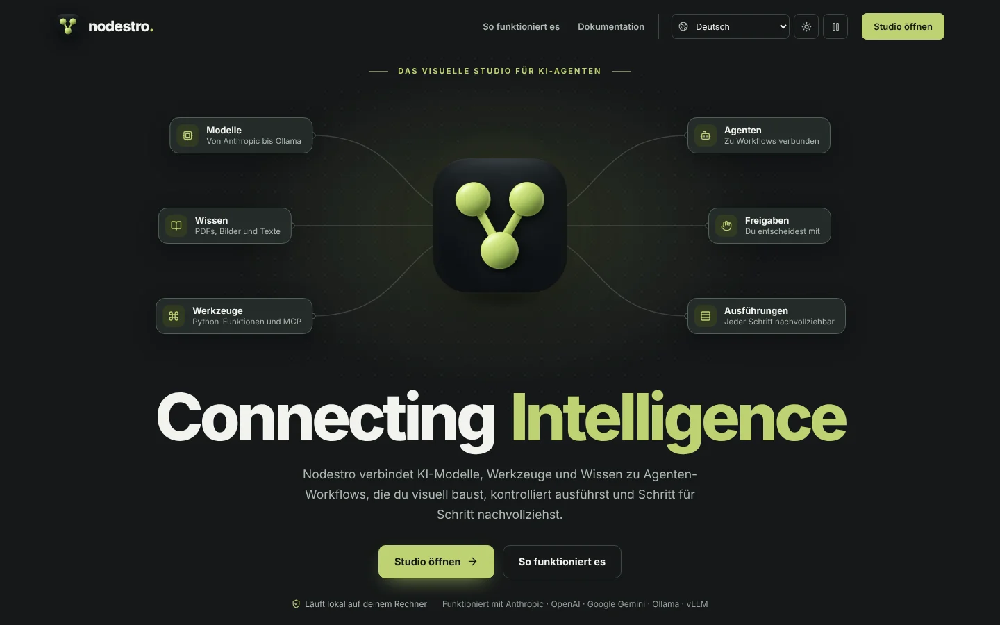
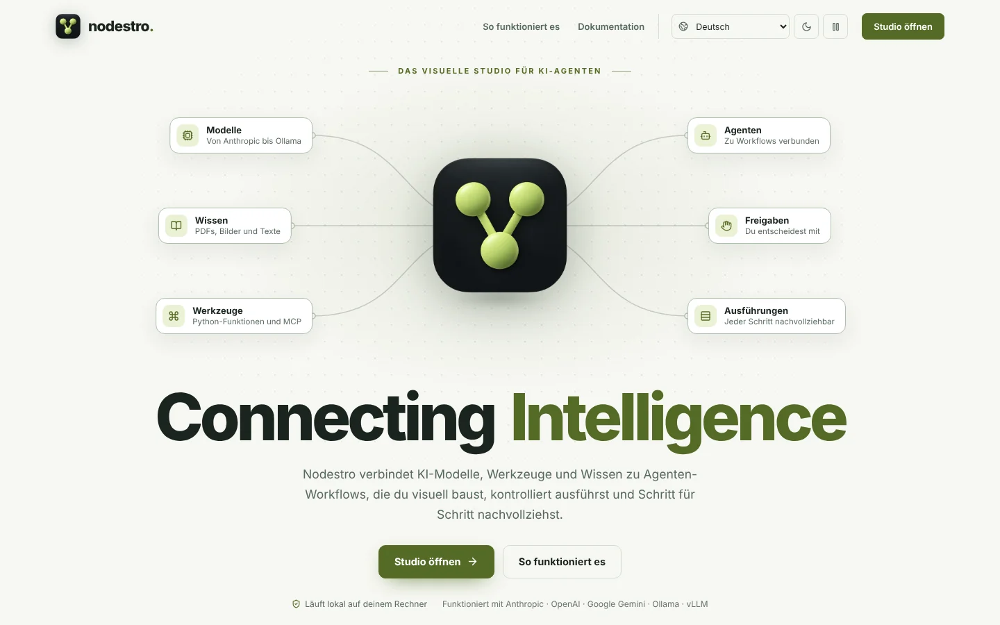
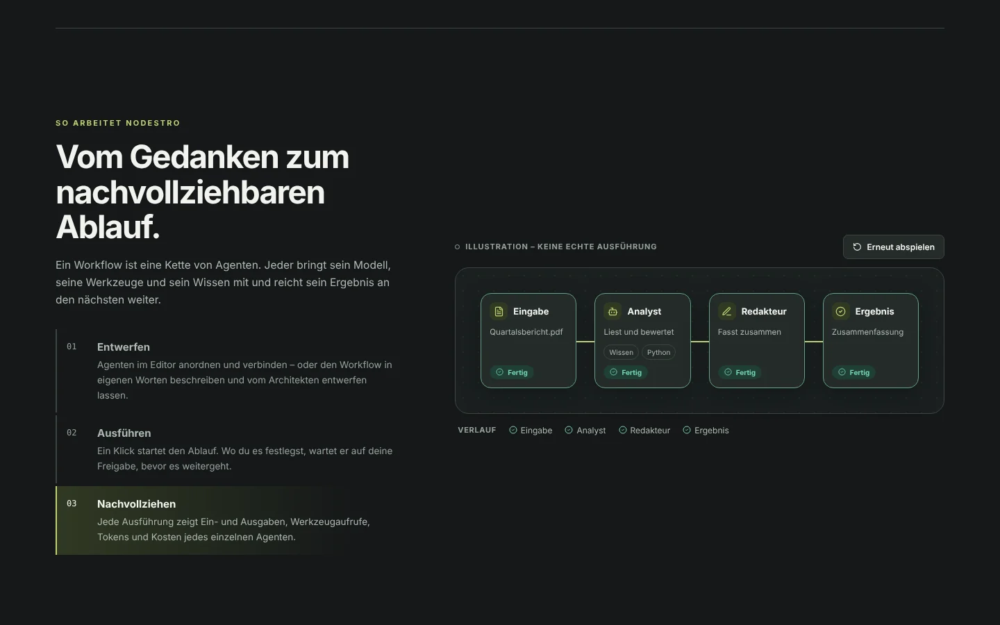
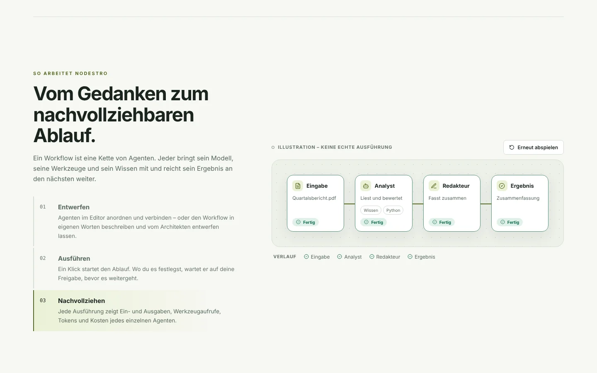
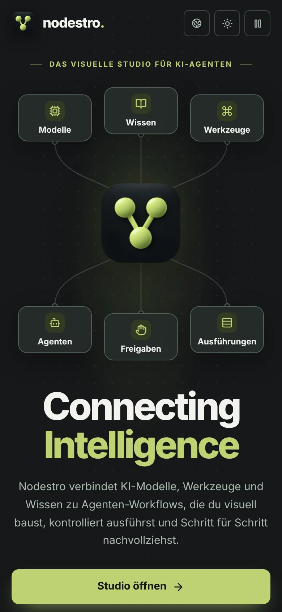
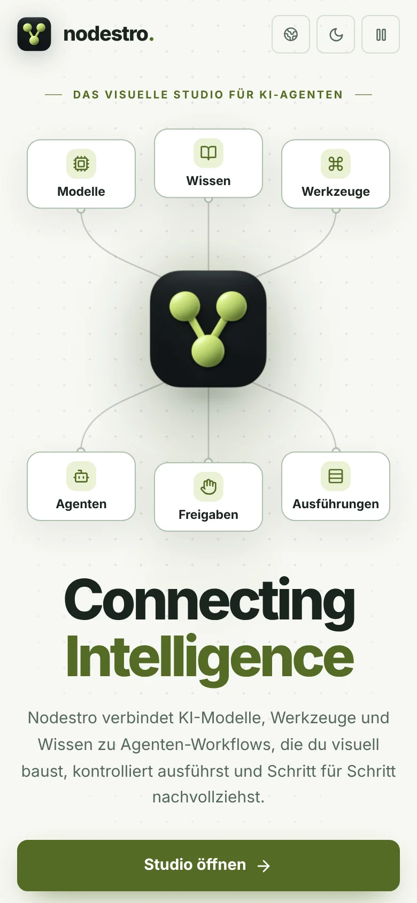

# Welcome page: "Connecting Intelligence"

The welcome page (`/welcome`) is Nodestro's brand entrance: the original logo, the official slogan
**Connecting Intelligence** and a short, honest explanation of what the Studio does, with one clear way in.
It is part of the Studio app (same React app, router, theme, languages and tokens), not a separate website.

Code: `frontend/src/welcome/` · texts: `frontend/src/i18n/locales/<lang>/welcome.json` · browser suite:
`frontend/e2e/welcome.mjs` (`scripts/e2e.sh welcome`).

| Dark | Light |
|---|---|
|  |  |
|  |  |
|  |  |

## 1. Starting point

- **Reference prototype** (HTML, inspiration only): split hero with headline "Intelligenz, die verbindet" next to
  the logo, two orbit rings with dots, floating glass cards, a ground ring, then a simulated studio window.
  Strengths: the original logo, Midnight Citron colors, a clear CTA, reduced-motion awareness. Weaknesses: the
  headline is a translated paraphrase that competes with the official slogan; orbit rings, floating cards and the
  glowing ground ring are decorative and say nothing about the product; the hero would read the same for any AI
  product; the studio simulation re-implements Studio UI as a second design. It was used for neither layout nor code.
- **Studio:** the root route `/` is the Workflows page (own workflows plus the example gallery); every other
  feature has a deep link (`/workflows/:id`, `/executions/:id`, …). Theme lives in `localStorage["nodestro-theme"]`
  (applied before the first render in `index.html`), the language in `localStorage["nodestro-language"]` plus the
  backend settings. Browser suites open `/` and expect the Workflows page.
- **Logo:** a 3D app-icon style mark (dark rounded square, three citron spheres forming a V: two nodes joining into
  a third). It stays legible down to 16 px, so one derived icon set covers every size without a redrawn variant.

## 2. Concept

Three directions were weighed:

| Direction | Idea | Verdict |
|---|---|---|
| A. Orbit showcase | Big floating logo with orbits and particles, split layout | Pretty but generic; motion has no meaning; close to the prototype |
| B. Logo-to-Studio morph | Scroll-driven transformation of the logo into a full Studio screenshot | Strong once, but heavy (scroll hijacking, large images), hard to keep honest and in six languages |
| **C. The connection** | The logo *is* the hub of a small, real Nodestro diagram | **Chosen** |

**C, "The connection":** the logo itself is a diagram (two nodes join into a third). The hero extends exactly
that idea: what Nodestro connects (models, knowledge, tools) flows *into* the logo, and what comes out of it
(agents connected into workflows, approvals, traceable runs) flows on. The slogan sits directly beneath and
names what the visitor just watched. Everything in the diagram is a real Studio concept, drawn in the Studio's
own node style on the Studio's own dotted canvas, so the page and the product are visibly one thing. It is calm,
symmetric and brand-first, explains the product without a word of jargon, and is cheap to render (SVG + CSS).

Page structure (each part answers one of the visitor's questions):

1. **Hero:** what is it? Eyebrow ("The visual studio for AI agents"), the diagram, the slogan as the `h1`, one
   sentence of value, *Open Studio* (primary) and *How it works*, and two facts (runs locally; providers).
2. **How it works:** design, run, trace. Three steps next to an illustrated four-node run that plays once when
   it scrolls into view (idle, running, done, history) and is labelled *Illustration – not a real run*.
3. **In the Studio:** six capability tiles, each a real link into the matching Studio page.
4. **Principles:** local and private, provider-independent, open to integrate (API, SDK).
5. **Closing:** the logo and the slogan as the sign-off, *Open Studio* and *Browse examples*.

Typography: Inter (the Studio font); the slogan at up to 104 px, weight 760, tight tracking; "Intelligence" in the
brand color. Only `--nd-*` roles are used, so dark and light mode need no overrides. Citron marks brand,
interaction and the active path; status colors appear only as status (running blue, done green) and always with
text and icon.

## 3. Motion

One idea, choreographed once, then one calm loop:

| Time | Intro (once) |
|---|---|
| 0–1.1 s | Canvas grid fades in; the logo emerges (scale, lift, focus) |
| 0.55–1.9 s | Routes draw towards and out of the logo; chips appear; ports appear |
| 1.25–2.2 s | "Connecting", then "Intelligence" rise into place; text and actions follow |

Loop (period 7.2 s, from 2.4 s): input pulses travel into the logo (0–30 %), the logo catches the light (a sheen
masked to the logo's own shape, halo swells, 26–50 %), output pulses travel on (36–64 %), the receiving chips
light up briefly, then everything rests. The pointer tilts the logo slightly (fine pointers only; one
`requestAnimationFrame` write of two CSS variables, no React re-render).

Rules: base styles are the final state, keyframes animate only *from* hidden, so the page is complete without
motion. Loops carry `.wl-loop` and stop when the visitor presses pause (the button is required by WCAG 2.2.2 for
motion longer than 5 s), hold while the hero is off screen (IntersectionObserver), and do not exist under
`prefers-reduced-motion` (no pause button then, illustration shows its final state). Only `opacity`,
`transform`-family properties, `stroke-dashoffset`, `background-position` and `filter` (intro only) animate; no
layout properties.

## 4. Integration decision

| Criterion | A. Separate `/welcome` only | B. Landing on `/`, Studio elsewhere | **C+. `/welcome` + first visit** |
|---|---|---|---|
| Wow on first open | No (nobody finds it) | Yes | **Yes** |
| Returning users | Unaffected | An extra click every time, or a new Studio URL | **Unaffected** |
| Deep links / bookmarks to `/` | Unchanged | Break (`/` changes meaning) | **Unchanged** |
| Back / forward | Normal | Normal | **No loop (replace redirect, once)** |
| Tests, docs, CLI, desktop app | Unchanged | All need a new start URL | **Unchanged** |
| Complexity | Lowest | High | **Low (one loader, one flag)** |

**Chosen: C+.** The page lives at its own route outside the Studio frame. The very first time a browser opens
the bare start page `/`, the Studio frame's loader (`studioLoader`, `welcome/firstVisit.ts`) redirects to
`/welcome` before anything renders (a replace, so Back does not bounce). Rules:

- Only `/` with no query and no hash is ever redirected. Every deep link opens exactly what it names.
- Opening any Studio page or the welcome page sets `localStorage["nodestro-welcome-seen"]`, so the redirect
  happens at most once per browser. Without storage there is no redirect at all.
- Automated browsers (`navigator.webdriver`) are not a person's first visit and are never redirected; this keeps
  every existing browser suite, screenshot tool and script unchanged. The welcome suite simulates a person.
- *Open Studio* is a normal link to `/`; Back returns to the welcome page, Forward to the Studio.
- The welcome page is always reachable: Studio sidebar *Help > Welcome*, or `/welcome`.
- Theme: the same `useTheme()` hook and storage key. Language: the same `setLanguage()` and the same backend
  settings call as the Settings page. No second theme or i18n system, no second React app.
- The page code (≈16 KB JS, 18 KB CSS before gzip) is a lazy route chunk; the Studio bundle only gained the texts
  and two small logo assets.

Brand in the Studio itself: the top bar shows the original logo instead of the old three-dot SVG; the favicon
set, Apple touch icon and web manifest are derived from the original logo; the window title of the welcome page
is "Nodestro · Connecting Intelligence". Nothing else in the Studio's layout changed.

## 5. Assets

All derived from the original 1254×1254 PNG with Lanczos downscaling (slight unsharp mask at 16/32 px), no redraw:

| File | Use |
|---|---|
| `public/favicon.ico` (16, 32, 48) | Classic favicon, every browser |
| `public/favicon-16.png`, `favicon-32.png` | PNG favicons |
| `public/apple-touch-icon.png` (180, opaque) | iOS home screen |
| `public/icon-192.png`, `icon-512.png` + `manifest.webmanifest` | Installed web app |
| `src/assets/brand/nodestro-logo-512.webp` (26 KB) | Welcome page logo (hashed by Vite) |
| `src/assets/brand/nodestro-logo-64.png` (7 KB) | Studio top bar |

Icon links carry `?v=2` so browsers drop the cached old icon. An SVG version was not made: the logo's shading
cannot be reproduced faithfully as vector art.

## 6. Accessibility

Landmarks (`header`, `nav`, `main`, `footer`), a skip link, one `h1` (the slogan), the diagram as a single image
with a full text alternative, decorative chips and the illustration hidden from assistive technology (the steps
list and caption carry the content), visible focus rings, all controls reachable and labelled in six languages,
status always with text and icon, pause control, reduced motion respected.

## 7. Known limits

- Checked in Chromium (Playwright, Linux) only. Firefox and WebKit were not run here; `E2E_BROWSER=firefox` or
  `webkit` runs the welcome suite in those engines. `mask-image` with an image and individual transform properties
  (`translate`, `scale`) need current browsers (Safari 15.4+, Firefox 72+, Chrome 104+).
- The page loads the Studio's main bundle (it is the same app); first paint therefore costs what the Studio costs.
- Language names in the picker are in their own language; on phones the picker shows only its globe icon.
